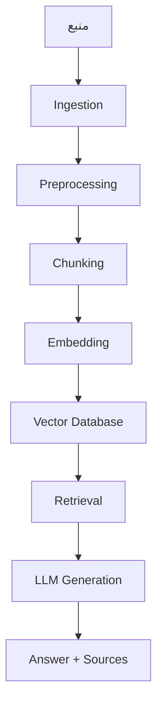
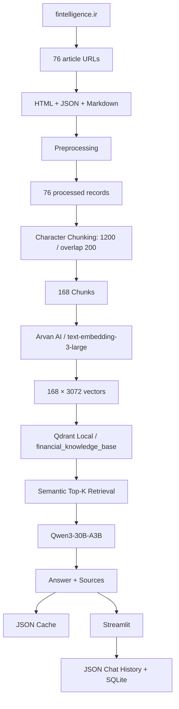

# گزارش کامل فاز ۱ — شاخه `main`

مخزن بررسی‌شده:

`Shahbazi-Amir/RAG_finance`

فقط شاخه `main` را بررسی کردم و **هیچ فایل، commit، branch یا تنظیمی را تغییر ندادم**.

وضعیت فعلی `main`:

* HEAD: `9d58a77f1c2e10a9c15f8dcc9f8df8ffd359ac0a`
* آخرین commit: `database added`
* تاریخ آخرین commit: ۱۵ ژوئیه ۲۰۲۶
* نسبت به ساختار اولیه پروژه، فاز ۱ طی حدود **۲۸ commit** توسعه پیدا کرده است.

---


<div dir="rtl" align="right">

> **جهت سند:** فارسی (RTL) — بخش‌های فنی، کدها و مسیرها به‌صورت LTR حفظ شده‌اند.

## فهرست مطالب

- [گزارش کامل فاز ۱ — شاخه `main`](#گزارش-کامل-فاز-۱--شاخه-main)
  - [فهرست مطالب](#فهرست-مطالب)
- [۱. هدف فاز ۱](#۱-هدف-فاز-۱)
- [۲. دریافت مقالات سایت (Ingestion)](#۲-دریافت-مقالات-سایت-ingestion)
    - [نکته مهم درباره کل سایت](#نکته-مهم-درباره-کل-سایت)
- [۳. پیش‌پردازش (Preprocessing)](#۳-پیشپردازش-preprocessing)
- [۴. قطعه‌بندی (Chunking)](#۴-قطعهبندی-chunking)
- [۵. بردارسازی (Embedding)](#۵-بردارسازی-embedding)
- [۶. پایگاه داده برداری (Vector Database)](#۶-پایگاه-داده-برداری-vector-database)
- [۷. بازیابی (Retrieval)](#۷-بازیابی-retrieval)
- [۸. تولید پاسخ (Generation)](#۸-تولید-پاسخ-generation)
- [۹. تبدیل Notebookها به ساختار ماژولار](#۹-تبدیل-notebookها-به-ساختار-ماژولار)
- [۱۰. خط لوله اصلی RAG (RAGPipeline)](#۱۰-خط-لوله-اصلی-rag-ragpipeline)
- [۱۱. کش (Cache)](#۱۱-کش-cache)
- [۱۲. دموی نهایی RAG (Final RAG Demo)](#۱۲-دموی-نهایی-rag-final-rag-demo)
    - [سؤال موجود در Cache](#سؤال-موجود-در-cache)
    - [سؤال جدید](#سؤال-جدید)
- [۱۳. ارزیابی (Evaluation)](#۱۳-ارزیابی-evaluation)
- [۱۴. دموی Streamlit](#۱۴-دموی-streamlit)
- [۱۵. امکانات برنامه فعلی](#۱۵-امکانات-برنامه-فعلی)
- [۱۶. ذخیره تاریخچه](#۱۶-ذخیره-تاریخچه)
    - [Chat History](#chat-history)
    - [SQLite](#sqlite)
- [۱۷. استقرار و ابزار کمکی پایگاه داده](#۱۷-استقرار-و-ابزار-کمکی-پایگاه-داده)
- [۱۸. وابستگی‌های فعلی (Dependencies)](#۱۸-وابستگیهای-فعلی-dependencies)
- [۱۹. وضعیت داده فاز ۱ در یک نگاه](#۱۹-وضعیت-داده-فاز-۱-در-یک-نگاه)
- [۲۰. معماری واقعی فعلی فاز ۱](#۲۰-معماری-واقعی-فعلی-فاز-۱)
- [۲۱. مرز فعلی فاز ۱](#۲۱-مرز-فعلی-فاز-۱)
- [جمع‌بندی فاز ۱](#جمعبندی-فاز-۱)

</div>

<a id="sec-1"></a>
# ۱. هدف فاز ۱

هدف پروژه ساخت یک **دستیار هوش مالی فارسی مبتنی بر RAG** است که پاسخ را از محتوای واقعی استخراج‌شده از منابع مالی تولید کند، نه صرفاً از دانش عمومی مدل.

معماری تعریف‌شده:



**نسخه متنی معماری:**

```text
منبع
 ↓
Ingestion
 ↓
Preprocessing
 ↓
Chunking
 ↓
Embedding
 ↓
Vector Database
 ↓
Retrieval
 ↓
LLM Generation
 ↓
Answer + Sources
```

README همین معماری و امکان توسعه منابع در آینده را به‌عنوان هدف پروژه تعریف کرده است.

---

<a id="sec-2"></a>
# ۲. دریافت مقالات سایت (Ingestion)

این مرحله در:

```text
notebooks/01_website_ingestion.ipynb
```

پیاده‌سازی شده است.

نسخه نهایی فاز ۱ مشخصاً برای:

```text
AUTHOR_ID = 4
AUTHOR_NAME = دکتر کمیل رودی
```

نوشته شده است.

Endpoint مورد استفاده:

```text
/Author/GetAuthorBlogByPage/{page}?auid=4
```

سیستم صفحه‌های نویسنده را یکی‌یکی می‌خواند و URLهای دارای:

```text
/Blog/Detail/
```

را استخراج می‌کند.

نتیجه اجرای ثبت‌شده:

```text
Total articles: 76
```

سپس هر ۷۶ مقاله دانلود شده‌اند:

```text
Downloaded: 76
Failed: 0
```

برای هر مقاله سه فایل ذخیره می‌شود:

```text
data/raw/webpages/komeil_roudi/<ARTICLE_ID>/
    article.html
    article.json
    article.md
```

JSON شامل:

```text
url
title
content
```

است.

### نکته مهم درباره کل سایت

در تاریخچه خود شاخه `main` یک مرحله آزمایشی برای استخراج **همه مقالات Blog سایت** نیز وجود داشته است.

از:

```text
POST /Blog/GetBlogSearchResult
```

با پیمایش ۴۶ صفحه استفاده شده و خروجی ثبت‌شده:

```text
Total links: 529
Saved to: data/raw/webpages/links.txt
```

بوده است.

پس فاز ۱ قبلاً توانسته **۵۲۹ لینک کل Blog** را شناسایی کند، اما pipeline نهایی ingestion روی این ۵۲۹ مقاله ادامه پیدا نکرده است.

**نسخه نهایی فعلی فاز ۱ فقط ۷۶ مقاله دکتر کمیل رودی را دانلود و وارد RAG می‌کند.**

---

<a id="sec-3"></a>
# ۳. پیش‌پردازش (Preprocessing)

Notebook:

```text
notebooks/02_preprocessing.ipynb
```

ورودی:

```text
data/raw/webpages/komeil_roudi/*/article.json
```

تعداد:

```text
Found 76 articles
```

عملیات پاک‌سازی شامل:

* حذف برخی کاراکترهای نامرئی
* حفظ نیم‌فاصله فارسی
* یکسان‌سازی newline
* حذف فاصله‌های اضافی
* حذف blank lineهای اضافی

خروجی:

```text
data/processed/komeil_roudi/
```

و اجرای ثبت‌شده:

```text
Processed articles: 76
```

است.

یک نکته داده‌ای هم دیده می‌شود: حداقل یکی از مقالات دانلودشده در `article.json` دارای `content` خالی بوده، در حالی که مقالات دیگر متن کامل دارند. بنابراین تعداد «دانلود موفق HTML» الزاماً به معنی ۷۶ متن غیرخالی نیست.

---

<a id="sec-4"></a>
# ۴. قطعه‌بندی (Chunking)

Notebook:

```text
notebooks/03_chunking.ipynb
```

روی ۷۶ مقاله پردازش‌شده اجرا شده است.

روش فعلی **character-based** است، نه token-based:

```python
chunk_size = 1200
chunk_overlap = 200
```

یعنی تقریباً:

```text
1200 character
200 character overlap
```

بین chunkها وجود دارد.

خروجی نهایی این مرحله:

```text
168 chunks
```

است.

تنظیمات رسمی پروژه هم همین مقادیر را دارد:

```text
CHUNK_SIZE = 1200
CHUNK_OVERLAP = 200
```

---

<a id="sec-5"></a>
# ۵. بردارسازی (Embedding)

مسیر اصلی توسعه‌یافته:

```text
notebooks/04_embeddings_arvan.ipynb
```

Embedding از طریق **Arvan AI Gateway** و API سازگار با OpenAI انجام شده است.

مدل:

```text
text-embedding-3-large
```

ابعاد هر بردار:

```text
3072
```

ورودی:

```text
168 chunks
```

خروجی:

```text
168 embeddings
```

در:

```text
data/embeddings/komeil_roudi/embeddings.json
```

برای هر chunk اطلاعاتی مثل این ذخیره شده:

```text
chunk_id
article_id
chunk_index
title
url
text
char_count
embedding
embedding_model
```

اجرای کامل ۱۶۸ embedding نیز در notebook ثبت شده است.

ماژول نهایی آن هم جدا شده است:

```text
src/embeddings/arvan_embedder.py
```

---

<a id="sec-6"></a>
# ۶. پایگاه داده برداری (Vector Database)

Notebook:

```text
notebooks/05_vectorstore.ipynb
```

Vector DB انتخاب‌شده:

```text
Qdrant
```

اما در فاز ۱ به‌صورت local filesystem اجرا می‌شود:

```text
data/vectorstore/qdrant_local
```

Collection:

```text
financial_knowledge_base
```

مشخصات:

```text
Points: 168
Vector size: 3072
Distance: Cosine
```

بنابراین همه ۱۶۸ chunk برداری وارد Qdrant شده‌اند.

---

<a id="sec-7"></a>
# ۷. بازیابی (Retrieval)

Notebook:

```text
notebooks/06_retrieval.ipynb
```

روند retrieval:

```text
Question
 ↓
Embedding question
 ↓
Qdrant query
 ↓
Top-K semantic results
```

برای سؤال نمونه:

```text
سواد مالی یعنی چه؟
```

سیستم سؤال را به بردار ۳۰۷۲بعدی تبدیل کرده و از Qdrant نتیجه گرفته است.

نتایج همراه این اطلاعات برمی‌گردند:

```text
score
chunk_id
article_id
title
url
text
```

در اجرای ثبت‌شده، Qdrant:

```text
status = green
points = 168
vector size = 3072
distance = Cosine
```

بوده است.

ماژول نهایی retrieval:

```text
src/retrieval/qdrant_retriever.py
```

است.

در حال حاضر retrieval یک **Dense Semantic Top-K Retrieval** ساده است؛ reranker، hybrid search یا keyword/BM25 در آن دیده نمی‌شود.

---

<a id="sec-8"></a>
# ۸. تولید پاسخ (Generation)

Notebook:

```text
notebooks/07_generation.ipynb
```

مدل تولید پاسخ در pipeline واقعی:

```text
Qwen3-30B-A3B
```

از طریق Arvan Chat Gateway است.

قانون اصلی prompt:

```text
فقط بر اساس منابع داده‌شده پاسخ بده.
```

و اگر اطلاعات کافی وجود نداشته باشد:

```text
در منابع موجود پاسخ کافی پیدا نشد.
```

در ماژول production نیز این رفتار تثبیت شده:

```text
src/generation/arvan_generator.py
```

یک اختلاف تنظیماتی کوچک وجود دارد:

در:

```text
config/settings.py
```

هنوز:

```text
LLM_MODEL = "gpt-4o-mini"
```

تعریف شده، اما pipeline واقعی `ArvanGenerator` به‌طور پیش‌فرض از:

```text
Qwen3-30B-A3B
```

استفاده می‌کند.

---

<a id="sec-9"></a>
# ۹. تبدیل Notebookها به ساختار ماژولار

در مرحله بعد پروژه از حالت صرفاً Notebook خارج شده است.

ساختار ایجادشده:

```text
src/
├── embeddings/
│   └── arvan_embedder.py
│
├── retrieval/
│   └── qdrant_retriever.py
│
├── generation/
│   └── arvan_generator.py
│
├── cache/
│   └── rag_cache.py
│
├── pipeline/
│   └── rag_pipeline.py
│
└── database/
    └── database.py
```

این کار در:

```text
notebooks/08_rag_pipeline.ipynb
```

به‌صورت مرحله‌ای انجام شده است.

---

<a id="sec-10"></a>
# ۱۰. خط لوله اصلی RAG (RAGPipeline)

هسته فعلی:

```text
src/pipeline/rag_pipeline.py
```

است.

روند `ask()`:

```text
Question
 ↓
Check Cache
 ↓
Embedding
 ↓
Qdrant Retrieval
 ↓
Build Context
 ↓
LLM Generation
 ↓
Format Sources
 ↓
Save Cache
 ↓
Return Answer
```

همچنین منابع تکراری بر اساس URL یا title حذف می‌شوند.

اگر مدل دقیقاً اعلام کند:

```text
در منابع موجود پاسخ کافی پیدا نشد.
```

سیستم sourceهای retrieval را به کاربر نشان نمی‌دهد.

---

<a id="sec-11"></a>
# ۱۱. کش (Cache)

فایل:

```text
src/cache/rag_cache.py
```

Cache فعلی JSON-based است.

سؤال:

1. normalize می‌شود.
2. SHA-256 از آن ساخته می‌شود.
3. با hash در cache ذخیره می‌شود.

اطلاعات ذخیره‌شده:

```text
question
question_hash
answer
sources
retrieved_chunks
top_k
embedding_model
generation_model
created_at
```

پس سؤال تکراری می‌تواند بدون اجرای دوباره کل RAG جواب داده شود.

---

<a id="sec-12"></a>
# ۱۲. دموی نهایی RAG (Final RAG Demo)

Notebook:

```text
notebooks/09_final_rag_demo.ipynb
```

در این مرحله pipeline نهایی عملاً آزمایش شده است.

دو حالت تست شده:

### سؤال موجود در Cache

```text
سواد مالی یعنی چه؟
```

خروجی:

```text
From cache: True
```

### سؤال جدید

```text
چرا مدیریت هزینه‌ها در سواد مالی مهم است؟
```

خروجی:

```text
From cache: False
```

و pipeline کامل:

```text
Embedding → Retrieval → Generation → Cache
```

اجرا شده است.

Notebook صراحتاً تأیید می‌کند که:

* import از `src` کار می‌کند.
* Qdrant Local کار می‌کند.
* cache کار می‌کند.
* سؤال جدید از مسیر کامل RAG عبور می‌کند.
* جواب جدید بعداً cache می‌شود.

---

<a id="sec-13"></a>
# ۱۳. ارزیابی (Evaluation)

Notebook:

```text
notebooks/10_evaluation.ipynb
```

یک مجموعه ۱۰ سؤالی ساخته شده:

```text
8 in-scope
2 out-of-scope
```

دو سؤال خارج از حوزه، مثلاً:

```text
بهترین روش خرید بیت‌کوین چیست؟
پیش‌بینی قیمت دلار در ماه آینده چیست؟
```

بودند.

نتیجه ثبت‌شده:

```text
Total: 10
Out-of-scope: 2
Correct out-of-scope rejections: 2 / 2
```

و ۷ پاسخ نیز هنگام این ارزیابی از cache آمده‌اند.

نتیجه evaluation نیز در مخزن ذخیره شده:

```text
data/evaluation/rag_evaluation_20260709_153736.json
```

این evaluation یک تست کوچک داخلی است و در `main` معیار جامع benchmark یا accuracy گسترده‌ای دیده نمی‌شود.

---

<a id="sec-14"></a>
# ۱۴. دموی Streamlit

اپ اصلی:

```text
app.py
```

با Streamlit ساخته شده است.

توسعه رابط در `11_apps.ipynb` مرحله‌ای بوده:

```text
Version 01
Single Q/A
       ↓
Version 02
Chat History UI
       ↓
Version 03
Persistent Chat History
       ↓
Version 04
Context-Aware Follow-up
       ↓
Version 05
Error Handling
       ↓
Version 06
SQLite Storage
```

نسخه ۲ تاریخچه چت و UI مکالمه‌ای را اضافه کرده است.

نسخه ۳ persistent history را اضافه کرده است.

نسخه ۴ سؤال‌های follow-up را اضافه کرده است.

نسخه فعلی در `app.py`:

```text
APP_VERSION = "v06_sqlite_storage"
```

است.

---

<a id="sec-15"></a>
# ۱۵. امکانات برنامه فعلی

اپ فعلی این امکانات را دارد:

* رابط چت فارسی
* `st.chat_input`
* `st.chat_message`
* انتخاب `top_k` بین ۳ تا ۱۰
* نمایش منابع
* نمایش similarity score
* نمایش `chunk_id`
* لینک مستقیم مقاله
* نشان دادن `From cache`
* نگهداری تاریخچه چت
* پاک کردن تاریخچه
* تولید `session_id`
* ذخیره زمان پاسخ
* مدیریت خطاهای API
* handling برای 401
* handling برای 429
* timeout
* connection error
* محدودیت location/IP
* سؤال‌های follow-up
* بازنویسی ساده سؤال با سؤال قبلی

خود UI نیز هنوز صراحتاً نوشته:

```text
پرسش‌وپاسخ فارسی بر اساس مقالات مالی دکتر کمیل رودی
```

یعنی دامنه knowledge base فاز ۱ کاملاً مشخص است.

---

<a id="sec-16"></a>
# ۱۶. ذخیره تاریخچه

دو مکانیزم persistence وجود دارد.

### Chat History

```text
data/app/chat_history.json
```

برای نگهداری مکالمه UI.

### SQLite

```text
data/database/rag_demo.db
```

جدول:

```text
conversations
```

فیلدهای اصلی:

```text
id
session_id
question
rewritten_question
answer
sources_json
from_cache
model_name
created_at
response_time_ms
```

---

<a id="sec-17"></a>
# ۱۷. استقرار و ابزار کمکی پایگاه داده

در آخرین وضعیت `main`، فایل database از Git جدا نگه داشته شده و script زیر اضافه شده:

```text
scripts/download_database.sh
```

که نسخه DB موجود روی سرور را با SCP به:

```text
data/database/rag_demo.db
```

منتقل می‌کند.

---

<a id="sec-18"></a>
# ۱۸. وابستگی‌های فعلی (Dependencies)

`requirements.txt` فعلی بسیار جمع‌وجور شده:

```text
streamlit
python-dotenv
openai
qdrant-client
requests
beautifulsoup4
lxml
tqdm
```

---

<a id="sec-19"></a>
# ۱۹. وضعیت داده فاز ۱ در یک نگاه

| مرحله                                 |                    وضعیت |
| ------------------------------------- | -----------------------: |
| کل لینک Blog که در آزمایش شناسایی شده |                  **529** |
| دامنه نهایی ingestion                 |       **دکتر کمیل رودی** |
| لینک نویسنده                          |                   **76** |
| Download                              |              **76 / 76** |
| Failed download                       |                    **0** |
| Processed article records             |                   **76** |
| Chunkها                               |                  **168** |
| Embeddingها                           |                  **168** |
| Embedding dimension                   |                 **3072** |
| Vector DB                             |         **Qdrant Local** |
| Qdrant points                         |                  **168** |
| Similarity                            |               **Cosine** |
| Embedding model                       | `text-embedding-3-large` |
| Generation واقعی                      |          `Qwen3-30B-A3B` |
| Cache                                 |           JSON + SHA-256 |
| UI                                    |                Streamlit |
| Conversation DB                       |                   SQLite |
| Evaluation                            |                  10 سؤال |
| Out-of-scope صحیح                     |                  **2/2** |

---

<a id="sec-20"></a>
# ۲۰. معماری واقعی فعلی فاز ۱



**نسخه متنی معماری فعلی:**

```text
fintelligence.ir
        │
        │ Author ID = 4
        ▼
76 article URLs
        │
        ▼
HTML + JSON + Markdown
        │
        ▼
Preprocessing
        │
        ▼
76 processed records
        │
        ▼
Character Chunking
1200 / overlap 200
        │
        ▼
168 Chunks
        │
        ▼
Arvan AI
text-embedding-3-large
        │
        ▼
168 × 3072 vectors
        │
        ▼
Qdrant Local
financial_knowledge_base
        │
        ▼
Semantic Top-K Retrieval
        │
        ▼
Qwen3-30B-A3B
        │
        ▼
Answer + Sources
        │
   ┌────┴─────┐
   ▼          ▼
JSON Cache   Streamlit
               │
               ▼
        JSON Chat History
               +
             SQLite
```

---

<a id="sec-21"></a>
# ۲۱. مرز فعلی فاز ۱

چیزهایی که **در وضعیت فعلی `main` وجود دارند ولی هنوز محدود هستند**:

* ingestion نهایی فقط نویسنده `ID=4` است.
* کشف ۵۲۹ مقاله کل Blog انجام شده، ولی pipeline کامل روی آن‌ها اجرا نشده.
* chunking بر اساس character است، نه token.
* retrieval فقط dense semantic + Cosine + Top-K است.
* reranking وجود ندارد.
* hybrid search دیده نمی‌شود.
* follow-up handling ساده و heuristic است.
* Qdrant فعلی local است.
* evaluation فقط ۱۰ سؤال دارد.
* در بعضی articleهای دانلودشده `content` خالی مشاهده شده است.
* بین `LLM_MODEL=gpt-4o-mini` در settings و مدل واقعی Qwen در generator ناهماهنگی تنظیماتی وجود دارد.

---

<a id="summary"></a>
# جمع‌بندی فاز ۱

**فاز ۱ عملاً یک RAG دمو کامل end-to-end و قابل اجرا ساخته است.**

یعنی این مسیر کامل شده:

```text
Website
→ Download
→ Clean
→ Chunk
→ Embed
→ Qdrant
→ Retrieve
→ Generate
→ Cache
→ Evaluate
→ Streamlit
→ Conversation Storage
```

اما Knowledge Base نهایی آن هنوز عمداً/عملاً محدود به:

**۷۶ مقاله دکتر کمیل رودی**

است.

نکته مهم برای ادامه پروژه این است که در خود تاریخچه فاز ۱، مکانیزم پیدا کردن **۵۲۹ مقاله کل Blog سایت** هم قبلاً کشف و آزمایش شده؛ ولی این ۵۲۹ لینک هنوز وارد مسیر کامل ingestion → preprocessing → chunking → embedding → vectorstore نشده‌اند.

**هیچ تغییری در مخزن ایجاد نکردم.**
