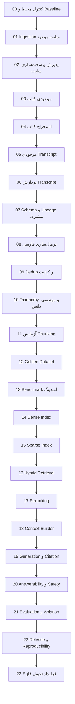
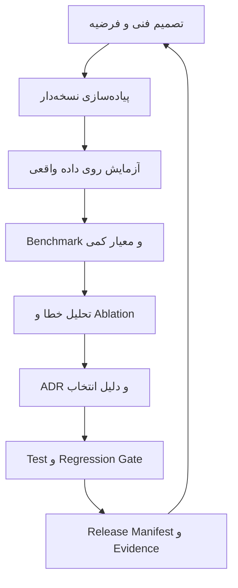

# نقشه راه اجرایی ماژولار فاز ۲ پروژه RAG_finance

**نسخه بازنگری‌شده بر مبنای نوت‌بوک‌های مستقل و انتساب دقیق محتوا**  
**Repository:** `Shahbazi-Amir/RAG_finance`  
**Branch بررسی‌شده:** `rag-phase2`  
**Commit مبنا:** `96c0f0c7d09f4bff107ed71664a0c57ed09f3214`  
**تاریخ سند:** ۲۱ اوت ۲۰۲۶  
**مخاطب نسخه Markdown:** تیم فنی و مجری مرحله‌به‌مرحله در محیط چت  
**وضعیت Repository:** این سند فقط حاصل بازرسی است و هیچ تغییری در مخزن ایجاد نکرده است.

---

## ۱. تصمیم اصلاحی اصلی

فاز ۲ مانند فاز ۱ از چند نوت‌بوک مستقل تشکیل می‌شود. هر مرحله فایل `.ipynb` جداگانه دارد و یک خروجی نسخه‌دار تولید می‌کند که ورودی مرحله بعد است.

این تصمیم سه دلیل دارد:

1. اگر یک مرحله شکست بخورد، لازم نیست کل Pipeline دوباره اجرا شود.
2. هر بخش به‌صورت مستقل قابل آموزش، تست، بازبینی و انتقال به نیروی دیگر است.
3. شواهد دانش فنی هر مرحله جداگانه ثبت می‌شود و برای ارزیابی فنی قابل دفاع‌تر است.

نوت‌بوک مستقل به معنی کد تکراری نیست. توابع پایدار در `src/phase2/` قرار می‌گیرند و نوت‌بوک‌ها آن‌ها را import می‌کنند. نوت‌بوک محل توضیح فارسی، اجرای آزمایش، نمایش نتیجه، تصمیم‌گیری و ثبت شواهد است.

---

## ۲. نتیجه بازرسی الگوی فاز ۱

در پوشه `notebooks/` فاز ۱ مراحل به فایل‌های مستقل تقسیم شده‌اند:

```text
01_website_ingestion.ipynb
02_preprocessing.ipynb
03_chunking.ipynb
04_embeddings.ipynb
04_embeddings_arvan.ipynb
05_vectorstore.ipynb
06_retrieval.ipynb
07_generation.ipynb
08_rag_pipeline.ipynb
09_final_rag_demo.ipynb
10_evaluation.ipynb
11_apps.ipynb
```

این الگو برای فاز ۲ حفظ می‌شود، ولی ضعف‌های فاز ۱ تکرار نمی‌شوند. در تعدادی از نوت‌بوک‌های فاز ۱ سلول اجرا‌نشده یا Error Output باقی مانده است. بنابراین در فاز ۲ هر نوت‌بوک باید از Kernel پاک اجرا شود و با Error صفر تحویل شود.

---

## ۳. وضعیت بخش سایت فاز ۲

فایل موجود:

```text
notebooks/phase2/01_website_ingestion.ipynb
```

شواهد قابل مشاهده در فایل:

- ۱۷۵ سلول شامل ۸۲ سلول Code و ۹۳ سلول Markdown؛
- تمام ۸۲ سلول Code دارای Execution Count متوالی هستند؛
- Error Output ثبت‌شده وجود ندارد؛
- ۵۲۹ مقاله کشف، Crawl، اعتبارسنجی و استخراج گزارش شده‌اند؛
- ۷۶ مقاله `primary_author` و ۴۵۳ مقاله `supervised` گزارش شده‌اند؛
- عنوان، متن، نویسنده و Raw Hash خالی در گزارش نهایی صفر است.

اما برای بستن Gate حرفه‌ای کافی نیست:

- Raw، Interim و Reportهای فاز ۲ در `.gitignore` قرار دارند؛ بنابراین وجود Snapshot محلی از روی Git اثبات نمی‌شود.
- در Manifest ثبت‌شده، ۴۵۳ مقدار `author` خالی و وضعیت همه رکوردها `discovered` است.
- عدد ۵۲۹ در گزارش پایانی Hard-code شده است.
- Validationها بیشتر `print` هستند و `assert` شکست‌پذیر ندارند.
- کنترل Boilerplate، Near-duplicate و بازبینی انسانی نمونه‌ای کامل نیست.
- چند تابع در طول نوت‌بوک بازتعریف شده‌اند و نسخه مرجع واحد ندارند.

**تصمیم:** سایت از صفر تکرار نمی‌شود. نوت‌بوک موجود Freeze می‌شود و نوت‌بوک مستقل `02_website_acceptance.ipynb` برای ممیزی، Repair و پذیرش آن اجرا می‌شود. Crawl کامل فقط زمانی مجاز است که Raw محلی مفقود یا نامعتبر باشد یا Snapshot جدید عمداً ساخته شود.

### ۳.۱. قاعده قطعی مالکیت و نقش محتوای مقالات

مقالات سایت یک گروه یکسان نیستند و نباید در Dataset یا پاسخ نهایی به یک شکل معرفی شوند:

1. **مقاله تألیف مستقیم مؤلف مرجع:** متن به نام خود مؤلف منتشر شده و می‌تواند به‌عنوان بیان مستقیم او معرفی شود؛ البته فقط وقتی Byline یا مدرک منبع این انتساب را تأیید کند.
2. **مقاله نویسنده دیگر زیر نظر سردبیری مؤلف مرجع:** نویسنده واقعی مقاله باید حفظ شود و نقش مؤلف مرجع فقط «سردبیر/ناظر علمی» ثبت شود. این مقاله نباید در پاسخ به‌عنوان نوشته مستقیم مؤلف معرفی شود.
3. **وضعیت نامشخص:** اگر Byline یا مدرک نقش سردبیری کامل نیست، رکورد با `attribution_status=pending_review` قرنطینه می‌شود و هیچ نامی حدس زده نمی‌شود.

فیلدهای اجباری Website Schema:

```text
credited_author_name
reference_expert_name
editorial_supervisor_name
content_authority_type = direct_author | editorial_supervision | unknown_pending_review
byline_raw
editorial_credit_raw
authorship_assertion_source
attribution_status = verified | pending_review | rejected
```

نگاشت مقادیر فعلی `primary_author` و `supervised` فقط بعد از تطبیق با Byline و شواهد صفحه انجام می‌شود. تعدادهای گزارش‌شده فعلی، جایگزین تأیید انتساب نیستند.

قاعده استفاده در RAG:

- برای پرسش‌هایی مانند «نظر خود مؤلف چیست؟» فقط کتاب تألیفی، گفتار مستقیم مؤلف و مقاله `direct_author` مجاز است.
- برای پرسش آموزشی عمومی، مقاله‌های `editorial_supervision` نیز قابل استفاده‌اند، اما Citation باید نام نویسنده واقعی و نقش سردبیری را جداگانه نمایش دهد.
- رتبه‌بندی نباید نقش سردبیری را به‌طور پنهان معادل نویسندگی مستقیم کند.
- اختلاف میان محتوای تألیف مستقیم و محتوای سردبیری باید در Context با `authority_type` قابل تشخیص باشد.

---

## ۴. فلوچارت کل اجرای فاز ۲



---

## ۵. قاعده استقلال نوت‌بوک‌ها

هر نوت‌بوک باید شرایط زیر را رعایت کند:

- از متغیر داخل حافظه نوت‌بوک قبلی استفاده نکند.
- ورودی را فقط از Artifact ذخیره‌شده و نسخه‌دار بخواند.
- در ابتدای اجرا، Schema، Version و Hash ورودی را کنترل کند.
- خروجی را ابتدا موقت بسازد، اعتبارسنجی کند و سپس نهایی کند.
- در پایان، `checkpoint.json` و گزارش Markdown/JSON مستقل تولید کند.
- از Kernel پاک و با `Restart & Run All` اجرا شود.
- سلول Code اجرا‌نشده و Error Output نداشته باشد.
- اعداد، مسیر شخصی، Timestamp و Metadata را حدس نزند.
- بدون اجازه صریح Commit یا Push نکند.

الگوی نام‌گذاری سلول‌های هر نوت‌بوک:

```text
NB<شماره>-C01, NB<شماره>-C02, ...
```

هر نوت‌بوک باید با این چهار بخش توضیحی آغاز شود:

1. این مرحله چه کاری انجام می‌دهد؟
2. چرا برای محصول و دانش فنی لازم است؟
3. ورودی و خروجی دقیق چیست؟
4. در چه شرایطی مرحله PASS یا FAIL می‌شود؟

---

## ۶. ساختار نهایی نوت‌بوک‌های فاز ۲

```text
notebooks/phase2/
  00_environment_and_baseline.ipynb
  01_website_ingestion.ipynb
  02_website_acceptance.ipynb
  03_book_inventory.ipynb
  04_book_ingestion.ipynb
  05_transcript_inventory.ipynb
  06_transcript_ingestion.ipynb
  07_unified_schema_and_lineage.ipynb
  08_persian_normalization.ipynb
  09_deduplication_and_quality.ipynb
  10_taxonomy_and_knowledge_engineering.ipynb
  11_chunking_benchmark.ipynb
  12_golden_dataset.ipynb
  13_embedding_benchmark.ipynb
  14_dense_index.ipynb
  15_sparse_index.ipynb
  16_hybrid_retrieval.ipynb
  17_reranking.ipynb
  18_context_builder.ipynb
  19_generation_and_citation.ipynb
  20_answerability_safety_confidence.ipynb
  21_evaluation_and_ablation.ipynb
  22_release_and_reproducibility.ipynb
  23_phase3_handoff.ipynb
```

---

# ۷. دستور اجرایی تفصیلی هر نوت‌بوک

## Notebook 00 — `00_environment_and_baseline.ipynb`

### توضیح برای کارفرما

این مرحله مانند صورت‌جلسه شروع پروژه است. قبل از پردازش داده باید معلوم باشد کد روی کدام نسخه، با چه کتابخانه‌ها، چه تنظیمات و چه داده‌ای اجرا شده است. بدون این مرحله اگر نتیجه تغییر کند، نمی‌توان علت تغییر را پیدا کرد یا همان نتیجه را دوباره ساخت.

### هدف فنی

ثبت Environment، Freeze فاز ۱، تعیین شناسه Release و ساخت قرارداد مشترک اجرای همه نوت‌بوک‌ها.

### ورودی

- Repository و Branch فعلی؛
- Artifactها و گزارش ارزیابی فاز ۱؛
- فایل‌های Configuration و متغیرهای محیطی بدون نمایش Secret.

### سلول‌ها

| سلول | کار | دلیل |
|---|---|---|
| NB00-C01 | Markdown معرفی دامنه فاز ۲ | جلوگیری از ورود Deployment و پنل به فاز ۲ |
| NB00-C02 | تشخیص Repo Root، Branch و Commit | حذف مسیرهای شخصی و ثبت نسخه کد |
| NB00-C03 | نمایش نسخه Python و Packageها | بازتولیدپذیری محیط |
| NB00-C04 | بررسی Secret فقط از نظر وجود | جلوگیری از افشای کلیدها |
| NB00-C05 | تنظیم Seed و timezone UTC | کاهش تغییرپذیری آزمایش |
| NB00-C06 | ساخت `run_id` و `release_candidate_id` | اتصال گزارش‌ها به یک اجرای مشخص |
| NB00-C07 | موجودی Artifactهای فاز ۱ | تثبیت Baseline مقایسه |
| NB00-C08 | ثبت محدودیت‌های فاز ۱ | مشخص‌کردن مسئله‌ای که فاز ۲ حل می‌کند |
| NB00-C09 | Hash تنظیمات و Artifactهای Baseline | اثبات عدم تغییر ورودی |
| NB00-C10 | Capability Gate و Assertها | توقف سریع در محیط ناقص |

### خروجی

```text
artifacts/phase2/run_context.json
reports/phase2/baseline/phase1_baseline.json
reports/phase2/baseline/known_limitations.md
artifacts/phase2/checkpoints/00_environment.json
```

### Gate

Branch و Commit مشخص، مسیرها قابل دسترسی، Secret لازم موجود، Hashها ثبت و فایل فاز ۱ تغییرنکرده باشد.

### شاهد دانش فنی

Environment manifest، Baseline قابل تکرار، فهرست محدودیت‌ها و روش کنترل تغییرپذیری.

---

## Notebook 01 — `01_website_ingestion.ipynb`

### توضیح برای کارفرما

این نوت‌بوک نسخه خام و قابل ردیابی همه مقالات سایت را ایجاد کرده است. ارزش آن فقط در «دانلود متن» نیست؛ باید بتوان نشان داد هر متن دقیقاً از کدام URL، در چه زمان و با چه Hash دریافت شده است.

### تصمیم درباره فایل موجود

فایل فعلی از ابتدا بازنویسی نمی‌شود. به‌عنوان Snapshot اجرایی حفظ می‌شود. اصلاحات عمومی فقط در صورتی روی آن انجام می‌شود که اجرای پذیرش Notebook 02 ثابت کند Artifact لازم مفقود است.

### اجزای موجود

- کشف صفحه‌بندی‌شده مقالات؛
- ساخت Stable ID؛
- شناسایی ۷۶ مقاله مؤلف؛
- Crawl دارای Retry و Resume؛
- Raw Hash و بررسی ساختار HTML؛
- استخراج عنوان، متن، نویسنده، Tag و آمار؛
- نرمال‌سازی اولیه؛
- گزارش ۵۲۹ مقاله.

### مواردی که نباید دوباره انجام شوند

- Crawl کامل بدون بررسی Raw موجود؛
- تغییر Stable IDهای فعلی؛
- حذف Raw قدیمی؛
- تبدیل ۴۵۳ مقاله سردبیری به «تألیف مستقیم»؛
- حدس مالکیت یا نویسنده مفقود.

### خروجی مورد انتظار برای مرحله بعد

```text
data/phase2/manifests/website_manifest_v1.json
data/phase2/raw/website/<article_id>/article.html
data/phase2/raw/website/<article_id>/source.json
data/phase2/interim/website_extracted_v2.json
reports/phase2/data_quality/website_extraction_v2.json
reports/phase2/ingestion/website_ingestion_v2.json
```

### شاهد دانش فنی

Discovery بدون Hard-code تعداد، Resume crawl، Raw integrity، Content-origin classification و Extraction report.

---

## Notebook 02 — `02_website_acceptance.ipynb`

### توضیح برای کارفرما

در این مرحله خروجی سایت مانند یک محموله تحویلی بازرسی می‌شود. گزارش قبلی می‌گوید ۵۲۹ مقاله داریم؛ این نوت‌بوک بررسی می‌کند آیا واقعاً تمام فایل‌ها موجود، سالم، غیرتکراری و قابل استناد هستند یا خیر.

### هدف فنی

تبدیل Website Ingestion موجود از «اجرای موفق در نوت‌بوک» به Dataset پذیرفته‌شده و نسخه‌دار.

### سلول‌ها

| سلول | کار | دلیل |
|---|---|---|
| NB02-C01 | بارگذاری Manifest و Schema validation | بررسی قرارداد داده |
| NB02-C02 | موجودی واقعی Raw/Interim/Report | تشخیص فایل مفقود |
| NB02-C03 | کنترل Hash تمام HTMLها | اثبات عدم خرابی Raw |
| NB02-C04 | تطبیق ۱:۱ Manifest، Raw و Extracted | جلوگیری از رکورد گمشده یا اضافی |
| NB02-C05 | ساخت Repair Queue | محدودکردن Crawl به موارد لازم |
| NB02-C06 | Repair incremental با Retry/Backoff | تکمیل بدون دانلود مجدد همه سایت |
| NB02-C07 | انتقال Extractor نهایی به ماژول مرجع | حذف چند تعریف متفاوت |
| NB02-C08 | Fixture و Regression Test ساختار HTML | تشخیص تغییر قالب سایت |
| NB02-C09 | استخراج مجدد از Raw پذیرفته‌شده | تولید خروجی قطعی |
| NB02-C10 | کنترل HTML leakage و Boilerplate | جلوگیری از ورود منو و اجزای سایت |
| NB02-C11 | Exact/Near-duplicate و Outlier | کنترل کیفیت محتوایی |
| NB02-C12 | استخراج Byline خام، نویسنده واقعی و نقش سردبیری | جلوگیری از انتساب مقاله دیگران به مؤلف مرجع |
| NB02-C13 | ساخت نگاشت `direct_author/editorial_supervision/pending_review` با مدرک | تبدیل نقش محتوایی به Metadata قابل دفاع |
| NB02-C14 | نمونه‌گیری طبقه‌بندی‌شده از هر دو گروه محتوایی | کنترل انسانی استخراج و انتساب |
| NB02-C15 | ثبت نتیجه بازبینی انسانی و Evidence URL/Selector | شاهد مستقل از کد |
| NB02-C16 | ساخت Manifest v2 پویا | حذف عدد Hard-code و تکمیل وضعیت‌ها |
| NB02-C17 | Assertهای انتساب، Lineage و Checkpoint | Gate واقعی |

### خروجی

```text
data/phase2/manifests/website_manifest_v2.jsonl
data/phase2/interim/website_extracted_v3.jsonl
reports/phase2/data_quality/website_acceptance_report.json
reports/phase2/data_quality/website_manual_review.csv
artifacts/phase2/checkpoints/02_website_acceptance.json
```

### Gate

Stable ID تکراری صفر، Broken hash صفر، Required field خالی صفر، Lineage شکسته صفر، انتساب بدون مدرک صفر و بازبینی انسانی هر دو گروه محتوایی تأییدشده باشد.

### شاهد دانش فنی

Incremental update، Regression fixture، Sampling design، Failure analysis، Manifest versioning و Data lineage.

---

## Notebook 03 — `03_book_inventory.ipynb`

### توضیح برای کارفرما

وجود چند فایل Word به معنی وجود چند کتاب مستقل نیست. ممکن است دو فایل نسخه متفاوت یک اثر باشند. اگر هر دو بدون تشخیص وارد RAG شوند، یک مطلب چند بار بازیابی می‌شود و پاسخ به شکل مصنوعی به آن منبع وزن بیشتری می‌دهد.

### وضعیت فعلی

هفت فایل DOCX در `data/books/` وجود دارد. نام‌ها احتمال چند نسخه موازی را نشان می‌دهد، اما تشخیص نهایی فقط بعد از Hash و مقایسه متن انجام می‌شود.

### سلول‌ها

| سلول | کار | دلیل |
|---|---|---|
| NB03-C01 | فهرست فایل، حجم و SHA-256 | ثبت Raw inventory |
| NB03-C02 | استخراج Core Properties و آمار پاراگراف/جدول | شناخت ساختار هر فایل |
| NB03-C03 | استخراج متن آزمایشی و Fingerprint | مقایسه نسخه‌ها |
| NB03-C04 | Exact و Near-duplicate analysis | یافتن نسخه‌های موازی |
| NB03-C05 | ساخت جدول Work/Edition | تفکیک اثر از نسخه فایل |
| NB03-C06 | ثبت author، rights و publication status | Attribution و مجوز |
| NB03-C07 | تصمیم انسانی درباره Canonical Edition | جلوگیری از انتخاب خودکار اشتباه |
| NB03-C08 | Assert یک Canonical Edition برای هر Work | Gate موجودی |

### Citation کتاب

فایل‌های فعلی DOCX صفحه ثابت ندارند. Citation قابل دفاع آن‌ها باید `chapter/section/paragraph` باشد. اگر Citation صفحه لازم است، باید PDF نهایی صفحه‌بندی‌شده اضافه و با Edition متناظر شود.

### خروجی و شاهد دانش فنی

`books_manifest_v1.jsonl`، گزارش مقایسه Editionها، تصمیم Canonical و ADR مربوط به Citation کتاب.

---

## Notebook 04 — `04_book_ingestion.ipynb`

### توضیح برای کارفرما

کتاب یک متن یک‌تکه نیست. عنوان فصل، زیرعنوان، مثال، تمرین و جدول نقش متفاوت دارند. استخراج حرفه‌ای این ساختار را نگه می‌دارد تا پاسخ بداند مطلب متعلق به کدام فصل و بخش است.

### سلول‌ها

| سلول | کار | دلیل |
|---|---|---|
| NB04-C01 | خواندن Canonical Editionها | جلوگیری از ورود نسخه تکراری |
| NB04-C02 | Parse ترتیب XML پاراگراف و جدول | حفظ ترتیب واقعی محتوا |
| NB04-C03 | استخراج Style و Heading level | بازسازی سلسله‌مراتب فصل |
| NB04-C04 | استخراج جدولها به Block ساخت‌یافته | جلوگیری از تخت‌شدن جدول |
| NB04-C05 | ساخت Chapter/Section tree | Citation و Chunking ساختاری |
| NB04-C06 | شماره پایدار Paragraph/Table | Locator قابل استناد |
| NB04-C07 | جداسازی فهرست، Header/Footer و منابع | کنترل Boilerplate |
| NB04-C08 | اتصال هر Block به Raw hash و Edition | Lineage |
| NB04-C09 | کنترل Heading orphan و ترتیب | کیفیت ساختار |
| NB04-C10 | نمونه‌گیری حداقل ۱۰ Block از هر اثر | بازبینی انسانی |
| NB04-C11 | ساخت Artifact و گزارش | تحویل رسمی |
| NB04-C12 | Assert و Checkpoint | Book Gate |

### خروجی

`books_extracted_v1.jsonl`، `book_structure_report.json`، `book_manual_review.csv` و Checkpoint.

### شاهد دانش فنی

Structure-aware parsing، Edition control، Citation locator، Table preservation و ارزیابی نمونه‌ای.

---

## Notebook 05 — `05_transcript_inventory.ipynb`

### توضیح برای کارفرما

Transcript فقط یک فایل متن نیست؛ باید معلوم باشد متن مربوط به کدام برنامه، فصل، قسمت، گوینده و منبع رسانه‌ای است. بدون این اطلاعات Citation و اعتماد کاربر ناقص می‌شود.

### وضعیت فعلی

هفت مجموعه و دست‌کم ۱۸۳ فایل اپیزود Markdown مشاهده شده است. قالب Metadata، نام گویندگان و پوشش Timestamp یکسان نیست.

### سلول‌ها

| سلول | کار | دلیل |
|---|---|---|
| NB05-C01 | پیمایش بازگشتی تمام فایل‌ها | موجودی کامل |
| NB05-C02 | تفکیک Episode از README/Review | جلوگیری از ورود فایل مدیریتی |
| NB05-C03 | استخراج program/season/episode/title/source/duration | Metadata coverage |
| NB05-C04 | بررسی توالی Episodeها و Gapها | کشف قسمت مفقود |
| NB05-C05 | اندازه‌گیری Speaker و Timestamp coverage | تعیین محدودیت Citation |
| NB05-C06 | تشخیص عنوان `media` و Speaker عمومی | Repair queue |
| NB05-C07 | Hash و duplicate detection | جلوگیری از تکرار |
| NB05-C08 | تصمیم Canonical و ثبت ابهام | عدم حدس Metadata |
| NB05-C09 | ساخت Transcript Manifest | قرارداد ورودی مرحله بعد |

### خروجی و شاهد دانش فنی

`transcripts_manifest_v1.jsonl`، Metadata gap report، Episode sequence report و Canonical decision log.

---

## Notebook 06 — `06_transcript_ingestion.ipynb`

### توضیح برای کارفرما

گفت‌وگو باید طوری پردازش شود که مرز گوینده و قسمت حفظ شود. اگر جمله مجری با توضیح متخصص مخلوط شود، سیستم ممکن است یک سؤال یا نظر مجری را به‌عنوان نظر مؤلف اصلی نقل کند.

### سلول‌ها

| سلول | کار | دلیل |
|---|---|---|
| NB06-C01 | Parse Markdown به Metadata/Speaker/Utterance | ساختاردهی گفتار |
| NB06-C02 | Alias table برای نام گویندگان | یکسان‌سازی بدون حدس |
| NB06-C03 | علامت‌گذاری Speaker مبهم | جلوگیری از Attribution اشتباه |
| NB06-C04 | ادغام جمله‌های خرد در مرز همان گوینده | بهبود خوانایی و بازیابی |
| NB06-C05 | تشخیص تکرار ASR و نویز | کیفیت متن |
| NB06-C06 | حفظ Timestamp واقعی و ثبت `missing` | جلوگیری از Timestamp ساختگی |
| NB06-C07 | ساخت locator اپیزود/گوینده/segment | Citation پایدار |
| NB06-C08 | بازبینی حداقل ۲۰ اپیزود از همه مجموعه‌ها | ارزیابی انسانی |
| NB06-C09 | ساخت Artifact و گزارش | تحویل رسمی |
| NB06-C10 | Assert و Checkpoint | Transcript Gate |

### خروجی

`transcripts_extracted_v1.jsonl`، `speaker_aliases_v1.json`، `transcript_quality_report.json` و Checkpoint.

### شاهد دانش فنی

Speaker-aware segmentation، ASR quality flags، Timestamp policy و Attribution test.

---

## Notebook 07 — `07_unified_schema_and_lineage.ipynb`

### توضیح برای کارفرما

سه منبع ساختار متفاوت دارند. این مرحله آن‌ها را به یک زبان مشترک تبدیل می‌کند، بدون اینکه تفاوت منبع از بین برود. نتیجه این است که هر پاسخ را می‌توان تا فایل و محل اصلی دنبال کرد.

### سلول‌ها و خروجی

1. تعریف و اعتبارسنجی `document.schema.json`؛
2. تبدیل Website به Common Document؛
3. تبدیل Book به Common Document؛
4. تبدیل Transcript به Common Document؛
5. ساخت `document_id` پایدار؛
6. اتصال `document_id → source_id → raw_content_hash`؛
7. کنترل Rights/Origin و جداسازی `credited_author` از `editorial_supervisor`؛
8. حفظ `byline_raw`، مدرک انتساب و `content_authority_type`؛
9. ساخت `documents_unified_v1.jsonl`؛
10. گزارش پوشش Lineage و Attribution؛
11. Assert Broken lineage و Invalid attribution برابر صفر.

### شاهد دانش فنی

Schema engineering، Stable IDs، Data lineage و Source-aware mapping.

---

## Notebook 08 — `08_persian_normalization.ipynb`

### توضیح برای کارفرما

در فارسی ممکن است «ی» و «ک»، نیم‌فاصله، ارقام و فاصله‌ها به شکل‌های مختلف ثبت شوند. برای انسان شبیه‌اند، ولی موتور جست‌وجو آن‌ها را متفاوت می‌بیند. نرمال‌سازی باعث بازیابی پایدارتر می‌شود، اما نباید معنای متن را تغییر دهد.

### سلول‌ها

1. تعریف Policy روشن تغییرات مجاز؛
2. Unicode NFC و حذف BOM/soft-hyphen؛
3. یکسان‌سازی کنترل‌شده ی/ک؛
4. سیاست نیم‌فاصله و فاصله؛
5. سیاست ارقام، علائم و URL؛
6. نگهداری هم‌زمان `raw_text` و `normalized_text`؛
7. ثبت Transformation log؛
8. Unit test برای نمونه‌های فارسی و مالی؛
9. اجرای سه منبع؛
10. مقایسه آماری قبل/بعد و Assert عدم حذف غیرعادی.

### شاهد دانش فنی

Normalizer نسخه‌دار فارسی، Regression corpus و گزارش اثر Transformation.

---

## Notebook 09 — `09_deduplication_and_quality.ipynb`

### توضیح برای کارفرما

ممکن است یک مفهوم هم در مقاله، هم کتاب و هم مصاحبه تکرار شده باشد. تکرار همیشه بد نیست، اما باید شناخته شود تا سیستم تصور نکند سه منبع مستقل یک ادعا را تأیید کرده‌اند.

### سلول‌ها

1. Exact duplicate با Content hash؛
2. Near-duplicate درون هر منبع؛
3. Cross-source similarity؛
4. تشخیص نسخه/اقتباس/تکرار بدون ادغام نویسندگان متفاوت؛
5. تعریف Source priority و Authority policy بدون حذف Lineage یا تغییر مالکیت اثر؛
6. Quality scoring بر اساس completeness و locator؛
7. Quarantine رکوردهای مسئله‌دار؛
8. ساخت Dataset پذیرفته‌شده؛
9. گزارش Dedup و Quality؛
10. Assert عدم حضور رکورد Quarantine در Release.

### شاهد دانش فنی

Cross-source deduplication، Canonical relation، Quality scoring و Quarantine workflow.

---

## Notebook 10 — `10_taxonomy_and_knowledge_engineering.ipynb`

### توضیح برای کارفرما

RAG حرفه‌ای فقط متن را جست‌وجو نمی‌کند؛ باید بداند محتوا درباره بودجه، درآمد، بدهی، پس‌انداز، ریسک، رفتار مالی یا هدف‌گذاری است. Taxonomy دانش مؤلف را به ساختار قابل استفاده تبدیل می‌کند.

### سلول‌ها

1. تعریف Topicهای اصلی سواد مالی؛
2. تعریف Competency و prerequisite؛
3. تعریف نوع محتوا: مفهوم، مثال، تمرین، هشدار و راهکار؛
4. نگاشت Candidate اسناد به Topic؛
5. ثبت Reason و Confidence برچسب همراه `content_authority_type`؛
6. نمونه‌گیری و بازبینی متخصص؛
7. اصلاح Taxonomy؛
8. Freeze نسخه اول؛
9. Coverage و conflict report؛
10. Assert برچسب نامعتبر صفر.

### شاهد دانش فنی

Domain taxonomy اختصاصی، Competency model، Expert review و Explainable labeling.

---

## Notebook 11 — `11_chunking_benchmark.ipynb`

### توضیح برای کارفرما

متن‌ها برای جست‌وجو به قطعات کوچک تقسیم می‌شوند. قطعه خیلی کوچک معنی را ناقص می‌کند و قطعه خیلی بزرگ اطلاعات نامربوط وارد پاسخ می‌کند. اندازه و روش Chunking باید با آزمایش انتخاب شود، نه سلیقه.

### Variantهای الزامی

- Structure-aware کوچک؛
- Structure-aware متوسط؛
- Parent-child؛
- روش مرجع Character-based فاز ۱ برای مقایسه.

### سلول‌ها

1. ثبت Variant و Config؛
2. Chunking سایت بر اساس Heading/Paragraph؛
3. Chunking کتاب بدون عبور از Section؛
4. Chunking Transcript بدون شکستن Speaker segment؛
5. حفظ Citation locator و parent ID؛
6. آمار Token/Overlap/Tiny/Huge؛
7. تست Reconstruction و Lineage؛
8. ساخت Artifact هر Variant؛
9. گزارش مقایسه؛
10. انتخاب نهایی بعد از Retrieval benchmark.

### شاهد دانش فنی

Source-aware chunking، Parent-child design، Ablation و Chunk quality metrics.

---

## Notebook 12 — `12_golden_dataset.ipynb`

### توضیح برای کارفرما

بدون مجموعه سؤال استاندارد نمی‌توان گفت سیستم بهتر شده است. Golden Dataset مانند برگه امتحانی ثابت است که پاسخ صحیح و منبع مرتبط هر سؤال از قبل توسط متخصص تعیین می‌شود.

### طبقات سؤال

- سؤال مستقیم از هر یک از سه منبع؛
- سؤال مفهومی و چندبخشی؛
- سؤال Cross-source؛
- سؤال دارای اصطلاح فارسی متنوع؛
- سؤال مبهم؛
- سؤال خارج از دانش موجود؛
- درخواست توصیه سرمایه‌گذاری شخصی؛
- سؤال دارای منبع متعارض.

### سلول‌ها

1. تعریف Golden schema؛
2. Sampling plan براساس Topic و Source؛
3. ساخت Candidate pool؛
4. ورود سؤال و Relevant locator توسط متخصص؛
5. ثبت answerability و expected behavior؛
6. کنترل Label و Duplicate question؛
7. اندازه‌گیری توافق ارزیابان روی نمونه مشترک؛
8. جداسازی Dev/Test بدون Leakage؛
9. Freeze نسخه اول؛
10. Assert اعتبار تمام locatorها.

### اندازه پیشنهادی

شروع پایلوت کوچک مجاز است، اما هدف اولیه Release حداقل ۳۰۰ سؤال است؛ تعداد نهایی بعد از ظرفیت داوری متخصص Freeze می‌شود.

### شاهد دانش فنی

Benchmark اختصاصی فارسی حوزه مالی، Labeling protocol، Inter-annotator agreement و Leakage control.

---

## Notebook 13 — `13_embedding_benchmark.ipynb`

### توضیح برای کارفرما

Embedding مدل تبدیل متن به بردار است. انتخاب یک مدل مشهور به‌تنهایی کافی نیست؛ باید روی سؤالات فارسی و داده واقعی همین پروژه اندازه‌گیری شود.

### سلول‌ها

1. ثبت Candidate modelها و Revision؛
2. ثبت Dimension، Tokenizer، Provider و هزینه؛
3. Embed نمونه Benchmark با Cache نسخه‌دار؛
4. اجرای هر Chunking × Embedding؛
5. Recall@k، MRR و nDCG؛
6. تحلیل Website/Book/Transcript؛
7. تحلیل Queryهای کوتاه، بلند و محاوره‌ای؛
8. Latency، failure و cost؛
9. انتخاب با ADR؛
10. Freeze Embedding config.

### شاهد دانش فنی

Benchmark بومی پروژه، Cost-quality trade-off و انتخاب مبتنی بر آزمایش.

---

## Notebook 14 — `14_dense_index.ipynb`

### توضیح برای کارفرما

این مرحله بردارهای منتخب را در پایگاه برداری ذخیره می‌کند. هدف فقط ذخیره‌سازی نیست؛ هر بردار باید با شناسه، منبع و نسخه صحیح قابل ردیابی باشد.

### سلول‌ها

1. خواندن Chunk release و Embedding config؛
2. ساخت Collection نسخه‌دار؛
3. تعریف Distance و Dimension؛
4. ساخت Payload schema؛
5. Batch upsert با Resume؛
6. Point count و ID parity؛
7. Payload/Vector spot-check؛
8. Snapshot و Restore test؛
9. ثبت Index manifest؛
10. Dense index Gate.

### شاهد دانش فنی

Idempotent indexing، Index integrity، Payload lineage و Restore evidence.

---

## Notebook 15 — `15_sparse_index.ipynb`

### توضیح برای کارفرما

جست‌وجوی معنایی گاهی نام، عدد یا اصطلاح دقیق را از دست می‌دهد. Sparse Search برای تطبیق واژه‌های دقیق استفاده می‌شود و مکمل Dense Search است.

### سلول‌ها

1. تعریف Analyzer فارسی؛
2. سیاست Tokenization، ارقام و نیم‌فاصله؛
3. ساخت BM25/Sparse index؛
4. کنترل Document frequency؛
5. تست نام‌ها و اصطلاحات دقیق؛
6. Benchmark مستقل Sparse؛
7. Error analysis؛
8. Freeze Sparse config.

### شاهد دانش فنی

Persian lexical retrieval، Analyzer benchmark و failure taxonomy.

---

## Notebook 16 — `16_hybrid_retrieval.ipynb`

### توضیح برای کارفرما

Hybrid Retrieval نتایج معنایی و واژه‌ای را ترکیب می‌کند. این باعث می‌شود هم مفهوم سؤال و هم عبارت دقیق آن دیده شود.

### سلول‌ها

1. Dense baseline؛
2. Sparse baseline؛
3. RRF fusion؛
4. Weighted fusion؛
5. Metadata filtering شامل منبع، نویسنده، گوینده و نوع اختیار محتوایی؛
6. Source diversity control؛
7. آزمایش Top-k و candidate depth؛
8. Slice metrics؛
9. Ablation dense/sparse/hybrid؛
10. انتخاب Config با ADR.

### شاهد دانش فنی

Fusion experiment، Retrieval optimization، Source-aware filtering و Ablation report.

---

## Notebook 17 — `17_reranking.ipynb`

### توضیح برای کارفرما

Retriever تعداد بیشتری نتیجه کاندید پیدا می‌کند؛ Reranker آن‌ها را با دقت بیشتر مرتب می‌کند تا بهترین شواهد به مدل پاسخ‌گو برسد.

### سلول‌ها

1. ثبت Candidate rerankerها؛
2. ساخت Pairهای Query/Chunk؛
3. ارزیابی بدون Reranker؛
4. ارزیابی Candidateها؛
5. تحلیل فارسی و سه منبع؛
6. Latency/cost؛
7. تعیین candidate_k و final_k؛
8. Failure analysis؛
9. ADR انتخاب؛
10. Regression Gate.

### شاهد دانش فنی

Reranker benchmark، کیفیت/هزینه، Error slices و Regression evidence.

---

## Notebook 18 — `18_context_builder.ipynb`

### توضیح برای کارفرما

حتی اگر اسناد درست پیدا شوند، نحوه قرارگرفتن آن‌ها در Context مهم است. Context Builder باید تکرار را حذف، تنوع منبع را حفظ و شواهد را در بودجه محدود مدل بچیند.

### سلول‌ها

1. Dedup نتایج Retrieval؛
2. محدودکردن dominance یک سند؛
3. تنوع Source/Topic؛
4. Parent expansion کنترل‌شده؛
5. Token budgeting؛
6. حفظ locator، نویسنده واقعی و نقش سردبیری کنار هر قطعه؛
7. تشخیص شواهد متعارض؛
8. Truncation tests؛
9. ساخت Context schema؛
10. Context Gate.

### شاهد دانش فنی

Context packing algorithm، Diversity control، conflict flags و token-budget tests.

---

## Notebook 19 — `19_generation_and_citation.ipynb`

### توضیح برای کارفرما

تفاوت این محصول با پاسخ عمومی مدل‌های زبانی در این است که هر ادعای مهم باید به بخش مشخصی از منبع متصل باشد و نقش صاحب محتوا نیز درست نمایش داده شود؛ صرفاً نمایش چند لینک در انتهای پاسخ کافی نیست.

### سلول‌ها

1. تعریف Answer/Claim/Citation schema؛
2. Prompt نسخه‌دار و محدود به Context؛
3. تولید پاسخ ساخت‌یافته؛
4. شکستن پاسخ به Claim؛
5. اتصال Claim به Chunk پشتیبان؛
6. Citation verifier برای support و locator؛
7. حذف یا بازنویسی Claim بدون پشتوانه؛
8. Citation مقاله تألیف مستقیم با URL و عبارت «نویسنده: ...»؛
9. Citation مقاله سردبیری با URL، «نویسنده: ...» و «زیر نظر سردبیری: ...» به‌صورت دو نقش مستقل؛
10. Citation کتاب با Work/Chapter/Paragraph و مؤلف اثر؛
11. Citation Transcript با Program/Episode/Speaker/Segment و گوینده واقعی؛
12. تست جلوگیری از Misattribution بین نویسنده و سردبیر؛
13. Broken locator tests؛
14. Claim coverage و Attribution correctness report و Gate.

### شاهد دانش فنی

Claim-level citation، Source-specific locator، Unsupported-claim control و Citation correctness benchmark.

---

## Notebook 20 — `20_answerability_safety_confidence.ipynb`

### توضیح برای کارفرما

سیستم حرفه‌ای باید بداند چه زمانی پاسخ کافی ندارد و چه زمانی سؤال وارد تصمیم مالی شخصی یا سرمایه‌گذاری می‌شود. Confidence نباید عددی باشد که مدل زبانی از خودش تولید کرده است.

### سلول‌ها

1. Intent classification؛
2. تشخیص سؤال آموزشی/مبهم/خارج از دامنه؛
3. Answerability از Evidence coverage؛
4. Clarification policy؛
5. Abstention policy؛
6. تفکیک آموزش مالی از توصیه سرمایه‌گذاری شخصی؛
7. Safety routing برای تصمیم پراثر؛
8. Confidence components: retrieval، citation، agreement و completeness؛
9. Confidence calibration روی Golden set؛
10. Prompt injection tests در Query و Retrieved content؛
11. Adversarial/safety cases؛
12. Safety Gate.

### شاهد دانش فنی

Explainable confidence، calibrated abstention، domain safety policy و adversarial test suite.

---

## Notebook 21 — `21_evaluation_and_ablation.ipynb`

### توضیح برای کارفرما

این نوت‌بوک گزارش می‌کند محصول واقعاً چقدر درست کار می‌کند و کدام جزء باعث بهبود شده است. Ablation یعنی یک جزء را موقتاً حذف کنیم تا اثر واقعی آن مشخص شود.

### معیارها

- Recall@k، MRR و nDCG؛
- Groundedness و completeness؛
- Citation correctness و claim coverage؛
- Attribution correctness برای direct author، نویسنده سردبیری و گوینده؛
- No-answer precision/recall/F1؛
- Safety violation rate؛
- Latency، token، cost و failure؛
- نتایج تفکیکی Website/Book/Transcript/Topic/Question type/Authority type.

### Ablationهای اجباری

- بدون Persian normalization؛
- Character chunking در برابر Structure-aware؛
- Dense-only در برابر Hybrid؛
- بدون Reranker؛
- بدون Source diversity؛
- بدون Citation verifier.

### خروجی و شاهد دانش فنی

Benchmark report، Ablation report، Error taxonomy، Failure cases، مقایسه فاز ۱ و Regression Gate.

---

## Notebook 22 — `22_release_and_reproducibility.ipynb`

### توضیح برای کارفرما

Release فقط یک پوشه خروجی نیست. باید دقیقاً مشخص باشد کدام داده، کد، مدل، تنظیمات و آزمون‌ها آن را ساخته‌اند و چگونه می‌توان همان نسخه را دوباره ایجاد کرد.

### سلول‌ها

1. جمع‌آوری تمام Version IDها؛
2. Hash Dataset/Chunk/Index/Config؛
3. ساخت Release manifest؛
4. Data Card؛
5. Retrieval Card؛
6. Evaluation Card؛
7. Known limitations؛
8. تست Restore و بازاجرای Validate-only؛
9. پاک‌سازی Output از Secret و مسیر شخصی؛
10. کنترل Notebookها: unrun=0 و error=0؛
11. ساخت Evidence index؛
12. Final Release Gate.

### شاهد دانش فنی

Reproducible release، Artifact provenance، Test evidence و Documentation package.

---

## Notebook 23 — `23_phase3_handoff.ipynb`

### توضیح برای کارفرما

فاز ۳ نباید مجبور شود منطق فاز ۲ را حدس بزند. این مرحله قرارداد مشخصی می‌سازد که وب‌سایت و API بدانند چگونه سؤال بفرستند و پاسخ، Claim، Citation، Confidence و Safety decision را دریافت کنند.

### سلول‌ها

1. بارگذاری Release پذیرفته‌شده فاز ۲؛
2. تعریف Request schema؛
3. تعریف Response schema؛
4. تعریف Citation object؛
5. تعریف statusهای answer/no-answer/clarification/safety؛
6. ثبت تمام Artifact versionها در پاسخ؛
7. ساخت Contract fixtures؛
8. تست backward compatibility؛
9. ساخت Sample conversations؛
10. Readiness report و Gate تحویل.

### خروجی

```text
artifacts/phase2/releases/<release_id>/phase3_handoff_contract.json
schemas/phase2/rag_request.schema.json
schemas/phase2/rag_response.schema.json
tests/phase2/contracts/
reports/phase2/release/phase3_readiness.md
```

### شاهد دانش فنی

Versioned API contract، traceable response، contract tests و separation of concerns بین RAG و Deployment.

---

## ۸. فلوچارت چرخه اثبات دانش فنی



این چرخه نشان می‌دهد ارزش فنی پروژه فقط استفاده از مدل آماده نیست. برای هر جزء، فرضیه، پیاده‌سازی، داده آزمایشی، نتیجه کمی، تحلیل شکست و تصمیم نسخه‌دار وجود دارد.

---

## ۹. ساختار ماژول‌های کد پشت نوت‌بوک‌ها

```text
src/phase2/
  contracts/
    ids.py
    schemas.py
    versions.py
  ingestion/
    website.py
    books.py
    transcripts.py
  normalization/
    persian.py
  quality/
    validators.py
    dedup.py
    sampling.py
  knowledge/
    taxonomy.py
    mapping.py
  chunking/
    website.py
    books.py
    transcripts.py
    parent_child.py
  embeddings/
    registry.py
    benchmark.py
  retrieval/
    dense.py
    sparse.py
    hybrid.py
  reranking/
    benchmark.py
  generation/
    context_builder.py
    generator.py
  citation/
    claims.py
    verifier.py
    locators.py
    attribution.py
  safety/
    intent.py
    answerability.py
    confidence.py
    policy.py
  evaluation/
    metrics.py
    runner.py
    ablation.py
  release/
    manifest.py
    evidence.py
```

Notebook ابتدا روش را توضیح می‌دهد، سپس تابع را با نمونه آزمایش می‌کند. وقتی تابع پذیرفته شد، نسخه پایدار آن در ماژول قرار می‌گیرد. این کار انتقال دانش و تست خودکار را هم‌زمان ممکن می‌کند.

---

## ۱۰. Artifactها و مسیر نسخه‌بندی

```text
data/phase2/manifests/
data/phase2/raw/
data/phase2/interim/
data/phase2/processed/
data/phase2/chunks/
data/phase2/embeddings/
data/phase2/index/

schemas/phase2/
config/phase2/
reports/phase2/
artifacts/phase2/checkpoints/
artifacts/phase2/releases/<release_id>/
```

Raw و Artifactهای حجیم نباید بدون برنامه داخل Git معمولی قرار گیرند. Manifest، Schema، Config، گزارش و Pointer نسخه‌دار Commit می‌شوند و فایل‌های حجیم با DVC، Object Storage یا روش نسخه‌دار مورد تأیید پروژه نگهداری می‌شوند.

---

## ۱۱. Evidence Matrix دانش فنی

| حوزه | شاهد الزامی | نوت‌بوک مسئول |
|---|---|---|
| Data Engineering | Manifest، Hash، Incremental update، Quality report | 01 تا 09 |
| دانش فارسی | Normalization policy و Regression corpus | 08 |
| مهندسی دانش | Taxonomy، Competency، Expert review | 10 |
| معماری چندمنبعی | Common schema و Source-specific locator | 07 |
| Retrieval Optimization | Dense/Sparse/Hybrid/Reranker benchmark | 13 تا 17 |
| Citation System | Claim-level verifier و locator tests | 19 |
| حاکمیت انتساب | Byline evidence، تفکیک نویسنده/سردبیر و Misattribution tests | 02، 07، 19 و 21 |
| کنترل توهم | Answerability، Abstention و unsupported claim tests | 19 و 20 |
| ایمنی مالی | Intent/Safety policy و adversarial tests | 20 |
| ارزیابی | Golden Dataset، Benchmark و Ablation | 12 و 21 |
| بازتولیدپذیری | Version IDs، hashes، clean rerun و restore | 00 و 22 |
| انتقال دانش | توضیح فارسی، ADR، Data/Model/Retrieval cards | همه، به‌ویژه 22 |

هیچ‌یک از این موارد تأیید دانش‌بنیان را تضمین نمی‌کند، اما نبود آن‌ها دفاع فنی پروژه را به «مدل آماده + Vector Database» محدود می‌کند.

---

## ۱۲. Test Suite الزامی

```text
tests/phase2/unit/
  test_stable_ids.py
  test_website_extractor.py
  test_book_extractor.py
  test_transcript_parser.py
  test_persian_normalization.py
  test_deduplication.py
  test_chunk_locators.py
  test_content_attribution.py
  test_confidence_components.py

tests/phase2/integration/
  test_raw_to_document.py
  test_document_to_chunk.py
  test_chunk_to_index.py
  test_query_to_citation.py

tests/phase2/regression/
  test_website_html_fixtures.py
  test_golden_retrieval.py
  test_golden_citations.py
  test_author_editor_separation.py
  test_no_answer.py
  test_financial_safety.py

tests/phase2/contracts/
  test_phase3_request.py
  test_phase3_response.py
  test_version_trace.py
```

هر باگ مهم ابتدا به Fixture یا Regression Test تبدیل و سپس اصلاح می‌شود.

---

## ۱۳. معیارهای اولیه پذیرش

این اعداد Target اولیه داخلی‌اند و بعد از Baseline و ظرفیت داوری متخصص باید Freeze شوند.

| معیار | Target اولیه |
|---|---:|
| Required schema completeness | 100% |
| Stable ID تکراری | 0 |
| Broken raw hash | 0 |
| Broken lineage | 0 |
| Invalid citation locator | 0 |
| مقاله با انتساب بدون مدرک در Release | 0 |
| خطای انتساب نویسنده/سردبیر در Golden set | 0 |
| Retrieval Recall@10 | حداقل 0.85 |
| Retrieval nDCG@10 | حداقل 0.75 |
| Citation correctness | حداقل 0.95 |
| Claim citation coverage | حداقل 0.90 |
| Unsupported critical claim | 0 |
| No-answer F1 | حداقل 0.85 |
| Critical safety test pass | 100% |
| Notebook unrun/error cells | 0 |

---

## ۱۴. ترتیب اجرای ایجنت

هر بار فقط یک نوت‌بوک اجرا شود. نمونه پرامپت:

```text
Repository: Shahbazi-Amir/RAG_finance
Branch: rag-phase2
Expected starting HEAD: <SHA تأییدشده مرحله قبل>

فقط Notebook 02 یعنی notebooks/phase2/02_website_acceptance.ipynb را طبق
RAG_finance_phase2_modular_notebooks_execution_plan.md اجرا کن.

قواعد:
1. ابتدا branch، HEAD، git status و ورودی‌های Notebook را گزارش کن.
2. هیچ فایل خارج از Scope این Notebook را تغییر نده.
3. تمام Code cellها را با NB02-Cxx شماره‌گذاری کن.
4. قبل از هر بخش، توضیح فارسی چه‌کاری/چرا/ورودی/خروجی/Gate بنویس.
5. عدد، Metadata، نویسنده، Timestamp یا نتیجه را حدس نزن.
6. Gateها باید assert واقعی و شکست‌پذیر باشند.
7. Notebook را از Kernel پاک Run All کن.
8. اگر Artifact لازم وجود ندارد، توقف کن و مسیر دقیق آن را اعلام کن.
9. Commit و Push نکن مگر اجازه صریح جداگانه داده شود.

گزارش پایان:
- فایل‌های خوانده‌شده و تغییرکرده
- سلول‌های افزوده یا اصلاح‌شده
- فرمان‌های اجراشده
- نتیجه هر Test و Gate
- مسیر، اندازه و Hash خروجی‌ها
- خطاها و Known limitations
- git diff summary
```

پس از PASS، خروجی و Commit تأییدشده ورودی Notebook بعدی می‌شود. عبور از مرحله FAIL ممنوع است.

---

## ۱۵. تقسیم پیشنهادی Commitها

هر نوت‌بوک و ماژول‌های همان مرحله یک Commit قابل بازبینی تشکیل دهند. داده Raw حجیم Commit نمی‌شود. نام پیشنهادی:

```text
phase2: add environment and baseline gate
phase2: accept website dataset v2
phase2: register canonical book editions
phase2: add structure-aware book ingestion
phase2: register transcript inventory
phase2: add speaker-aware transcript ingestion
phase2: add unified schema and lineage
phase2: add Persian normalization
phase2: add cross-source deduplication
phase2: add financial literacy taxonomy
phase2: benchmark source-aware chunking
phase2: add golden dataset v1
phase2: benchmark embedding candidates
phase2: build dense index v2
phase2: build Persian sparse index
phase2: benchmark hybrid retrieval
phase2: benchmark reranking
phase2: add context builder
phase2: add claim-level citations
phase2: add answerability safety confidence
phase2: add evaluation and ablations
phase2: package reproducible release
phase2: add phase3 handoff contract
```

Commit و Push فقط با مجوز جداگانه انجام می‌شود.

---

## ۱۶. تعریف Done هر نوت‌بوک

یک نوت‌بوک فقط زمانی Done است که:

- توضیح فارسی برای مخاطب غیرمتخصص داشته باشد؛
- ورودی نسخه‌دار و Hash آن ثبت شده باشد؛
- تمام سلول‌های Code شماره داشته باشند؛
- Restart & Run All موفق باشد؛
- سلول اجرا‌نشده و Error Output نداشته باشد؛
- Artifact و گزارش مستقل تولید شده باشد؛
- Gate با Assert واقعی PASS شده باشد؛
- Known limitations ثبت شده باشد؛
- شواهد فنی آن به Evidence index اضافه شده باشد؛
- Notebook بعدی بدون استفاده از حافظه این Notebook بتواند خروجی را بخواند.

---

## ۱۷. تعریف Done کل فاز ۲

فاز ۲ زمانی کامل است که ۲۴ نوت‌بوک مستقل طبق ترتیب اجرا و تمام Gateها PASS شده باشند؛ سه منبع در Dataset مشترک نسخه‌دار قرار گرفته باشند؛ Retrieval ترکیبی و Reranking با Golden Dataset ارزیابی شده باشند؛ Claim-level Citation، Abstention، Safety و Confidence توضیح‌پذیر فعال باشند؛ و Release قابل بازتولید همراه قرارداد تحویل فاز ۳ ساخته شده باشد.

تعداد زیاد داده یا ساخت Vector Database به‌تنهایی تکمیل فاز ۲ محسوب نمی‌شود.

---

## ۱۸. اولین مسیر اجرایی پیشنهادی

1. ساخت و اجرای `00_environment_and_baseline.ipynb`؛
2. Freeze نوت‌بوک موجود سایت؛
3. اجرای `02_website_acceptance.ipynb`؛
4. اگر Raw موجود و سالم بود، Crawl مجدد انجام نشود؛
5. اگر بخشی مفقود یا خراب بود، فقط Repair incremental انجام شود؛
6. پس از Website Gate، وارد `03_book_inventory.ipynb` شوید.

**جمع‌بندی:** مسیر صحیح، دورریختن کار فعلی سایت نیست. کار فعلی به‌عنوان Baseline حفظ و با یک Gate مستقل قابل دفاع می‌شود؛ سپس هر بخش فاز ۲ در نوت‌بوک جداگانه، با توضیح فارسی، آزمون، Artifact، گزارش و شاهد دانش فنی پیش می‌رود.
