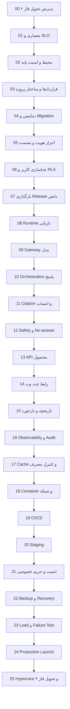
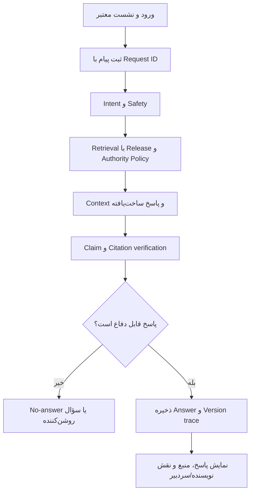

# نقشه راه اجرایی ماژولار فاز ۳ پروژه RAG_finance

**نسخه:** ۱.۰ — استقرار و راه‌اندازی محصول چت مستند روی سایت  
**مبنای طراحی:** خروجی فاز ۲ و `phase3_product_decision_memo_fa.md`  
**دامنه:** Backend، Database، Web Chat، اتصال RAG، امنیت، پایش، استقرار و Launch  
**خارج از دامنه:** پنل مدیریت گسترده، آزمون سواد مالی، پرونده مالی فردی، برنامه اقدام و مشاور شخصی؛ این موارد متعلق به فاز ۴ هستند.  
**مخاطب نسخه Markdown:** تیم فنی و مجری مرحله‌به‌مرحله در محیط چت  

---

## ۱. هدف و مرز فاز ۳

فاز ۳ باید Release پذیرفته‌شده فاز ۲ را به یک سرویس واقعی چندکاربره تبدیل کند که کاربر از طریق سایت سؤال بپرسد، پاسخ مستند دریافت کند، منبع هر ادعا را ببیند و تاریخچه گفت‌وگوی خودش را مشاهده کند.

فاز ۳ نباید به فاز ۴ تبدیل شود. در این مرحله سیستم پروفایل کامل مالی، آزمون، امتیاز سلامت مالی، برنامه شخصی بدهی یا بودجه، مسیر آموزشی فردی و پنل مدیریتی جامع تولید نمی‌کند. فقط قراردادهای توسعه‌پذیر برای این قابلیت‌ها در معماری پیش‌بینی می‌شوند.

خروجی قابل قبول فاز ۳ «یک چت نمایشی» نیست. محصول باید دارای این ویژگی‌ها باشد:

- API و Web UI واقعی؛
- دیتابیس چندکاربره و جداسازی داده کاربران؛
- اتصال نسخه‌دار به Release فاز ۲؛
- پاسخ، Citation، Confidence و No-answer قابل ردیابی؛
- تاریخچه گفت‌وگو و بازخورد؛
- امنیت، Rate limit، Audit log و مدیریت Secret؛
- استقرار تکرارپذیر، Backup/Restore و Rollback؛
- تست Load، امنیت، قرارداد و رگرسیون؛
- شواهد فنی قابل ارائه به کارفرما و ارزیاب فنی.

---

## ۲. تصمیم معماری مرجع

معماری مرجع بر اساس یادداشت تصمیم فاز ۳:

- Frontend: `Next.js` یا گزینه هم‌سطح پس از ADR؛
- Backend: `FastAPI`؛
- داده تراکنشی: `PostgreSQL`؛
- دانش برداری فاز ۲: `Qdrant`؛
- Cache، Rate limit و Job کوتاه: `Redis`؛
- فایل و Snapshot: Object Storage؛
- اجرای سرویس‌ها: Docker Compose در نسخه اول؛
- Reverse proxy و TLS: بر اساس زیرساخت نهایی؛
- Model Gateway مستقل از ارائه‌دهنده؛
- معماری نرم‌افزار: Modular Monolith با مرز ماژولی روشن.

این Stack قبل از پیاده‌سازی در ADR ثبت می‌شود. محل سرور، مدل نهایی، دامنه، سرویس TLS و سیاست انتقال داده در اسناد فعلی قطعی نشده‌اند و در Module 01 باید با کارفرما Freeze شوند؛ هیچ مقدار عملیاتی حدس زده نمی‌شود.

---

## ۳. قانون انتساب منبع در محصول

فاز ۳ موظف است تفاوت محتواهای زیر را بدون تغییر از فاز ۲ دریافت و در پاسخ حفظ کند:

| نوع محتوا | نمایش صحیح در محصول | نمایش ممنوع |
|---|---|---|
| مقاله تألیف مستقیم | `نویسنده: نام مؤلف` | حذف نام مؤلف یا نمایش نقش مبهم |
| مقاله نویسنده دیگر زیر نظر سردبیری | `نویسنده: نام نویسنده` و `زیر نظر سردبیری: نام مؤلف مرجع` | معرفی سردبیر به‌عنوان نویسنده مقاله |
| کتاب تألیفی | `اثر: نام کتاب، مؤلف: ...، فصل/بخش/پاراگراف` | Citation بدون محل اثر |
| ویدئو/صوت | `برنامه/قسمت، گوینده، Segment و زمان در صورت وجود واقعی` | ساخت Timestamp یا نسبت‌دادن سخن مجری به مؤلف |
| انتساب نامشخص | `انتساب در حال بررسی` یا عدم استفاده در پاسخ قطعی | حدس نام نویسنده یا سردبیر |

قواعد API و Retrieval:

- `credited_author_name` و `editorial_supervisor_name` هرگز در یک فیلد ادغام نمی‌شوند.
- API باید `content_authority_type` و `attribution_status` را همراه Citation برگرداند.
- اگر کاربر درباره «نظر خود مؤلف» سؤال کرد، Retrieval فقط منابع بیان مستقیم را مجاز بداند.
- برای سؤال آموزشی عمومی، منابع سردبیری قابل استفاده‌اند، ولی برچسب نقش‌ها باید نمایش داده شود.
- Cache key باید Policy و Authority filter را در بر گیرد تا پاسخ یک نوع سؤال برای نوع دیگر بازاستفاده نشود.
- Telemetry باید خطاهای Misattribution را مستقل ثبت کند.

---

## ۴. فلوچارت کل فاز ۳



---

## ۵. قاعده استقلال ماژول‌ها

هر Module یک واحد مستقل کار و بازبینی است و باید:

- Scope، ورودی، خروجی و وابستگی مشخص داشته باشد؛
- تغییراتش در پوشه ماژول خود محدود باشد؛
- Config و Secret را از کد جدا کند؛
- تست واحد، تست قرارداد یا تست یکپارچه متناسب داشته باشد؛
- Artifact و گزارش پذیرش تولید کند؛
- Gate شکست‌پذیر داشته باشد؛
- Known limitation را ثبت کند؛
- بدون PASS شدن، ماژول بعدی را آزاد نکند.

برای Moduleهای تحلیلی و آزمایشی می‌توان Notebook مستقل ساخت؛ سرویس Production نباید داخل Notebook پیاده‌سازی شود. Notebook فقط برای Benchmark، Load analysis، Error analysis و گزارش شواهد استفاده می‌شود.

الگوی شناسه فعالیت:

```text
P3M<شماره>-T01, P3M<شماره>-T02, ...
```

---

# ۶. دستور اجرایی تفصیلی ماژول‌ها

## Module 00 — `phase2_handoff_acceptance`

### توضیح برای کارفرما

قبل از ساخت سایت باید مطمئن شویم موتور دانشی تحویلی ثابت، نسخه‌دار و قابل مصرف است. اتصال به پوشه‌های موقت یا خروجی نوت‌بوک‌ها باعث می‌شود محصول با هر اجرای فاز ۲ تغییر کند.

### فعالیت‌ها

1. دریافت `release_id` و Release Manifest فاز ۲؛
2. اعتبارسنجی `rag_request.schema.json` و `rag_response.schema.json`؛
3. کنترل Hash داده، Chunk، Embedding، Index و Config؛
4. اجرای Contract test روی نمونه درخواست‌ها؛
5. کنترل Citation locator برای سایت، کتاب و Transcript؛
6. کنترل وجود فیلدهای نویسنده، سردبیر، گوینده و نوع اختیار محتوایی؛
7. اجرای Smoke benchmark فاز ۲؛
8. ثبت Compatibility matrix و نتیجه پذیرش.

### خروجی

```text
artifacts/phase3/checkpoints/00_phase2_handoff.json
reports/phase3/phase2_compatibility_report.md
config/phase3/knowledge_release.lock
```

### Gate

Hash mismatch، Broken contract، Broken locator و Invalid attribution باید صفر باشد. Release فاز ۲ باید وضعیت `accepted_for_phase3=true` بگیرد.

### شاهد دانش فنی

Release compatibility، Contract testing، Artifact integrity و Provenance verification.

---

## Module 01 — `architecture_slo_and_scope_freeze`

### توضیح برای کارفرما

این مرحله تصمیم‌های مبهم را به قرارداد فنی قابل اندازه‌گیری تبدیل می‌کند تا وسط استقرار معماری یا Scope تغییر نکند.

### فعالیت‌ها

1. Freeze دامنه فاز ۳ و فهرست صریح موارد فاز ۴؛
2. ثبت Context diagram و Container diagram؛
3. تثبیت Stack با ADR؛
4. تعیین محیط‌های Local، Test، Staging و Production؛
5. تعیین DAU، پیام روزانه، Concurrent request و بودجه مصرف؛
6. تعیین SLO اولیه Availability، latency و error rate؛
7. تعیین RPO و RTO Backup؛
8. ثبت محل میزبانی، دامنه، TLS و محدودیت انتقال داده؛
9. ساخت Risk register و Dependency register؛
10. تعریف معیار Go/No-Go Launch.

### خروجی و Gate

`docs/phase3/architecture.md`، `docs/phase3/scope.md`، `docs/phase3/slo.md` و ADRها باید تأیید شوند. مقدار حل‌نشده‌ای که روی امنیت یا هزینه اثر دارد، Gate را Fail می‌کند.

### شاهد دانش فنی

Architecture decision record، SLO engineering، Capacity assumptions و Scope control.

---

## Module 02 — `environment_and_security_baseline`

### فعالیت‌ها

1. Freeze نسخه Python، Node، PostgreSQL، Qdrant، Redis و Docker؛
2. ساخت lockfileهای وابستگی؛
3. تعریف `.env.example` بدون Secret؛
4. ممنوع‌کردن Secret در Repository؛
5. فعال‌کردن Dependency و Secret scanning؛
6. تنظیم Lint، Type check و Test command واحد؛
7. ساخت SBOM و گزارش Dependency؛
8. ثبت Timezone، Locale و Encoding؛
9. تعیین Log redaction policy؛
10. ساخت Environment manifest.

### Gate و شواهد

Build پاک روی محیط جدید، Secret leakage صفر، Dependency بحرانی حل‌نشده صفر و فرمان واحد تست موفق باشد. شواهد: SBOM، Environment manifest و Security baseline report.

---

## Module 03 — `project_structure_and_contracts`

### ساختار پیشنهادی

```text
apps/
  api/
  web/
src/phase3/
  auth/
  conversations/
  rag_runtime/
  citations/
  safety/
  telemetry/
  storage/
schemas/phase3/
infra/
tests/phase3/
docs/phase3/
```

### فعالیت‌ها

1. تعریف مرز Domain moduleها؛
2. تعریف Error model مشترک؛
3. تعریف Request ID و Trace ID؛
4. نسخه‌بندی API از `/v1`؛
5. ساخت Schemaهای User، Conversation، Message، Answer و Citation؛
6. تعریف فیلدهای Attribution؛
7. تعریف Compatibility policy؛
8. ساخت Contract tests بین Backend، Frontend و RAG runtime؛
9. ساخت Architecture dependency test برای جلوگیری از Import معکوس.

### Gate

Schema validation و Contract test صددرصد PASS و Circular dependency صفر باشد.

### شاهد دانش فنی

Separation of concerns، Versioned contracts و Dependency governance.

---

## Module 04 — `database_schema_and_migrations`

### توضیح برای کارفرما

دیتابیس فقط محل ذخیره پیام نیست؛ باید نشان دهد چه کسی، چه زمانی، با کدام نسخه دانش و کدام منبع پاسخ گرفته است.

### موجودیت‌های فعال فاز ۳

```text
users, identities, sessions, consents
conversations, messages, answers, citations
retrieval_runs, model_runs, feedback
audit_events, security_events
knowledge_releases
```

### فعالیت‌ها

1. طراحی ERD و Data dictionary؛
2. تعریف Primary/Foreign key و Index؛
3. افزودن `user_id` به تمام داده‌های کاربر؛
4. ذخیره Citation و Attribution به‌صورت ساخت‌یافته؛
5. ذخیره Versionهای knowledge/retrieval/model/policy؛
6. تعریف Migration forward و rollback؛
7. تست Migration روی دیتابیس خالی و دیتابیس دارای داده؛
8. تعریف Retention و soft/hard delete؛
9. آماده‌سازی Namespace رزروشده برای موجودیت‌های فاز ۴ بدون فعال‌سازی آن‌ها.

### Gate

Migration clean، rollback test، FK violation صفر و Query plan قابل قبول برای مسیرهای اصلی.

### شاهد دانش فنی

Data modeling، Migration discipline، Version trace و Query optimization.

---

## Module 05 — `authentication_and_sessions`

### فعالیت‌ها

1. انتخاب روش ورود طبق تصمیم کارفرما؛
2. Password hashing استاندارد در صورت ورود رمزدار؛
3. Session token امن و rotation؛
4. Cookie امن با `HttpOnly`، `Secure` و `SameSite`؛
5. CSRF policy؛
6. محدودیت تلاش ورود و lockout کنترل‌شده؛
7. Logout و revoke همه نشست‌ها؛
8. Expiration و refresh policy؛
9. ثبت Security event بدون ذخیره Secret؛
10. تست منفی Session theft و replay.

### Gate

دسترسی بدون هویت به Endpoint محافظت‌شده صفر، Session پس از revoke نامعتبر و Secret در log صفر باشد.

### شاهد دانش فنی

Identity architecture، Session lifecycle و Negative security testing.

---

## Module 06 — `tenant_isolation_and_rls`

### توضیح برای کارفرما

مهم‌ترین ریسک چندکاربره این است که یک کاربر تاریخچه یا داده کاربر دیگر را ببیند. کنترل فقط در کد کافی نیست و باید در دیتابیس نیز اعمال شود.

### فعالیت‌ها

1. فعال‌سازی Row-Level Security برای جداول کاربرمحور؛
2. تعریف Policy خواندن، نوشتن، ویرایش و حذف؛
3. تنظیم Context امن user/tenant در هر Transaction؛
4. جلوگیری از دسترسی Background job خارج از Scope؛
5. تست cross-user برای تمام Endpointها؛
6. تست ID enumeration؛
7. تست دسترسی مستقیم Repository layer؛
8. ثبت Audit برای عملیات حساس؛
9. ساخت Isolation matrix.

### Gate

Cross-user data exposure و RLS bypass در تست‌ها باید صفر باشد.

### شاهد دانش فنی

Defense in depth، Database-enforced isolation و Adversarial authorization tests.

---

## Module 07 — `knowledge_release_loader`

### فعالیت‌ها

1. خواندن `knowledge_release.lock`؛
2. کنترل Hash و Schema پیش از Startup؛
3. اتصال به Collection نسخه‌دار Qdrant؛
4. اعتبارسنجی Point count و Payload schema؛
5. کنترل فیلدهای Source locator و Attribution؛
6. ممنوع‌کردن اتصال به Index بدون Release ID؛
7. Health check مستقل دانش؛
8. Warm-up محدود؛
9. Rollback به Release قبلی؛
10. تست خرابی Release و Fail-closed.

### Gate

سرویس نباید با Release ناسازگار Ready شود. Rollback باید بدون بازسازی Index ممکن باشد.

### شاهد دانش فنی

Immutable release loading، Startup validation و Knowledge rollback.

---

## Module 08 — `retrieval_runtime`

### فعالیت‌ها

1. تبدیل Config برنده فاز ۲ به Runtime package؛
2. Dense/Sparse/Hybrid/Rerank pipeline؛
3. Metadata filter برای Source و Authority type؛
4. Intent-aware filter برای «نظر مستقیم مؤلف»؛
5. Timeout و retry محدود؛
6. Candidate و final-k ثابت و نسخه‌دار؛
7. عدم ثبت Query حساس به شکل Raw در log عمومی؛
8. ثبت Retrieval run و scoreها؛
9. Regression test با Golden set؛
10. Fallback کنترل‌شده در خرابی جزء غیرضروری.

### Gate

Metricهای فاز ۲ در Runtime نباید بیش از Tolerance مصوب افت کنند؛ Misattribution filter failure صفر باشد.

### شاهد دانش فنی

Production retrieval parity، Authority-aware retrieval و Runtime regression.

---

## Module 09 — `model_gateway`

### فعالیت‌ها

1. تعریف Interface مستقل از Provider؛
2. Timeout، retry و circuit breaker؛
3. محدودیت Token و هزینه؛
4. ثبت مدل و نسخه در هر run؛
5. حذف یا ماسک داده غیرضروری پیش از ارسال؛
6. Streaming adapter؛
7. خروجی ساخت‌یافته و Schema validation؛
8. Fallback model طبق Policy؛
9. تست خطا، کندی و پاسخ نامعتبر؛
10. Benchmark کیفیت/هزینه/latency پیش از Freeze Provider.

### Gate

وابستگی مستقیم Domain code به SDK ارائه‌دهنده صفر، خروجی نامعتبر مدیریت‌نشده صفر و Cost guard فعال باشد.

### شاهد دانش فنی

Provider abstraction، Resilience pattern و Cost-quality benchmark.

---

## Module 10 — `answer_orchestration`

### فعالیت‌ها

1. ساخت Query context از پیام جاری و تاریخچه محدود؛
2. Intent و Answerability؛
3. Retrieval و Context builder؛
4. تولید پاسخ ساخت‌یافته؛
5. Claim/Citation verification؛
6. اعمال Safety و No-answer؛
7. ساخت Confidence از اجزای قابل توضیح؛
8. ذخیره Runها و Versionها در یک Transaction منطقی؛
9. مدیریت cancellation و duplicate request؛
10. Idempotency برای retry کلاینت.

### Gate

هر Answer باید `request_id`، نسخه دانش، Runها، Citation و وضعیت Safety داشته باشد. پاسخ ناقص نباید به‌عنوان موفق ثبت شود.

### شاهد دانش فنی

Traceable orchestration، Idempotency، Failure-state design و Explainable confidence.

---

## Module 11 — `citation_and_attribution_delivery`

### فعالیت‌ها

1. تعریف Citation DTO مشترک Frontend/Backend؛
2. ارسال URL و locator معتبر؛
3. ارسال `credited_author_name`؛
4. ارسال جداگانه `editorial_supervisor_name`؛
5. ارسال `speaker_name` برای Transcript؛
6. ارسال `content_authority_type` و `attribution_status`؛
7. نمایش Citation کنار Claim و فهرست منابع؛
8. Tooltip یا جزئیات «چرا این منبع استفاده شد»؛
9. Broken link و Broken locator handling؛
10. تست Snapshot برای چهار نوع نمایش منبع؛
11. تست ممنوعیت تبدیل سردبیر به نویسنده.

### Gate

Citation correctness و Attribution correctness باید Target فاز ۲ را حفظ کنند؛ نام حدسی و locator ساختگی صفر.

### شاهد دانش فنی

Claim-level citation delivery، Attribution-safe UI contract و Misattribution regression.

---

## Module 12 — `safety_no_answer_and_policy`

### فعالیت‌ها

1. تفکیک آموزش مالی از توصیه سرمایه‌گذاری شخصی؛
2. تشخیص سؤال خارج از منبع یا مبهم؛
3. Clarification، Abstention و Safe completion؛
4. ممنوعیت ادعای قطعی بدون Citation؛
5. Prompt injection defense برای ورودی و محتوای بازیابی‌شده؛
6. سیاست نمایش Disclaimer متناسب، نه ثابت و بی‌اثر؛
7. ثبت Policy version؛
8. ساخت Red-team corpus فارسی؛
9. تست درخواست افشای داده کاربر دیگر؛
10. تست توصیه خرید/فروش و پاسخ پرریسک.

### Gate

Critical policy violation در Suite مصوب باید صفر و No-answer F1 در محدوده پذیرش باشد.

### شاهد دانش فنی

Domain policy، Adversarial testing، calibrated abstention و prompt-injection controls.

---

## Module 13 — `product_api`

### Endpointهای حداقل

```text
POST /v1/auth/login
POST /v1/auth/logout
GET  /v1/me
POST /v1/conversations
GET  /v1/conversations
GET  /v1/conversations/{id}
POST /v1/conversations/{id}/messages
POST /v1/answers/{id}/feedback
GET  /health/live
GET  /health/ready
```

### فعالیت‌ها

1. OpenAPI نسخه‌دار؛
2. Validation ورودی و محدودیت اندازه؛
3. Error code پایدار؛
4. Pagination تاریخچه؛
5. Streaming پاسخ با stateهای مشخص؛
6. Idempotency key؛
7. Request/Trace ID؛
8. Authorization در هر Endpoint؛
9. Contract test و backward compatibility؛
10. API abuse tests.

### Gate

OpenAPI validation، Contract suite، Authorization suite و Error contract صددرصد PASS.

### شاهد دانش فنی

API engineering، versioning، streaming contract و abuse resistance.

---

## Module 14 — `web_chat_interface`

### توضیح برای کارفرما

این بخش رابط واقعی کاربر در سایت است؛ نه پنل مدیریتی فاز ۴. تمرکز روی پرسش، پاسخ مستند، تاریخچه و تجربه خطای قابل فهم است.

### فعالیت‌ها

1. صفحه ورود و مدیریت Session؛
2. فهرست گفت‌وگوهای خود کاربر؛
3. صفحه Chat واکنش‌گرا؛
4. Streaming پاسخ و امکان لغو؛
5. نمایش Citation در سطح Claim؛
6. نمایش صحیح نویسنده و سردبیر؛
7. نمایش Confidence به زبان قابل فهم؛
8. نمایش No-answer و سؤال روشن‌کننده؛
9. Error/Retry state بدون تکرار پیام؛
10. Accessibility پایه Keyboard، focus، contrast و screen-reader label؛
11. تست موبایل و مرورگرهای هدف؛
12. ممنوعیت نمایش اطلاعات Debug یا Prompt داخلی.

### Gate

مسیر Login→Chat→Citation→History روی مرورگرهای مصوب و موبایل PASS؛ خطای انتساب UI صفر.

### شاهد دانش فنی

Source-aware UX، streaming state machine، accessibility و resilient client behavior.

---

## Module 15 — `conversation_history_and_feedback`

### فعالیت‌ها

1. ذخیره User message و Answer به‌صورت immutable event؛
2. عنوان‌گذاری مکالمه بدون تغییر محتوای اصلی؛
3. Pagination و مرتب‌سازی؛
4. حذف مکالمه طبق Retention policy؛
5. Feedback مثبت/منفی و دسته خطا؛
6. ثبت Citation مشکل‌دار یا انتساب اشتباه؛
7. جلوگیری از دسترسی کاربر دیگر؛
8. Export ساخت‌یافته در صورت تصویب Scope؛
9. Dataset بازخورد بدون PII برای ارزیابی بعدی؛
10. تست Race condition و duplicate write.

### Gate

History consistency، حذف مطابق Policy، cross-user exposure صفر و Feedback trace کامل.

### شاهد دانش فنی

Event traceability، feedback engineering و privacy-preserving evaluation data.

---

## Module 16 — `observability_and_audit`

### فعالیت‌ها

1. Structured log با Request/Trace ID؛
2. Metricهای request، latency، error، retrieval و model؛
3. Dashboard سلامت سرویس؛
4. Alert برای Availability، error rate، DB pool و مصرف؛
5. Audit event برای ورود و عملیات حساس؛
6. Redaction داده مالی و Token؛
7. ثبت نسخه Knowledge/Model/Policy؛
8. Trace نمونه‌برداری‌شده برای مسیر پاسخ؛
9. Runbook هشدارها؛
10. تست اینکه PII و Secret در Log وجود ندارد.

### Gate

هر درخواست قابل ردیابی، Alertهای بحرانی آزمایش‌شده و Secret/PII leakage در log صفر.

### شاهد دانش فنی

End-to-end traceability، privacy-aware telemetry و operational runbooks.

---

## Module 17 — `cache_rate_limit_and_cost_control`

### فعالیت‌ها

1. Rate limit بر اساس کاربر و IP؛
2. Daily quota و budget guard؛
3. Cache فقط برای خروجی‌های مجاز؛
4. Cache key شامل Release، Policy، Authority filter و Locale؛
5. ممنوعیت Cache مشترک برای پاسخ شخصی یا تاریخچه؛
6. TTL و invalidation هنگام Release جدید؛
7. Idempotency store؛
8. Queue/backpressure در پیک؛
9. تست bypass و cache poisoning؛
10. گزارش هزینه هر پاسخ موفق.

### Gate

Rate-limit bypass، cross-user cache leak و stale citation پس از Release باید صفر باشد.

### شاهد دانش فنی

Cost governance، cache isolation، backpressure و abuse control.

---

## Module 18 — `containerization_and_networking`

### سرویس‌های مرجع

```text
web, api, postgres, qdrant, redis, reverse-proxy
```

### فعالیت‌ها

1. Dockerfile چندمرحله‌ای برای Web و API؛
2. اجرای process با کاربر غیر root؛
3. Healthcheck و startup dependency؛
4. Network segmentation؛
5. Volume و persistence policy؛
6. Secret injection در Runtime؛
7. محدودیت CPU/Memory؛
8. Image scanning و pin digest؛
9. Compose برای Local و Deployment؛
10. Cold-start و restart test.

### Gate

Build تکرارپذیر، Critical image vulnerability حل‌نشده صفر و restart بدون از دست‌رفتن داده.

### شاهد دانش فنی

Reproducible packaging، container hardening و stateful-service design.

---

## Module 19 — `ci_cd_and_release_pipeline`

### فعالیت‌ها

1. Lint، type check و unit tests؛
2. Integration tests با سرویس‌های موقت؛
3. Migration test؛
4. Contract و security tests؛
5. Build و scan Image؛
6. تولید Release manifest و SBOM؛
7. Deploy خودکار به Staging؛
8. Approval دستی Production؛
9. Rollback workflow؛
10. نگهداری Artifact و Test report؛
11. Branch protection و ممنوعیت Secret در log.

### Gate

هیچ Deployment تولیدی بدون Test report، Image digest، Migration check و Approval انجام نشود.

### شاهد دانش فنی

Quality gates، supply-chain evidence و controlled deployment.

---

## Module 20 — `staging_deployment_and_e2e`

### فعالیت‌ها

1. Provision محیط Staging نزدیک به Production؛
2. TLS و Domain آزمایشی؛
3. داده Test غیرشخصی؛
4. اجرای Migration؛
5. بارگذاری Release پذیرفته‌شده فاز ۲؛
6. Smoke و E2E؛
7. تست سه منبع و چهار نوع Citation؛
8. تست نویسنده/سردبیر؛
9. تست No-answer و Safety؛
10. تست Restart و dependency outage؛
11. UAT کارفرما و ثبت Issue.

### Gate

مسیرهای بحرانی E2E و UAT PASS، Issue بحرانی باز صفر و Staging قابل بازسازی باشد.

### شاهد دانش فنی

Production-like validation، E2E evidence و stakeholder acceptance.

---

## Module 21 — `security_privacy_and_threat_validation`

### فعالیت‌ها

1. Threat model برای Web، API، DB، Qdrant و Model gateway؛
2. تست OWASP API/Web متناسب؛
3. تست prompt injection و data exfiltration؛
4. تست IDOR و RLS bypass؛
5. TLS، headerهای امنیتی و CORS؛
6. Dependency و image scan؛
7. Consent و Retention validation؛
8. Account/data deletion test؛
9. Incident response tabletop؛
10. ثبت Risk acceptanceهای باقی‌مانده.

### Gate

Critical/High vulnerability حل‌نشده صفر، Data isolation failure صفر و Incident runbook تأییدشده.

### شاهد دانش فنی

Threat modeling، privacy engineering، adversarial validation و incident readiness.

---

## Module 22 — `backup_restore_and_disaster_recovery`

### فعالیت‌ها

1. Backup نسخه‌دار PostgreSQL؛
2. Snapshot و Restore Qdrant؛
3. Backup Config و Release pointer؛
4. رمزگذاری و دسترسی محدود Backup؛
5. Retention و rotation؛
6. Restore در محیط خالی؛
7. Point-in-time recovery در صورت امکان زیرساخت؛
8. اندازه‌گیری RPO/RTO واقعی؛
9. تست خرابی جزئی و کامل؛
10. Runbook و گزارش Restore.

### Gate

Backup بدون Restore موفق ارزشی ندارد. Restore کامل باید در محدوده RPO/RTO مصوب PASS شود.

### شاهد دانش فنی

Recoverability evidence، DR testing و state restoration.

---

## Module 23 — `performance_load_and_failure_testing`

### سناریوها

- Login و History بدون مدل؛
- Chat کوتاه و بلند؛
- Query بدون پاسخ؛
- Citation چندمنبعی؛
- پیک Concurrent؛
- کندی یا قطع Model provider؛
- قطع Redis؛
- کندی PostgreSQL یا Qdrant؛
- Restart یک سرویس؛
- محدودیت Rate و Budget.

### فعالیت‌ها

1. Freeze workload model با اعداد تأییدشده؛
2. Baseline p50/p95/p99؛
3. Load، stress و soak test؛
4. اندازه‌گیری saturation؛
5. Failure injection کنترل‌شده؛
6. تحلیل Queue و timeout؛
7. بررسی DB pool و Index latency؛
8. اندازه‌گیری هزینه هر پاسخ؛
9. Capacity report و tuning؛
10. Regression threshold.

### Gate

SLOهای Freeze‌شده، Error budget و ظرفیت Peak باید PASS شوند. اعداد نمونه یادداشت تصمیم، تا زمان Freeze تعهد قطعی نیستند.

### شاهد دانش فنی

Load model، capacity engineering، failure analysis و cost-performance tuning.

---

## Module 24 — `production_launch`

### فعالیت‌ها

1. Go/No-Go checklist؛
2. Freeze Image digest، DB migration و Knowledge release؛
3. Backup قبل از استقرار؛
4. اجرای Deployment کنترل‌شده؛
5. Migration و health verification؛
6. Smoke test با حساب آزمایشی؛
7. فعال‌سازی محدود کاربران اولیه؛
8. پایش Error، latency، cost و safety؛
9. Rollback در عبور از Threshold؛
10. ثبت زمان، نسخه‌ها و مسئول تصمیم؛
11. Production acceptance report.

### Gate

تمام P0ها بسته، Rollback آماده، Backup معتبر، UAT تأییدشده و مانیتورینگ فعال باشد.

### شاهد دانش فنی

Controlled release، change traceability، rollback readiness و launch evidence.

---

## Module 25 — `hypercare_and_phase4_handoff`

### فعالیت‌ها

1. بازه Hypercare با مالک مشخص؛
2. دسته‌بندی Incident و SLA پاسخ داخلی؛
3. مرور روزانه Error، latency، Citation و Safety؛
4. تحلیل Feedback کاربران اولیه؛
5. اصلاح فقط Bugهای فاز ۳ و جلوگیری از Scope creep؛
6. Freeze Baseline عملیاتی پس از پایداری؛
7. ساخت Runbook بهره‌برداری؛
8. انتقال دانش به تیم نگهداری؛
9. تعریف Contract فاز ۴ برای Profile، Assessment، Goals و Action Plan؛
10. ثبت Tech debt و Deferred decisions؛
11. Phase 3 closure report.

### Gate

Incident بحرانی باز صفر، Runbook و آموزش تحویل‌شده، Metrics پایدار و قرارداد ورودی فاز ۴ تأییدشده باشد.

### شاهد دانش فنی

Operational learning، incident taxonomy، maintainability و controlled handoff.

---

## ۷. فلوچارت مسیر یک سؤال کاربر



---

## ۸. ساختار Artifactها

```text
artifacts/phase3/checkpoints/
artifacts/phase3/releases/<release_id>/
config/phase3/
schemas/phase3/
reports/phase3/architecture/
reports/phase3/security/
reports/phase3/performance/
reports/phase3/operations/
docs/phase3/adr/
docs/phase3/runbooks/
infra/
tests/phase3/
```

هر Release باید حداقل شامل App version، Image digest، DB migration version، Knowledge release، Retrieval config، Model gateway config، Policy version، Schema version، Test report و Rollback target باشد.

---

## ۹. Test Suite الزامی

```text
tests/phase3/unit/
  test_contracts.py
  test_attribution_mapping.py
  test_policy.py
  test_cache_keys.py
  test_redaction.py

tests/phase3/integration/
  test_database_migrations.py
  test_rls_isolation.py
  test_rag_runtime.py
  test_model_gateway.py
  test_answer_persistence.py

tests/phase3/contracts/
  test_openapi.py
  test_frontend_backend_contract.py
  test_phase2_runtime_contract.py
  test_citation_attribution_contract.py

tests/phase3/e2e/
  test_login_chat_citation_history.py
  test_no_answer.py
  test_author_editor_display.py
  test_logout_and_revoke.py

tests/phase3/security/
  test_cross_user_access.py
  test_idor.py
  test_prompt_injection.py
  test_rate_limit.py
  test_log_leakage.py

tests/phase3/performance/
  load_chat.js
  load_history.js
  soak_chat.js
```

---

## ۱۰. معیارهای پذیرش اولیه

مقادیر عملکردی باید در Module 01 با بار واقعی Freeze شوند. معیارهای غیرقابل مذاکره:

| معیار | Gate |
|---|---:|
| Cross-user data exposure | 0 |
| Broken Phase 2 release hash | 0 |
| Invalid citation locator | 0 |
| خطای انتساب نویسنده/سردبیر در Suite | 0 |
| Unsupported critical claim | 0 |
| Critical safety violation | 0 |
| Secret یا PII در Log test | 0 |
| Migration/rollback failure | 0 |
| Backup بدون Restore تأییدشده | 0 |
| Critical/High security issue باز | 0 |
| E2E critical path failure | 0 |
| Release بدون manifest و rollback | 0 |

Targetهای پیشنهادی یادداشت تصمیم مانند Availability 99.5٪، p95 غیرمدلی کمتر از 500ms و p95 پاسخ مدل ترجیحاً کمتر از 15s فقط پس از تأیید زیرساخت و Load model به SLO تبدیل می‌شوند.

---

## ۱۱. Evidence Matrix دانش فنی فاز ۳

| حوزه | شاهد قابل ارائه | Module |
|---|---|---|
| معماری | C4، ADR، Dependency rules | 01 و 03 |
| مهندسی داده | ERD، Migration، RLS و Version trace | 04 و 06 |
| یکپارچه‌سازی RAG | Release lock، Runtime regression | 00، 07 و 08 |
| Citation و Attribution | DTO، UI snapshots و Misattribution tests | 11 و 14 |
| امنیت | Threat model، Negative tests و Scan report | 02، 05، 06 و 21 |
| پایداری | Circuit breaker، Retry، Failure tests | 09، 10 و 23 |
| عملیات | Metrics، Alert، Audit و Runbook | 16 و 25 |
| کنترل مصرف | Rate limit، Cache isolation و Cost report | 17 |
| بازتولیدپذیری | Container digest، SBOM و Release manifest | 18 و 19 |
| تداوم خدمت | Backup/Restore و Rollback evidence | 22 و 24 |
| ارزیابی | E2E، Load، Security و UAT reports | 20، 21 و 23 |

این شواهد دفاع فنی پروژه را از «قرار دادن یک رابط روی مدل و پایگاه برداری» فراتر می‌برد؛ با این حال هیچ نقشه فنی به‌تنهایی تأیید دانش‌بنیان را تضمین نمی‌کند.

---

## ۱۲. اولویت‌بندی

### P0 — الزامی پیش از Launch

Moduleهای 00 تا 16، 18 تا 24؛ به‌ویژه RLS، Citation/Attribution، Safety، Backup/Restore، Security و Rollback.

### P1 — لازم برای کنترل رشد

بهینه‌سازی Module 17، کامل‌کردن Dashboardها، Soak test طولانی‌تر و بهبود Cost report.

### P2 — پس از مشاهده مصرف واقعی

افزایش Replica، CDN، Queue پیشرفته، orchestration پیچیده‌تر و قابلیت‌های PWA. Kubernetes و Microservice بدون شواهد بار واقعی وارد Scope نمی‌شوند.

---

## ۱۳. تعریف Done هر Module

یک Module فقط زمانی Done است که:

- Scope و وابستگی آن ثبت شده باشد؛
- کد Production در ماژول مربوط قرار گرفته باشد؛
- Config و Secret از کد جدا باشند؛
- تست‌های مثبت و منفی مرتبط PASS باشند؛
- Artifact و گزارش مرحله تولید شده باشد؛
- Gate واقعی PASS شده باشد؛
- Known limitation و Risk باقی‌مانده ثبت شده باشد؛
- Runbook یا توضیح فارسی انتقال دانش تکمیل شده باشد؛
- ماژول بعدی بتواند فقط از Contract و Artifact آن استفاده کند.

---

## ۱۴. تعریف Done کل فاز ۳

فاز ۳ زمانی کامل است که Release ثابت فاز ۲ از طریق API و رابط وب چندکاربره در محیط Production قابل استفاده باشد؛ هر کاربر فقط داده خود را ببیند؛ پاسخ‌ها Claim-level Citation و Attribution درست داشته باشند؛ تاریخچه و بازخورد ذخیره شود؛ Safety و No-answer فعال باشد؛ استقرار، Migration، Backup، Restore، Monitoring و Rollback آزمایش شده باشند؛ Load و Security Gateها PASS شده باشند؛ و قرارداد ورودی فاز ۴ تحویل شود.

وجود یک صفحه چت یا اجرای Docker Compose به‌تنهایی به معنی تکمیل فاز ۳ نیست.

---

## ۱۵. ترتیب Commitهای پیشنهادی

```text
phase3: accept phase2 release contract
phase3: freeze architecture scope and slo
phase3: add environment and security baseline
phase3: add project boundaries and api contracts
phase3: add database schema and migrations
phase3: add authentication and session lifecycle
phase3: enforce row level security
phase3: add knowledge release loader
phase3: package retrieval runtime
phase3: add provider independent model gateway
phase3: add traceable answer orchestration
phase3: add citation and attribution delivery
phase3: add safety and no-answer policy
phase3: add product api v1
phase3: add web chat interface
phase3: add history and feedback
phase3: add observability and audit
phase3: add cache rate limit and cost controls
phase3: add hardened containers
phase3: add ci cd quality gates
phase3: deploy and validate staging
phase3: complete security validation
phase3: prove backup and restore
phase3: complete load and failure tests
phase3: launch production release
phase3: complete hypercare and phase4 handoff
```

هر Commit فقط با مجوز صریح Repository انجام می‌شود.

---

## ۱۶. دستور استفاده مرحله‌به‌مرحله در چت

در هر گفت‌وگو فقط یک Module اجرا شود:

```text
Repository: Shahbazi-Amir/RAG_finance
Branch: <branch تاییدشده فاز ۳>
Expected starting HEAD: <SHA مرحله قبل>

فقط Module <شماره و نام> را طبق
RAG_finance_phase3_modular_execution_plan.md اجرا کن.

الزامات:
1. ابتدا Branch، HEAD، Git status، ورودی‌ها و Dependencyها را گزارش کن.
2. هیچ فایل خارج از Scope این Module را تغییر نده.
3. فعالیت‌ها را با P3Mxx-Txx ثبت کن.
4. قبل از تغییر، طراحی و دلیل فنی را به فارسی توضیح بده.
5. Secret، آدرس سرور، SLO، نویسنده یا نتیجه تست را حدس نزن.
6. Test و Gate باید شکست‌پذیر باشند.
7. در Gate ناموفق توقف کن و مرحله بعد را شروع نکن.
8. Commit، Push، Deploy یا Migration تولیدی بدون مجوز صریح انجام نده.

گزارش پایان:
- فایل‌های خوانده‌شده و تغییرکرده
- فعالیت‌های تکمیل‌شده
- فرمان‌ها و Migrationها
- نتیجه Test و Gate
- Artifact، مسیر، اندازه و Hash
- Known limitations و Riskها
- Git diff summary
```

---

## ۱۷. مسیر شروع صحیح

1. اجرای Module 00 و پذیرش Release واقعی فاز ۲؛
2. Freeze تصمیم‌های باز زیرساخت در Module 01؛
3. ساخت Baseline و Contractها؛
4. تکمیل Database، Auth و RLS پیش از رابط Chat؛
5. اتصال Runtime فاز ۲ با Citation و Attribution؛
6. ساخت API و سپس Web Chat؛
7. تکمیل Observability، Security و Recovery؛
8. Staging، UAT، Load و Failure test؛
9. Launch محدود و قابل Rollback؛
10. Hypercare و تحویل کنترل‌شده به فاز ۴.

**جمع‌بندی:** فاز ۳ پل میان موتور دانشی فاز ۲ و محصول شخصی‌سازی‌شده فاز ۴ است. اگر این پل با جداسازی کاربر، قرارداد نسخه‌دار، Citation صحیح، امنیت، Restore و Rollback ساخته نشود، توسعه پنل و مشاور شخصی روی پایه ناپایدار انجام خواهد شد.
