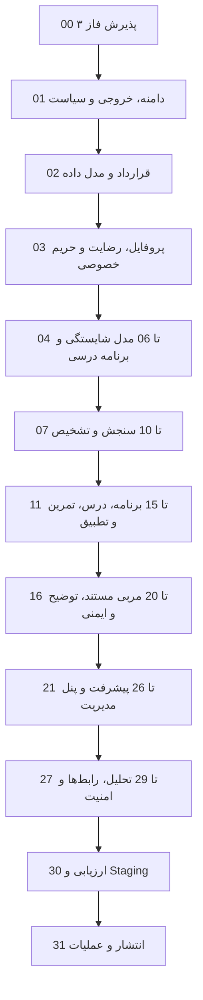
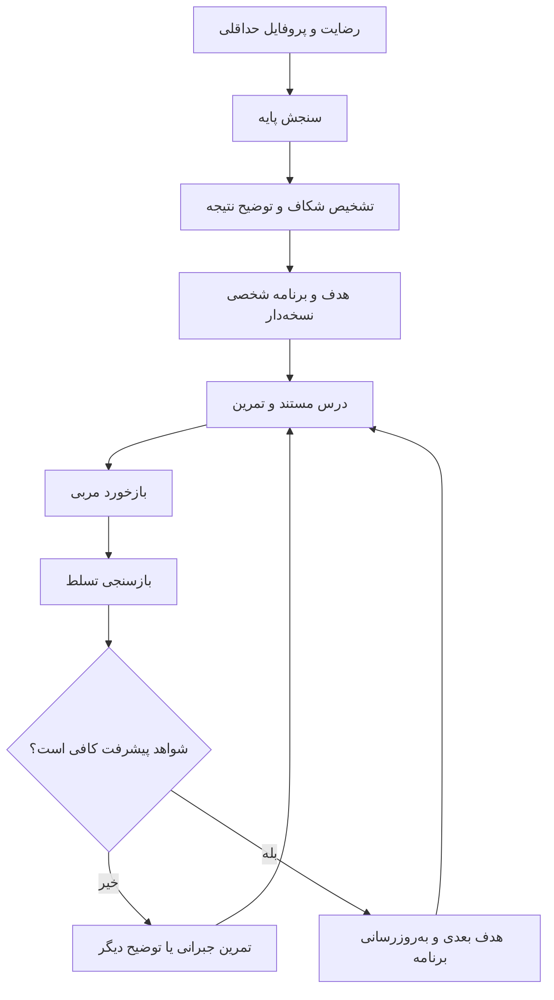

# نقشه راه اجرایی ماژولار فاز ۴ پروژه RAG_finance

**نسخه:** ۱.۰ — پنل مدیریت و مربی شخصی سواد مالی  
**مبنای طراحی:** Release پذیرفته‌شده فاز ۲ و سرویس Production پذیرفته‌شده فاز ۳  
**دامنه:** پروفایل و رضایت، سنجش سواد مالی، تشخیص شکاف، برنامه آموزشی شخصی، درس و تمرین، مربی مستند، سنجش پیشرفت، پنل مدیریت، حاکمیت محتوا و ارزیابی  
**مرز ایمنی:** آموزش و ارتقای سواد مالی؛ نه مدیریت دارایی، معامله‌گری، سیگنال یا توصیه سرمایه‌گذاری شخصی  
**مخاطب نسخه Markdown:** تیم فنی و مجری مرحله‌به‌مرحله  

---

## ۱. هدف و تعریف محصول فاز ۴

فاز ۴ باید سامانه چت مستند فاز ۳ را به «مربی شخصی سواد مالی» تبدیل کند. تفاوت اصلی این است که محصول فقط متن مرتبط پیدا نمی‌کند؛ بلکه با رضایت کاربر، سطح فعلی او را می‌سنجد، شکاف دانشی را توضیح می‌دهد، هدف آموزشی می‌سازد، مسیر یادگیری نسخه‌دار پیشنهاد می‌کند، تمرین و آزمون ارائه می‌دهد، پیشرفت را در طول زمان ثبت می‌کند و برنامه بعدی را بر اساس شواهد واقعی تطبیق می‌دهد.

ارزش پیشنهادی محصول:

- پاسخ‌ها بر پایه مجموعه دانش اختصاصی و دارای Citation واقعی هستند؛
- دیدگاه مستقیم مؤلف مرجع از مقالات سایر نویسندگان زیر نظر سردبیری جدا می‌ماند؛
- برنامه آموزشی از «شکاف مهارتی اندازه‌گیری‌شده» ساخته می‌شود، نه از حدس مدل؛
- هر پیشنهاد آموزشی دلیل، منبع، سطح اطمینان و راه بررسی دارد؛
- سیستم در نبود شواهد کافی، پاسخ قطعی یا توصیه شخصی تولید نمی‌کند؛
- کارفرما می‌تواند محتوا، برنامه‌ها، آزمون‌ها، سیاست‌ها و کیفیت را از پنل کنترل کند؛
- همه تصمیم‌های مهم نسخه‌دار، قابل ممیزی، قابل بازتولید و قابل Rollback هستند.

فاز ۴ زمانی موفق نیست که صرفاً پروفایل کاربر را به Prompt اضافه کند. موفقیت زمانی است که تغییر سطح سواد مالی، صحت استناد، ایمنی، توضیح‌پذیری و کیفیت شخصی‌سازی با Benchmark و آزمون قابل اندازه‌گیری باشد.

---

## ۲. مرز «مربی سواد مالی» و «مشاور سرمایه‌گذاری»

| مجاز در فاز ۴ | نیازمند کنترل/ارجاع | ممنوع به‌عنوان خروجی خودکار |
|---|---|---|
| آموزش بودجه‌بندی، پس‌انداز، بدهی، تورم، ریسک و مفاهیم مالی | موضوعات حساس وابسته به وضعیت واقعی کاربر | خرید/فروش دارایی مشخص |
| سنجش فهم و پیشنهاد درس بعدی | درخواست حقوقی، مالیاتی یا قراردادی | تضمین سود یا پیش‌بینی قطعی بازار |
| تمرین سناریویی و بازخورد آموزشی | بحران بدهی یا آسیب‌پذیری مالی شدید | مدیریت سبد یا تخصیص دارایی شخصی |
| برنامه رشد سواد مالی | اطلاعات ناقص یا متناقض کاربر | تصمیم‌گیری به‌جای کاربر |
| توضیح گزینه‌ها و پیامدهای عمومی | موضوع خارج از Knowledge Base | نسبت‌دادن نظر به مؤلف بدون مدرک |

متن دقیق سیاست، Disclaimer، مسیر ارجاع و شرایط استفاده باید توسط واحد مسئول کسب‌وکار/حقوقی تأیید شود. این نقشه ادعای حقوقی نمی‌کند؛ فقط Gate فنی اجرای سیاست مصوب را تعریف می‌کند.

---

## ۳. اصول معماری مرجع

1. **لایه آموزشی از RAG جدا ولی متصل است:** RAG منبع و شواهد را می‌دهد؛ موتور آموزشی وضعیت، هدف و توالی یادگیری را مدیریت می‌کند.
2. **شخصی‌سازی مبتنی بر داده معتبر است:** فقط داده رضایت‌داده‌شده، پاسخ آزمون، رفتار آموزشی و بازخورد ثبت‌شده استفاده می‌شود.
3. **هر تصمیم قابل توضیح است:** برای درس بعدی، بازخورد یا پاسخ باید `reason_codes`، شواهد و نسخه سیاست موجود باشد.
4. **حالت کاربر نسخه‌دار است:** تغییر سطح، برنامه و امتیاز با Event و Snapshot ثبت می‌شود و بازنویسی خاموش ممنوع است.
5. **انتشار کنترل‌شده است:** محتوا، سؤال، Rubric، برنامه درسی و Policy پیش از انتشار Draft، Review و Published دارند.
6. **مدل آماده مرجع حقیقت نیست:** امتیاز، Citation، قوانین ایمنی و وضعیت پیشرفت در کد و داده ساخت‌یافته محاسبه و اعتبارسنجی می‌شوند.
7. **حداقل‌سازی داده رعایت می‌شود:** هر فیلد شخصی باید هدف مصرف، مدت نگهداری، سطح حساسیت و امکان حذف داشته باشد.
8. **قابلیت بازگشت وجود دارد:** Release محصول باید App، Knowledge، Curriculum، Assessment، Policy و Model config را با هم قفل کند.

معماری پیشنهادی ادامه Modular Monolith فاز ۳ است. ایجاد Microservice فقط پس از مشاهده بار، مرز مالکیت یا نیاز مقیاس مستقل و ثبت ADR مجاز است.

---

## ۴. قانون مالکیت و انتساب محتوا

هر محتوای آموزشی، سؤال آزمون، توضیح مربی و Citation باید نقش واقعی تولیدکننده را حفظ کند:

| نوع منبع | کاربرد مجاز | نمایش الزامی |
|---|---|---|
| مقاله تألیف مستقیم مؤلف مرجع | دیدگاه مستقیم، آموزش و Citation | نام مؤلف و محل مقاله |
| مقاله نویسنده دیگر زیر نظر سردبیری | آموزش عمومی و مکمل | نام نویسنده واقعی + نقش سردبیری مؤلف مرجع |
| کتاب تألیفی | آموزش، تمرین و Citation | عنوان، مؤلف، فصل و صفحه/محل واقعی |
| ویدئو/صوت مؤلف | آموزش و نقل دیدگاه مستقیم | برنامه/قسمت، گوینده و Timestamp واقعی در صورت وجود |
| محتوای اقتباسی پنل | فقط با Provenance معتبر | سازنده، منبع مادر، وضعیت تأیید و نسخه |
| انتساب نامشخص | قرنطینه یا بررسی انسانی | عدم نمایش به‌عنوان نظر قطعی مؤلف |

قواعد غیرقابل مذاکره:

- `credited_author_id`، `editorial_supervisor_id`، `speaker_id` و `reviewer_id` فیلدهای جدا هستند؛
- پرسش «نظر خود مؤلف چیست؟» فقط از محتوای بیان مستقیم پاسخ می‌گیرد؛
- موتور برنامه‌ریزی می‌تواند از محتوای سردبیری استفاده کند، اما آن را دیدگاه مستقیم مؤلف معرفی نمی‌کند؛
- سؤال آزمون باید به `learning_objective_id` و `source_evidence_ids` متصل باشد؛
- Misattribution بحرانی، انتشار Release را متوقف می‌کند.

---

## ۵. فلوچارت کل فاز ۴



## ۶. حلقه تجربه شخصی کاربر



---

## ۷. قاعده استقلال ماژول‌ها

هر Module یک واحد مستقل پیاده‌سازی و پذیرش است و باید ورودی، خروجی، Schema، Migration، Config، Test، Artifact، Gate، محدودیت شناخته‌شده و توضیح فارسی داشته باشد. رابط کاربری، سرویس Production و Migration داخل Notebook پیاده‌سازی نمی‌شوند؛ Notebook فقط برای تحلیل داده، طراحی سنجش، Calibration، Benchmark و Error analysis است.

الگوی شناسه فعالیت:

```text
P4M<شماره>-T01, P4M<شماره>-T02, ...
```

الگوی مسیر:

```text
apps/api/modules/<module>/
apps/web/features/<feature>/
apps/admin/features/<feature>/
schemas/phase4/
config/phase4/
notebooks/phase4/<module>/
tests/phase4/<module>/
artifacts/phase4/checkpoints/
reports/phase4/<module>/
docs/phase4/adr/
docs/phase4/runbooks/
```

---

# ۸. دستور اجرایی تفصیلی ماژول‌ها

## Module 00 — `phase3_handoff_acceptance`

### چرا این کار انجام می‌شود

مربی شخصی نباید روی سرویس چت ناپایدار یا Release دانشی نامشخص ساخته شود. این مرحله قرارداد واقعی فاز ۳ را می‌پذیرد و از شروع روی فرضیات جلوگیری می‌کند.

### فعالیت‌ها

1. ثبت Branch، HEAD، App version و Production release فاز ۳؛
2. اعتبارسنجی API، Auth، RLS، Citation، History و Feedback؛
3. کنترل Knowledge release lock و Policy version؛
4. اجرای Smoke test مسیر ورود، پرسش، Citation، No-answer و Logout؛
5. کنترل حفظ نقش نویسنده/سردبیر/گوینده؛
6. کنترل Backup/Restore و Rollback evidence؛
7. ثبت بدهی فنی و تصمیم‌های Deferred؛
8. تولید Compatibility report فاز ۴.

### خروجی

`artifacts/phase4/checkpoints/00_phase3_handoff.json`، `config/phase4/phase3_release.lock` و `reports/phase4/00_handoff_acceptance.md`.

### Gate

Contract شکسته، Cross-user exposure، Citation locator خراب، Misattribution، Critical security issue و Restore آزمایش‌نشده باید صفر باشد.

### شاهد دانش فنی

Release compatibility، Contract testing، Provenance verification و controlled handoff.

## Module 01 — `scope_outcomes_personas_and_policy_freeze`

### چرا این کار انجام می‌شود

بدون تعریف نتیجه آموزشی، سامانه به مجموعه‌ای از قابلیت‌های پراکنده تبدیل می‌شود. این مرحله مشخص می‌کند محصول برای چه کسی، چه تغییری و با چه مرزی ایجاد می‌کند.

### فعالیت‌ها

1. تعریف Personaها بر اساس نیاز آموزشی، نه برچسب بازاریابی؛
2. تعریف Job-to-be-done و سناریوهای موفقیت/عدم موفقیت؛
3. Freeze دامنه فاز ۴ و موارد خارج از دامنه؛
4. تعریف Learning outcomeهای قابل سنجش؛
5. تصویب مرز آموزش، توصیه و ارجاع؛
6. تعیین سیاست داده، رضایت، حذف حساب و نگهداری؛
7. تعیین KPI، Guardrail metric و Go/No-Go؛
8. ثبت فرضیه‌های محصول و ریسک‌ها؛
9. تعیین مسئول تأیید محتوایی، آموزشی، فنی و سیاستی؛
10. ثبت ADR تصمیم‌های باز.

### خروجی و Gate

`docs/phase4/product_scope.md`، `learning_outcomes.yaml`، `policy_boundary.yaml` و `risk_register.md`. هیچ خروجی حساس بدون مالک و معیار پذیرش مجاز نیست.

### شاهد دانش فنی

Outcome engineering، policy-as-code preparation و measurable product framing.

## Module 02 — `architecture_contracts_and_release_model`

### فعالیت‌ها

1. ترسیم Context، Container و Component diagram؛
2. تعریف مرز ماژول‌های Profile، Assessment، Learning، Coach، Admin و Analytics؛
3. تعریف API/Event contract و قواعد سازگاری عقب‌رو؛
4. طراحی `phase4_release_manifest` شامل نسخه App، Knowledge، Curriculum، Assessment، Policy و Model config؛
5. تعریف Idempotency، concurrency و transaction boundary؛
6. تعریف Audit event مشترک؛
7. تعریف Feature flag و Rollback contract؛
8. ثبت Dependency rule و تست نقض مرزها.

### خروجی و Gate

Schemaها، ADRها، Release manifest و Contract tests باید قبل از Migration تأیید شوند.

### شاهد دانش فنی

Domain decomposition، versioned contracts، reproducible release و architecture fitness functions.

## Module 03 — `identity_profile_consent_and_privacy`

### چرا این کار انجام می‌شود

شخصی‌سازی بدون رضایت و کنترل کاربر هم پرریسک است و هم غیرقابل دفاع. پروفایل باید حداقلی، هدف‌مند و قابل حذف باشد.

### فعالیت‌ها

1. تعریف فیلدهای ضروری و حذف فیلدهای «شاید بعداً لازم شود»؛
2. ثبت purpose، sensitivity، retention و lawful/business approval برای هر فیلد؛
3. طراحی Consent receipt نسخه‌دار و امکان پس‌گرفتن رضایت؛
4. جداسازی داده هویتی از حالت آموزشی در حد معماری مصوب؛
5. اعمال RLS و کنترل مالکیت؛
6. طراحی export، correction و deletion workflow؛
7. Redaction در Log و Analytics؛
8. تست کاربر جدید، رضایت ناقص، لغو رضایت و حذف حساب؛
9. ساخت Data inventory و Data flow map.

### Gate

هر فیلد بدون هدف، مالک و نگهداری مشخص Fail است. دسترسی متقاطع کاربر و داده حساس در Log باید صفر باشد.

### شاهد دانش فنی

Privacy by design، consent versioning، data minimization و isolation testing.

## Module 04 — `financial_literacy_competency_model`

### چرا این کار انجام می‌شود

برای تشخیص و برنامه‌ریزی باید «سواد مالی» به مهارت‌های روشن و قابل سنجش شکسته شود؛ وگرنه امتیاز کلی معنا و قابلیت اقدام ندارد.

### فعالیت‌ها

1. استخراج حوزه‌ها از مجموعه دانش و هدف محصول؛
2. تعریف Competency، Skill، Learning objective و prerequisite؛
3. تعریف سطوح شناختی و سطح دشواری؛
4. نگاشت هر Objective به شواهد منبع؛
5. ثبت مالک علمی، Reviewer و نسخه؛
6. تعریف Conflict و Coverage rule؛
7. ساخت Graph و Schema validation؛
8. جلسه بازبینی با صاحب دانش؛
9. ثبت Coverage gap و موضوعات خارج از دامنه.

### خروجی

`data/phase4/competency_graph/`، `schemas/phase4/competency.schema.json` و گزارش پوشش.

### Gate

Objective بدون تعریف سنجش یا بدون شواهد منبع منتشر نمی‌شود. چرخه پیش‌نیاز نامعتبر و شناسه ناپایدار باید صفر باشد.

### شاهد دانش فنی

Ontology design، competency graph، prerequisite modeling و source-grounded knowledge engineering.

## Module 05 — `curriculum_graph_and_content_mapping`

### فعالیت‌ها

1. تبدیل Competency graph به مسیرهای آموزشی قابل ارائه؛
2. تعریف Learning unit، ترتیب، پیش‌نیاز، مدت تقریبی و سطح؛
3. نگاشت Chunkها و Citationها به واحد آموزشی؛
4. تفکیک محتوای مستقیم مؤلف از محتوای سردبیری؛
5. تعریف Alternative explanation و remedial path؛
6. ثبت Coverage، redundancy و contradiction؛
7. نسخه‌بندی Curriculum و Diff انتشار؛
8. ساخت Validator برای orphan objective و orphan content؛
9. بازبینی علمی و آموزشی.

### Gate

هر واحد باید هدف، پیش‌نیاز، شواهد، روش سنجش و Attribution معتبر داشته باشد.

### شاهد دانش فنی

Curriculum graph، content alignment، lineage-preserving mapping و controlled publishing.

## Module 06 — `learning_content_and_activity_contracts`

### فعالیت‌ها

1. تعریف Schema درس، مثال، تمرین، خلاصه و بازخورد؛
2. تعریف Claim-level evidence برای متن تولیدی یا اقتباسی؛
3. تعریف Readability، اصطلاحات فارسی و لحن؛
4. تعیین قواعد استفاده از محتوای مولد و نیاز به Review؛
5. تعریف Template برای سناریوهای روزمره بدون توصیه شخصی؛
6. ثبت نویسنده، سردبیر، Reviewer و منبع مادر؛
7. Sanitization و جلوگیری از محتوای اجرایی مخرب؛
8. ساخت Schema و snapshot tests.

### Gate

محتوای بدون Objective، Provenance، Review status یا Attribution وارد حالت Published نمی‌شود.

### شاهد دانش فنی

Structured learning objects، provenance contracts و content quality automation.

## Module 07 — `assessment_blueprint`

### چرا این کار انجام می‌شود

آزمون خوب فقط تعدادی سؤال نیست. باید معلوم باشد هر سؤال چه مهارتی را می‌سنجد، چه پوششی ایجاد می‌کند و نتیجه آن چه تصمیمی را تغییر می‌دهد.

### فعالیت‌ها

1. تعریف هدف سنجش پایه، حین مسیر و پایان مسیر؛
2. طراحی Test blueprint بر اساس Objective، سطح و دشواری؛
3. تعریف تعداد و ترکیب سؤال بدون حدس مقدار نهایی؛
4. تعریف Rubric، Partial credit و Unknown؛
5. طراحی جلوگیری از نشت پاسخ و حفظ نسخه؛
6. تعریف زمان، Skip، Resume و accessibility؛
7. تعیین حداقل نمونه Pilot برای تحلیل پس از جمع‌آوری داده واقعی؛
8. ثبت Review علمی و آموزشی؛
9. تعریف معیار Reliability و Validity برای Freeze پس از Pilot.

### Gate

Blueprint باید پوشش Objective و دلیل استفاده از هر نوع سؤال را نشان دهد؛ Target آماری پیش از داده Pilot قطعی نمی‌شود.

### شاهد دانش فنی

Assessment design، construct alignment و evidence-centered design.

## Module 08 — `question_bank_versioning_and_review`

### فعالیت‌ها

1. Schema سؤال، گزینه، پاسخ، Rubric، Hint و Explanation؛
2. اتصال به Objective و Source evidence؛
3. ثبت difficulty prior و discrimination بعد از Pilot؛
4. Workflow Draft → Review → Approved → Published → Retired؛
5. نگهداری تاریخچه و ممنوعیت overwrite سؤال استفاده‌شده؛
6. تشخیص Duplicate و leakage؛
7. تفکیک سؤال نویسنده، Reviewer و سردبیر؛
8. آزمون Attribution و Citation توضیح پاسخ؛
9. ساخت Import/Export کنترل‌شده و گزارش تغییر.

### Gate

سؤال بدون پاسخ معتبر، Rubric، Objective، Evidence و تأیید منتشر نمی‌شود.

### شاهد دانش فنی

Versioned item bank، content governance، item lineage و quality workflow.

## Module 09 — `assessment_runtime_and_scoring`

### فعالیت‌ها

1. ایجاد Assessment session نسخه‌قفل‌شده؛
2. انتخاب سؤال مطابق Blueprint و Seed قابل بازتولید؛
3. ذخیره پاسخ به‌صورت Idempotent؛
4. محاسبه Score قطعی در کد، نه توسط مدل زبانی؛
5. ثبت evidence trail هر امتیاز؛
6. مدیریت Timeout، Resume، Retake و Retired item؛
7. جلوگیری از تغییر نتیجه با انتشار نسخه جدید؛
8. تست Boundary، concurrency و replay؛
9. گزارش نتیجه قابل توضیح برای کاربر.

### Gate

یک ورودی و نسخه یکسان باید نتیجه یکسان بدهد. Score بدون trace و cross-user access باید صفر باشد.

### شاهد دانش فنی

Deterministic scoring، reproducibility، session integrity و auditability.

## Module 10 — `diagnosis_gap_and_uncertainty_model`

### چرا این کار انجام می‌شود

امتیاز خام برای کاربر قابل اقدام نیست. این ماژول امتیاز را به تشخیص مهارتی همراه با عدم‌قطعیت و محدودیت تبدیل می‌کند.

### فعالیت‌ها

1. تجمیع Item evidence به Objective mastery؛
2. ثبت Confidence/uncertainty و حداقل شواهد؛
3. تشخیص شکاف پیش‌نیاز؛
4. تفکیک «نمی‌داند» از «داده کافی نیست»؛
5. تولید Reason code و توضیح قابل فهم؛
6. مقایسه روش ساده Baseline با روش‌های پیچیده‌تر؛
7. Calibration با داده Pilot و جلوگیری از ادعای دقت پیش از آن؛
8. Error analysis و Slice analysis؛
9. نسخه‌بندی Diagnosis model.

### Gate

تشخیص بدون حداقل شواهد باید `insufficient_evidence` باشد. روش پیچیده فقط با بهبود قابل اندازه‌گیری پذیرفته می‌شود.

### شاهد دانش فنی

Uncertainty-aware diagnosis، calibration، baseline comparison و interpretable scoring.

## Module 11 — `goal_setting_and_constraints`

### فعالیت‌ها

1. تعریف Goal templateهای آموزشی؛
2. دریافت اولویت، زمان قابل صرف و ترجیح یادگیری با رضایت؛
3. اعتبارسنجی هدف و تشخیص درخواست خارج از دامنه؛
4. تبدیل هدف به Objectiveهای قابل سنجش؛
5. نمایش تعارض هدف با پیش‌نیازها؛
6. ثبت پذیرش یا ویرایش هدف توسط کاربر؛
7. نسخه‌بندی Goal و دلیل تغییر؛
8. امکان توقف، تعلیق و حذف؛
9. تست ورودی مبهم، متناقض و حساس.

### Gate

هدف شخصی نباید بدون تأیید کاربر یا خارج از مرز آموزش فعال شود.

### شاهد دانش فنی

Goal decomposition، constraint validation و user-controlled personalization.

## Module 12 — `personalized_learning_plan_engine`

### چرا این کار انجام می‌شود

این موتور قلب تفاوت محصول با جستجوی متن است: شکاف، پیش‌نیاز، هدف و ظرفیت زمانی را به برنامه‌ای قابل توضیح و نسخه‌دار تبدیل می‌کند.

### فعالیت‌ها

1. تعریف Candidate generation از Curriculum graph؛
2. اعمال prerequisite، mastery، goal و time constraints؛
3. تعریف Ranking قابل توضیح؛
4. تولید Plan item با `reason_codes` و Evidence؛
5. ثبت Plan version و ورودی‌های محاسبه؛
6. امکان Accept، Skip، Replace و Replan توسط کاربر؛
7. جلوگیری از استفاده از داده لغو رضایت‌شده؛
8. ساخت Baseline rule-based؛
9. مقایسه هر روش پیشرفته با Baseline؛
10. تست determinism، fairness slice و policy boundary.

### Gate

هیچ آیتم برنامه بدون Objective، منبع، دلیل و نسخه تولید نمی‌شود. Replan نباید تاریخچه را پاک کند.

### شاهد دانش فنی

Constraint-aware planning، explainable ranking، versioned decisions و ablation testing.

## Module 13 — `lesson_delivery_and_learning_session`

### فعالیت‌ها

1. ایجاد Learning session با Plan و Curriculum version؛
2. نمایش هدف، زمان تقریبی و پیش‌نیاز؛
3. ارائه درس با Citation قابل بازکردن؛
4. نمایش صحیح نقش مؤلف، نویسنده و سردبیر؛
5. ثبت شروع، توقف، ادامه و تکمیل؛
6. Bookmark، یادداشت و گزارش مشکل؛
7. کنترل Readability و نمایش موبایل؛
8. ثبت event بدون متن حساس غیرضروری؛
9. E2E مسیر درس تا تمرین.

### Gate

درس Published باید فقط با نسخه قفل‌شده و Citation معتبر نمایش داده شود؛ Completion ساختگی یا دوباره‌شماری‌شده مجاز نیست.

### شاهد دانش فنی

Versioned learning delivery، traceable content rendering و reliable event capture.

## Module 14 — `practice_exercise_and_feedback_engine`

### فعالیت‌ها

1. تعریف تمرین بازیابی، سناریو، محاسبه و Reflection؛
2. Rubric قطعی برای موارد ساخت‌یافته؛
3. محدودکردن ارزیابی مدل زبانی به موارد مصوب و ثبت شواهد؛
4. Hint مرحله‌ای و Feedback آموزشی؛
5. Citation توضیح پاسخ؛
6. جلوگیری از تبدیل سناریو به توصیه مالی واقعی؛
7. ثبت Attempt، Hint use و revision؛
8. تست پاسخ‌های معادل، ناقص و خارج از دامنه؛
9. Review نمونه‌های خطا.

### Gate

Feedback نباید ادعای بدون شواهد، تحقیر کاربر یا توصیه سرمایه‌گذاری تولید کند. نمره ساخت‌یافته باید قابل بازتولید باشد.

### شاهد دانش فنی

Rubric-driven feedback، grounded explanations و safe scenario design.

## Module 15 — `mastery_update_and_adaptive_progression`

### فعالیت‌ها

1. تعریف Evidence weight برای آزمون، تمرین و بازسنجی؛
2. به‌روزرسانی Mastery با نسخه الگوریتم؛
3. جلوگیری از جهش سطح با یک پاسخ؛
4. تعریف Decay یا عدم Decay پس از آزمایش و ADR؛
5. انتخاب Remedial، Practice یا Advance؛
6. توضیح دلیل تغییر سطح؛
7. ثبت Snapshot و Event؛
8. Calibration و Brier/ECE در صورت مدل احتمالاتی؛
9. مقایسه با Baseline و Ablation؛
10. تست replay و تغییر نسخه.

### Gate

تغییر Mastery بدون evidence trail و algorithm version ممنوع است. الگوریتم جدید باید Regression و Calibration gate را پاس کند.

### شاهد دانش فنی

Longitudinal mastery modeling، calibration، adaptive sequencing و reproducible state updates.

## Module 16 — `personal_coach_orchestration`

### چرا این کار انجام می‌شود

مربی باید بداند کاربر در چه مرحله‌ای است و چه کاری مجاز است؛ اما نباید آزادانه داده‌های شخصی و متن بازیابی‌شده را ترکیب کند.

### فعالیت‌ها

1. تعریف Intentهای آموزشی و Coach state machine؛
2. جداسازی حالت‌های Explain، Practice، Reflect، Plan و Reassess؛
3. ساخت Context حداقلی از Profile، Goal، Mastery و Lesson؛
4. اعمال Consent و purpose filter پیش از Context؛
5. فراخوانی RAG با Authority policy؛
6. تولید خروجی ساخت‌یافته شامل Answer، Evidence، Confidence و Next action؛
7. Claim verification و Policy check؛
8. مدیریت سؤال روشن‌کننده و No-answer؛
9. ثبت Trace با Versionها و Redaction؛
10. تست State transition و Prompt injection.

### Gate

مربی حق تغییر قطعی Score، Goal یا Plan بدون سرویس مالک و ثبت Event را ندارد. پاسخ فاقد شواهد کافی باید محدود یا متوقف شود.

### شاهد دانش فنی

Stateful orchestration، least-context construction، policy enforcement و grounded generation.

## Module 17 — `personalized_source_aware_retrieval`

### فعالیت‌ها

1. استفاده از Retrieval runtime فاز ۲/۳ با Release lock؛
2. افزودن فیلتر Objective، difficulty و content role؛
3. حفظ Authority rule برای نظر مستقیم مؤلف؛
4. جلوگیری از نشت Profile به Query log؛
5. ساخت Query فقط از ویژگی‌های لازم؛
6. ارزیابی Retrieval برای Persona و Skill slice؛
7. تست پرسش‌های مبهم و متعارض؛
8. ثبت candidate، score، rerank و policy decision؛
9. Cache isolation بر اساس user-independent key یا کنترل مصوب.

### Gate

افزودن شخصی‌سازی نباید Recall/Citation را نسبت به Baseline بدون دلیل کاهش دهد یا Attribution را خراب کند.

### شاهد دانش فنی

Policy-aware retrieval، query minimization، slice evaluation و authority-sensitive ranking.

## Module 18 — `citation_attribution_and_learning_evidence`

### فعالیت‌ها

1. Citation در پاسخ، درس، تمرین و توضیح نتیجه؛
2. ساخت locator واقعی برای URL، صفحه، فصل و Timestamp؛
3. نمایش نام نویسنده واقعی و نقش سردبیری جدا؛
4. اتصال Claim به Evidence ID؛
5. کنترل Citation completeness و correctness؛
6. ایجاد گزارش Misattribution؛
7. جلوگیری از Citation به محتوای Retired یا قرنطینه؛
8. UI برای بازکردن منبع و توضیح نقش؛
9. Regression suite برای انواع منبع.

### Gate

Invalid locator، Unsupported critical claim و Misattribution در Suite بحرانی باید صفر باشد.

### شاهد دانش فنی

Claim-evidence graph، locator verification، attribution-safe UX و lineage preservation.

## Module 19 — `explainability_confidence_and_next_action`

### فعالیت‌ها

1. تفکیک Confidence بازیابی، شواهد، تشخیص و برنامه؛
2. ممنوعیت ساخت یک درصد ظاهری بدون Calibration؛
3. تعریف سطح کیفی تا زمان وجود داده کافی؛
4. تولید `reason_codes` برای نتیجه و Next action؛
5. نمایش «چرا این درس؟»، «بر اساس چه منبعی؟» و «چه چیزی نامطمئن است؟»؛
6. تعریف Counterfactual ساده: چه شواهدی نتیجه را تغییر می‌دهد؛
7. تست سازگاری توضیح با تصمیم واقعی؛
8. ارزیابی فهم توضیح در UAT؛
9. ثبت نسخه Explanation policy.

### Gate

توضیح نباید بعداً و مستقل از منطق تصمیم ساخته شود. Confidence عددی فقط پس از Calibration مجاز است.

### شاهد دانش فنی

Decision provenance، calibrated confidence، faithful explanation و user-facing uncertainty.

## Module 20 — `safety_no_answer_and_escalation`

### فعالیت‌ها

1. Taxonomy درخواست آموزشی، حساس، سرمایه‌گذاری، بحران و خارج از دامنه؛
2. Policy engine نسخه‌دار؛
3. تشخیص داده ناکافی و سؤال روشن‌کننده؛
4. پاسخ امن برای درخواست خرید/فروش و تضمین سود؛
5. No-answer همراه با دلیل و مسیر امن بعدی؛
6. تعریف Human review/ارجاع فقط طبق فرآیند مصوب؛
7. Prompt injection و data exfiltration tests؛
8. تست تناقض منبع و منبع کم‌اعتبار؛
9. ثبت Safety event با Redaction؛
10. بازبینی Red-team و اصلاح Policy.

### Gate

Critical safety violation، افشای داده کاربر دیگر، اجرای دستور مخرب منبع و توصیه صریح ممنوع باید صفر باشد.

### شاهد دانش فنی

Policy-as-code، abstention design، adversarial testing و controlled escalation.

## Module 21 — `longitudinal_progress_and_event_store`

### فعالیت‌ها

1. تعریف Eventهای Assessment، Plan، Lesson، Practice و Mastery؛
2. ثبت immutable event و Snapshot قابل بازسازی؛
3. Version کردن Event schema؛
4. Idempotency و deduplication؛
5. ساخت Timeline کاربر؛
6. محاسبه Progress از Event معتبر؛
7. امکان Replay و Rebuild؛
8. اعمال retention و deletion؛
9. تست دیررس، تکراری و خارج از ترتیب؛
10. Data quality report.

### Gate

Progress باید از Eventهای قابل ردیابی بازتولید شود. حذف کاربر و بازسازی Snapshot باید آزمایش شود.

### شاهد دانش فنی

Event-driven state، temporal lineage، replayability و data quality engineering.

## Module 22 — `admin_rbac_audit_and_four_eyes_control`

### چرا این کار انجام می‌شود

پنل مدیریت دسترسی قدرتمند دارد؛ بنابراین نقش، مجوز و ثبت عملیات باید قبل از امکانات مدیریتی ساخته شود.

### فعالیت‌ها

1. تعریف نقش‌های حداقلی Admin، Content editor، Scientific reviewer، Support و Auditor؛
2. Permission matrix و deny-by-default؛
3. جداسازی مشاهده داده شخصی از مدیریت محتوا؛
4. MFA/Session policy بر اساس زیرساخت مصوب؛
5. ثبت Audit log تغییرناپذیر برای عملیات حساس؛
6. Four-eyes approval برای Publish و Policy change؛
7. Break-glass با دلیل و بازبینی؛
8. تست Privilege escalation، IDOR و export؛
9. مرور دوره‌ای دسترسی‌ها.

### Gate

عمل حساس بدون هویت، دلیل، قبل/بعد و Audit event ممنوع است. نقش عمومی با دسترسی همه‌چیز مجاز نیست.

### شاهد دانش فنی

Fine-grained authorization، separation of duties و tamper-evident audit.

## Module 23 — `admin_content_curriculum_and_release_management`

### فعالیت‌ها

1. مدیریت Competency، Objective، Learning unit و Mapping؛
2. نمایش Provenance و نقش نویسنده/سردبیر؛
3. Workflow Draft، Review، Approved، Published و Retired؛
4. Diff نسخه و Impact analysis؛
5. Validation پیش از انتشار؛
6. Preview دقیق تجربه کاربر؛
7. انتشار اتمیک Curriculum release؛
8. Rollback به نسخه قبلی؛
9. گزارش orphan، gap و stale citation؛
10. تست مجوز و همزمانی ویرایش.

### Gate

انتشار بدون Review، Diff، Validation، Manifest و Rollback target ممنوع است.

### شاهد دانش فنی

Knowledge governance، dependency impact analysis، atomic publishing و traceable rollback.

## Module 24 — `admin_assessment_management`

### فعالیت‌ها

1. مدیریت Blueprint، Question، Rubric و Version؛
2. Preview و اجرای آزمایشی؛
3. Scientific/educational review؛
4. مدیریت Retire بدون تغییر نتیجه تاریخی؛
5. Item statistics پس از داده واقعی؛
6. تشخیص سؤال بسیار آسان/سخت یا کم‌تفکیک؛
7. Flag برای leakage و dispute؛
8. انتشار Assessment release؛
9. Rollback و Compatibility check؛
10. Audit کامل تغییرات.

### Gate

سؤال استفاده‌شده overwrite نمی‌شود و آمار Pilot بدون حداقل نمونه مصوب مبنای تصمیم قطعی قرار نمی‌گیرد.

### شاهد دانش فنی

Psychometric operations، item lifecycle، immutable history و evidence-based revision.

## Module 25 — `admin_user_cohort_support_and_data_controls`

### فعالیت‌ها

1. نمای خلاصه کاربر با حداقل داده لازم؛
2. جست‌وجوی کنترل‌شده و Masking؛
3. Cohort فقط با حداقل اندازه و قواعد حریم خصوصی مصوب؛
4. مشاهده Progress بدون امکان تغییر خاموش Score؛
5. Support action با دلیل و Audit؛
6. مدیریت درخواست export/correction/deletion؛
7. جلوگیری از دانلود انبوه پیش‌فرض؛
8. ثبت Case و پیوند به Incident؛
9. تست دسترسی نقش‌ها و نشت در Export؛
10. Runbook پشتیبانی.

### Gate

دسترسی به داده شخصی فقط با Purpose، Permission و Audit مجاز است. ویرایش مستقیم Event و Score ممنوع است.

### شاهد دانش فنی

Purpose-bound access، privacy-preserving operations و auditable support workflows.

## Module 26 — `quality_safety_review_and_human_governance`

### فعالیت‌ها

1. صف خطاهای Citation، Attribution، Safety و Content؛
2. اولویت‌بندی بر اساس شدت و فراوانی؛
3. نمایش Trace Redacted و Versionها؛
4. ثبت تصمیم Reviewer و reason code؛
5. امکان Quarantine محتوا یا Policy rollback؛
6. جلوگیری از استفاده از Feedback خام به‌عنوان حقیقت؛
7. تعریف SLA داخلی بررسی طبق تصمیم کسب‌وکار؛
8. Sampling دوره‌ای پاسخ‌ها؛
9. ثبت Inter-reviewer agreement در موارد لازم؛
10. گزارش اصلاح و closure evidence.

### Gate

Critical issue باز مانع Release است. تصمیم انسانی بدون Reviewer identity و دلیل قابل ثبت نیست.

### شاهد دانش فنی

Human-in-the-loop governance، risk-based triage، reviewer consistency و closed-loop quality.

## Module 27 — `learning_analytics_feedback_and_experiments`

### فعالیت‌ها

1. تعریف Event dictionary و metric contract؛
2. تفکیک Product metric از Learning outcome؛
3. محاسبه Pre/Post، retention و mastery calibration؛
4. تحلیل Drop-off و مسیرهای جبرانی؛
5. Slice analysis با رعایت رضایت و حداقل اندازه؛
6. دریافت Feedback ساخت‌یافته؛
7. Experiment registry، فرضیه و stop rule؛
8. جلوگیری از آزمایش روی Safety boundary؛
9. A/B یا phased rollout فقط پس از توان آماری مصوب؛
10. گزارش محدودیت و عدم استنتاج علی بدون طراحی مناسب.

### Gate

Metric بدون تعریف، مخرج، Window و منبع داده منتشر نمی‌شود. Dashboard نباید همبستگی را علیت معرفی کند.

### شاهد دانش فنی

Learning analytics، metric governance، experiment discipline و responsible interpretation.

## Module 28 — `user_and_admin_product_interfaces`

### فعالیت‌ها

1. User journey: onboarding، consent، baseline، diagnosis، plan، lesson، practice و progress؛
2. Admin journey: review، publish، monitor، investigate و rollback؛
3. APIهای نسخه‌دار و OpenAPI contract؛
4. Stateهای loading، empty، error، no-answer و revoked consent؛
5. نمایش Citation، Authority role، Confidence و reason؛
6. Accessibility، RTL، موبایل و Keyboard navigation؛
7. جلوگیری از Dark pattern در رضایت و هدف؛
8. Frontend-backend contract tests؛
9. Critical path E2E؛
10. UAT با سناریوی کاربر و مدیر.

### Gate

مسیرهای بحرانی باید با داده نسخه‌دار و بدون دسترسی خارج از نقش کار کنند. Attribution در UI نباید خلاصه یا مخدوش شود.

### شاهد دانش فنی

Contract-driven UX، accessible RTL product design و provenance-aware interfaces.

## Module 29 — `security_privacy_threat_and_resilience_validation`

### فعالیت‌ها

1. Threat model برای Profile، Assessment، Coach و Admin؛
2. تست Auth، RLS، CSRF، XSS، IDOR و mass assignment؛
3. Prompt injection و indirect injection؛
4. Secret scan، dependency scan و SBOM؛
5. Encryption و key rotation طبق زیرساخت مصوب؛
6. Rate limit و abuse detection؛
7. Backup/Restore داده فاز ۴؛
8. آزمون حذف، Export و retention؛
9. Incident runbook و tabletop exercise؛
10. Remediation و retest.

### Gate

Critical/High باز، Cross-user exposure، Secret/PII leakage و Restore شکست‌خورده باید صفر باشد.

### شاهد دانش فنی

Threat-driven validation، adversarial RAG security، privacy testing و operational resilience.

## Module 30 — `evaluation_benchmark_regression_and_staging`

### چرا این کار انجام می‌شود

پیش از انتشار باید ثابت شود محصول هم درست آموزش می‌دهد، هم مستند و امن است و هم در بار واقعی کار می‌کند.

### فعالیت‌ها

1. ساخت Golden journey برای Personaها و سطوح مختلف؛
2. Benchmark Assessment reliability/validity پس از Pilot؛
3. Benchmark learning gain و retention؛
4. ارزیابی Diagnosis و Mastery calibration؛
5. ارزیابی Plan relevance، prerequisite violation و explanation faithfulness؛
6. ارزیابی Retrieval، Citation، Attribution، No-answer و Safety؛
7. Regression بین Releaseها؛
8. Load، soak و failure test؛
9. UAT کاربر، صاحب دانش و مدیر پنل؛
10. Error taxonomy، ablation و تصمیم Go/No-Go؛
11. ثبت محدودیت نمونه و عدم قطعیت؛
12. Freeze Baseline پذیرفته‌شده.

### Gate

معیارهای P0 باید PASS شوند. Targetهای عددی غیر بحرانی پس از Baseline/Pilot واقعی Freeze می‌شوند و حدس زده نمی‌شوند.

### شاهد دانش فنی

Multi-dimensional evaluation، psychometric validation، learning-effect measurement، ablation و regression engineering.

## Module 31 — `controlled_rollout_hypercare_and_operations`

### فعالیت‌ها

1. ساخت Phase 4 release manifest؛
2. Migration rehearsal و rollback rehearsal؛
3. انتشار محدود با Feature flag؛
4. Canary cohort طبق سیاست رضایت؛
5. پایش Error، Safety، Citation، learning event و cost؛
6. Incident severity و Runbook؛
7. بازبینی روزانه Hypercare؛
8. اصلاح Bug بدون Scope creep؛
9. آموزش تیم پشتیبانی و مدیریت محتوا؛
10. Freeze Baseline عملیاتی؛
11. Closure report و Tech debt register؛
12. برنامه بهبود بعدی فقط بر اساس شواهد مصرف واقعی.

### Gate

Incident بحرانی باز صفر، Rollback و Restore موفق، Runbook و آموزش تحویل‌شده، Audit کامل و Metricهای مصوب پایدار باشند.

### شاهد دانش فنی

Controlled rollout، composite release management، operational learning و measurable handoff.

---

## ۹. ساختار داده و موجودیت‌های اصلی

| موجودیت | وظیفه | قاعده نسخه/ممیزی |
|---|---|---|
| `user_profile` | داده حداقلی شخصی‌سازی | تغییر و رضایت ثبت شود |
| `consent_receipt` | دامنه و نسخه رضایت | append-only |
| `competency/objective` | مدل مهارت | stable ID + version |
| `curriculum_release` | مسیرهای آموزشی | manifest + rollback |
| `learning_unit` | درس و فعالیت | provenance + review |
| `assessment_release` | Blueprint و مجموعه سؤال | immutable after use |
| `assessment_session/response` | اجرای آزمون | version lock + trace |
| `diagnosis_snapshot` | شکاف و عدم قطعیت | algorithm version |
| `goal_version` | هدف پذیرفته‌شده | history retained |
| `learning_plan_version` | برنامه شخصی | reason + evidence |
| `mastery_event/snapshot` | تغییر تسلط | replayable |
| `coach_interaction` | گفت‌وگوی آموزشی | policy + evidence trace |
| `content_review` | تأیید علمی/آموزشی | reviewer + decision |
| `audit_event` | عملیات حساس | tamper-evident policy |

نسخه مرکب محصول در `phase4_release` نگهداری می‌شود و همه قفل‌های App، Knowledge، Curriculum، Assessment، Policy و Model config را در بر می‌گیرد. هیچ فیلد مالی شخصی جدیدی صرفاً برای «شاید مفید باشد» اضافه نمی‌شود. نیازمندی دقیق داده، سیاست نگهداری و نقش‌های دسترسی پیش از Migration باید تصویب شوند.

---

## ۱۰. Test Suite الزامی

```text
tests/phase4/unit/
  test_competency_graph.py
  test_attribution_roles.py
  test_scoring_determinism.py
  test_diagnosis_reason_codes.py
  test_plan_constraints.py
  test_mastery_update.py
  test_policy_boundaries.py

tests/phase4/contracts/
  test_phase3_handoff_contract.py
  test_profile_consent_schema.py
  test_assessment_schema.py
  test_learning_plan_schema.py
  test_coach_response_schema.py
  test_release_manifest.py

tests/phase4/integration/
  test_consent_to_baseline.py
  test_assessment_to_diagnosis.py
  test_diagnosis_to_plan.py
  test_lesson_practice_mastery.py
  test_curriculum_publish_and_rollback.py
  test_user_deletion_and_rebuild.py

tests/phase4/e2e/
  test_onboarding_assessment_plan_lesson.py
  test_reassessment_and_replan.py
  test_author_editor_attribution.py
  test_no_answer_and_safe_boundary.py
  test_admin_review_publish_rollback.py
  test_consent_revoke_and_delete.py

tests/phase4/security/
  test_cross_user_access.py
  test_admin_privilege_escalation.py
  test_idor_and_mass_assignment.py
  test_prompt_and_indirect_injection.py
  test_export_and_log_leakage.py

tests/phase4/evaluation/
  test_retrieval_citation_regression.py
  test_assessment_quality.py
  test_diagnosis_calibration.py
  test_plan_relevance_and_prerequisites.py
  test_explanation_faithfulness.py
  test_learning_gain_report.py

tests/phase4/performance/
  load_assessment.js
  load_coach.js
  load_admin.js
  soak_learning_sessions.js
```

---

## ۱۱. Benchmark و معیارهای پذیرش

### معیارهای غیرقابل مذاکره

| معیار | Gate |
|---|---:|
| Cross-user data exposure | 0 |
| دسترسی Admin خارج از نقش | 0 |
| Misattribution نویسنده/سردبیر/گوینده در Suite بحرانی | 0 |
| Invalid critical citation locator | 0 |
| Unsupported critical claim | 0 |
| توصیه خرید/فروش یا تضمین سود در Safety suite | 0 |
| Score بدون trace یا غیرقابل بازتولید | 0 |
| Plan item بدون Objective، دلیل و نسخه | 0 |
| تغییر Mastery بدون Evidence و algorithm version | 0 |
| PII/Secret در Log test | 0 |
| Release بدون Manifest و Rollback | 0 |
| Critical/High security issue باز | 0 |

### معیارهایی که پس از Pilot واقعی Freeze می‌شوند

- پایایی و روایی ابزار سنجش؛
- Item difficulty و discrimination؛
- Learning gain پیش/پس و Retention؛
- Calibration تشخیص و Mastery؛
- Plan acceptance، completion و prerequisite violation؛
- Explanation comprehension و faithfulness؛
- No-answer precision/recall؛
- Retrieval/Citation metrics در Sliceهای موضوعی؛
- Latency، availability، error rate و cost per completed learning unit؛
- نرخ بازگشت و تکمیل، با تفکیک روشن از نتیجه یادگیری.

هیچ Target عددی غیر بحرانی در این سند جعل نمی‌شود. ابتدا Baseline و Pilot با نمونه مصوب اجرا، سپس مقدار، بازه اطمینان، مالک و تاریخ بازبینی Freeze می‌شود.

---

## ۱۲. Evidence Matrix دانش فنی فاز ۴

| حوزه | شاهد قابل ارائه | Module |
|---|---|---|
| معماری اختصاصی | C4، ADR، Contract و Release model | 01–02 |
| حریم خصوصی | Data map، Consent version، RLS و deletion evidence | 03 و 29 |
| مهندسی دانش | Competency/Curriculum graph و Coverage report | 04–06 |
| سنجش | Blueprint، Item bank، Reliability/Validity report | 07–10 |
| شخصی‌سازی | Plan engine، constraint tests و reason codes | 11–12 |
| یادگیری تطبیقی | Mastery model، calibration و ablation | 13–15 |
| مربی مستند | State machine، evidence trace و policy tests | 16–20 |
| Attribution | author/editor/speaker tests و UI evidence | 17–18 و 28 |
| داده طولی | Event schema، replay و data quality | 21 |
| پنل مدیریت | RBAC، audit، review و rollback | 22–26 |
| تحلیل محصول آموزشی | Metric contract، Pilot و experiment registry | 27 |
| امنیت و پایداری | Threat model، red-team، restore و load | 29–31 |
| اثر آموزشی | pre/post، retention و limitation report | 30 |

این مجموعه شواهد ارزش فنی پروژه را از «مدل آماده + پایگاه برداری + رابط» فراتر می‌برد: مدل شایستگی، سنجش نسخه‌دار، برنامه‌ریزی محدودیت‌محور، یادگیری تطبیقی، استناد نقش‌محور، حاکمیت انسانی و ارزیابی اثر آموزشی اجزای قابل دفاع هستند. با این حال تأیید دانش‌بنیان نتیجه ارزیابی رسمی است و هیچ نقشه‌ای آن را تضمین نمی‌کند.

---

## ۱۳. اولویت‌بندی اجرایی

### P0 — ضروری برای ادعای «مربی شخصی سواد مالی»

Moduleهای 00 تا 23، 28 تا 31؛ شامل پذیرش فاز ۳، سیاست، حریم خصوصی، مدل شایستگی، سنجش، تشخیص، برنامه شخصی، درس و تمرین، Mastery، مربی مستند، Citation، Safety، Progress، RBAC، رابط‌ها، امنیت، Benchmark و Rollout.

### P1 — مهم برای بهره‌برداری کنترل‌شده

Moduleهای 24 تا 27؛ شامل عملیات حرفه‌ای آزمون، پشتیبانی کنترل‌شده، صف کیفیت و تحلیل یادگیری. نسخه حداقلی این کنترل‌ها پیش از Launch لازم است و عمق کامل آن‌ها می‌تواند مرحله‌ای تکمیل شود.

### P2 — بهبود پس از داده واقعی

الگوریتم‌های پیچیده‌تر Mastery، مسیرهای کاملاً Adaptive، Experiment گسترده، Recommendation چندهدفه، تحلیل Cohort پیشرفته و بهینه‌سازی زیرساخت. ورود این موارد فقط با Baseline، داده کافی و ADR انجام می‌شود.

---

## ۱۴. ترتیب وابستگی و امکان کار موازی

| موج | ماژول‌ها | شرط شروع |
|---|---|---|
| A | 00–03 | فاز ۳ پذیرفته‌شده |
| B | 04–06 و طراحی اولیه 22 | Scope و Contract Freeze |
| C | 07–10 | Competency و Content contract |
| D | 11–15 | Diagnosis پذیرفته‌شده |
| E | 16–21 | Plan، RAG و Policy contract |
| F | 23–28 | RBAC پایه و Domain contract |
| G | 29–30 | Feature-complete candidate |
| H | 31 | همه Gateهای P0 PASS |

در هر موج می‌توان Frontend، Backend، Data و Evaluation را موازی پیش برد، اما قرارداد ورودی و خروجی باید پیش از کار موازی Freeze شود.

---

## ۱۵. تعریف Done هر Module

یک Module فقط زمانی Done است که:

- Scope، وابستگی و Decisionهایش ثبت شده باشد؛
- Schema/API/Event و Migration آن نسخه‌دار باشند؛
- کد Production از Notebook جدا باشد؛
- تست مثبت، منفی، امنیتی یا آماری متناسب PASS باشد؛
- Artifact و گزارش فارسی تولید شده باشد؛
- Attribution و حریم خصوصی کنترل شده باشد؛
- Metric و Gate واقعی PASS شده باشد؛
- Known limitation، Risk و Tech debt ثبت شده باشد؛
- Runbook یا راهنمای انتقال دانش تکمیل شده باشد؛
- ماژول بعد فقط از Contract رسمی آن استفاده کند.

## ۱۶. تعریف Done کل فاز ۴

فاز ۴ زمانی کامل است که کاربر با رضایت روشن وارد شود، سنجش نسخه‌دار انجام دهد، تشخیص شکاف قابل توضیح بگیرد، هدف و برنامه شخصی را بپذیرد، درس مستند و تمرین دریافت کند، پیشرفت او از Event معتبر محاسبه شود، مربی در مرز آموزش پاسخ مستند و امن بدهد و بر اساس شواهد بازسنجی مسیر را تطبیق دهد. همچنین مدیر باید بتواند محتوا، Curriculum، Assessment، Policy، کیفیت و انتشار را با RBAC، Review، Audit و Rollback کنترل کند.

وجود پروفایل، Dashboard، آزمون ساده یا Prompt شخصی‌شده به‌تنهایی به معنی تکمیل فاز ۴ نیست.

---

## ۱۷. ترتیب Commitهای پیشنهادی

```text
phase4: accept phase3 production contract
phase4: freeze scope outcomes personas and policy
phase4: add architecture contracts and composite release model
phase4: add minimal profile consent and privacy controls
phase4: add financial literacy competency graph
phase4: add curriculum graph and source mapping
phase4: add learning content contracts
phase4: add assessment blueprint
phase4: add versioned question bank workflow
phase4: add deterministic assessment runtime
phase4: add uncertainty aware diagnosis
phase4: add goal and constraint model
phase4: add explainable learning plan engine
phase4: add versioned lesson delivery
phase4: add practice and feedback engine
phase4: add mastery and adaptive progression
phase4: add personal coach state orchestration
phase4: add personalized source aware retrieval
phase4: add citation attribution and evidence delivery
phase4: add confidence and decision explanations
phase4: add safety no answer and escalation policy
phase4: add longitudinal progress event store
phase4: add admin rbac audit and four eyes control
phase4: add curriculum release management
phase4: add assessment administration
phase4: add controlled user and support operations
phase4: add quality and safety review queue
phase4: add learning analytics and experiment registry
phase4: add user and admin interfaces
phase4: complete security privacy and resilience validation
phase4: complete evaluation benchmark and staging
phase4: launch controlled release and complete hypercare
```

هر Commit، Push، Migration یا Deploy فقط با مجوز صریح و پس از PASS شدن Gate مربوط انجام می‌شود.

---

## ۱۸. دستور استفاده مرحله‌به‌مرحله

در هر نوبت فقط یک Module اجرا شود:

```text
Repository: Shahbazi-Amir/RAG_finance
Branch: <branch تأییدشده فاز ۴>
Expected starting HEAD: <SHA مرحله قبل>

فقط Module <شماره و نام> را طبق
RAG_finance_phase4_personal_financial_literacy_advisor_roadmap.md اجرا کن.

الزامات:
1. ابتدا Branch، HEAD، Git status، ورودی‌ها و Dependencyها را گزارش کن.
2. هیچ فایل خارج از Scope این Module را تغییر نده.
3. فعالیت‌ها را با P4Mxx-Txx ثبت کن.
4. پیش از تغییر، طراحی و دلیل فنی را به فارسی توضیح بده.
5. داده کاربر، سیاست حقوقی، نتیجه Pilot، Target، نویسنده یا Attribution را حدس نزن.
6. نقش مؤلف مستقیم، نویسنده مقاله سردبیری، سردبیر و گوینده را جدا نگه دار.
7. کد Production را داخل Notebook قرار نده؛ Notebook فقط تحلیل و Benchmark است.
8. Test و Gate باید شکست‌پذیر باشند.
9. در Gate ناموفق توقف کن و ماژول بعدی را شروع نکن.
10. Commit، Push، Deploy، Migration تولیدی یا تغییر داده واقعی بدون مجوز صریح انجام نده.

گزارش پایان:
- فایل‌های خوانده‌شده و تغییرکرده
- فعالیت‌های تکمیل‌شده
- Schema، Migration، API یا Eventهای ایجادشده
- فرمان‌ها و نتیجه Test/Gate
- Artifact، مسیر، اندازه و Hash
- Metric، Baseline و محدودیت نمونه
- Known limitations، Risk و Tech debt
- Git diff summary
```

---

## ۱۹. مسیر شروع صحیح

1. فقط Module 00 را اجرا و فاز ۳ واقعی را بپذیرید؛
2. دامنه، نتیجه آموزشی، مرز ایمنی و سیاست داده را Freeze کنید؛
3. قرارداد و Release model را پیش از جدول‌های جدید بسازید؛
4. پروفایل حداقلی و رضایت را قبل از شخصی‌سازی تکمیل کنید؛
5. مدل شایستگی و Curriculum را پیش از آزمون و برنامه شخصی بسازید؛
6. Assessment، Scoring و Diagnosis را با Baseline ساده و قابل توضیح اجرا کنید؛
7. موتور برنامه شخصی، درس، تمرین و Mastery را مرحله‌ای وصل کنید؛
8. مربی را روی State machine، RAG مستند، Citation و Policy ببندید؛
9. RBAC و Audit را پیش از امکانات پنل مدیریت فعال کنید؛
10. Benchmark اثر آموزشی، Safety، Security و Load را در Staging اجرا کنید؛
11. Release محدود، قابل Rollback و دارای Hypercare منتشر کنید.

**جمع‌بندی:** مسیر درست فاز ۴ ساخت یک «سیستم یادگیری شخصی مستند» است، نه افزودن چند فیلد پروفایل به چت. اگر Competency، Assessment، Diagnosis، Plan، Mastery، Citation، Safety، Governance و Evaluation همگی نسخه‌دار و قابل سنجش اجرا شوند، محصول از جستجوی متن فاصله می‌گیرد و دانش فنی قابل دفاع ایجاد می‌کند. این مسیر ریسک عقب‌گرد را کاهش می‌دهد، اما نتیجه نهایی به کیفیت اجرای Gateها، داده Pilot واقعی و ارزیابی رسمی وابسته است.
