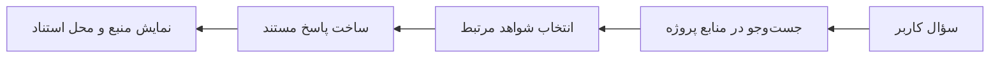
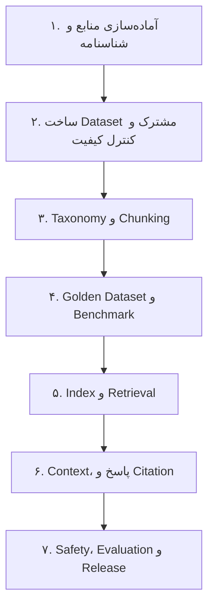
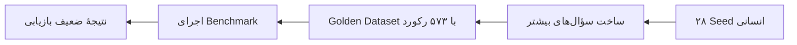
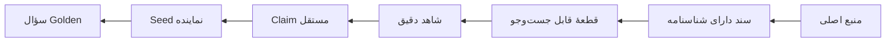
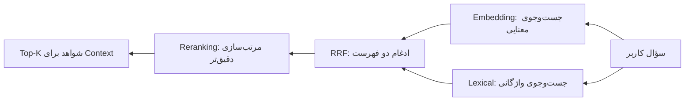
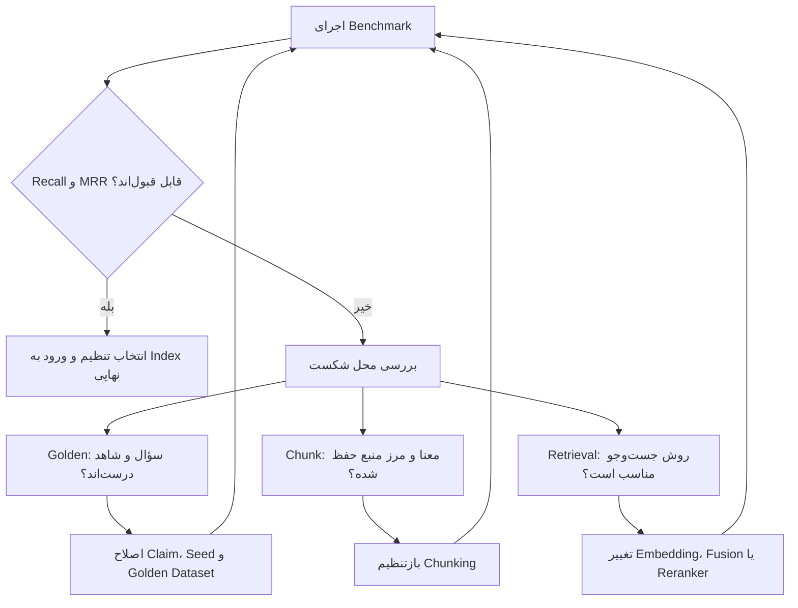

# گزارش روایی و آموزشی فاز دوم RAG Finance

## از تکمیل منابع تا ساخت معیار قابل‌اعتماد برای آزمون RAG

**نسخهٔ متنی برای تأیید محتوا پیش از ساخت Word**  
**مخاطب:** کارفرما و تصمیم‌گیر غیر فنی  
**مبنای گزارش:** نقشه‌های رسمی پروژه و Notebookهای شاخهٔ `rag-phase2`  
**وضعیت پروژه در زمان این گزارش:** مسیر ساخت Claim و Claim Registry در حال تکمیل است؛ فاز دوم هنوز به Gate نهایی نرسیده است.

---

# ۱. این گزارش قرار است چه چیزی را روشن کند؟

این گزارش فهرست کارهای برنامه‌نویسی نیست. هدف آن این است که خواننده‌ای که هیچ آشنایی قبلی با RAG ندارد، بتواند بدون توضیح شفاهی اضافه به پرسش‌های زیر پاسخ دهد:

1. محصول RAG Finance دقیقاً چیست و چه تفاوتی با پرسیدن سؤال از یک هوش مصنوعی عمومی دارد؟
2. نقشهٔ فاز دوم چه بوده است؟
3. در عمل تا کجای نقشه پیش رفته‌ایم؟
4. در هر مرحله چه مسئله‌ای را حل کرده‌ایم؟
5. کجا نتیجه مطابق انتظار نبوده و چگونه آن را کشف کرده‌ایم؟
6. چرا از Golden Dataset به Claim و Evidence برگشته‌ایم؟
7. اصطلاح‌هایی مانند Embedding، RRF، Recall@10 و MRR چه معنایی دارند؟
8. برای پایان فاز دوم چه کارهایی باقی مانده است؟

روایت اصلی این پروژه یک خط مستقیم و بدون خطا نیست. مسیر واقعی چنین بوده است:

> برنامه‌ریزی کردیم، داده را آماده کردیم، روش‌ها را آزمایش کردیم، به یک اشکال بنیادی در معیار آزمون رسیدیم و به‌جای پنهان‌کردن آن، مسیر را از لایهٔ شواهد اصلاح کردیم.

---

# ۲. RAG چیست و چرا با هوش مصنوعی عمومی فرق دارد؟

## ۲.۱. پرسیدن سؤال از هوش مصنوعی عمومی

یک مدل عمومی براساس دانشی که قبلاً در زمان آموزش یاد گرفته پاسخ می‌دهد. ممکن است پاسخ روان و قانع‌کننده باشد، اما همیشه معلوم نیست:

- پاسخ دقیقاً از کدام منبع آمده است؛
- آیا دیدگاه دکتر کمیل رودی را بازگو می‌کند یا یک دیدگاه عمومی را؛
- آیا جمله‌ای از کتاب، مقاله یا گفتار خاصی پشتیبانی می‌شود؛
- اگر پاسخ در منابع ما وجود نداشته باشد، مدل واقعاً سکوت می‌کند یا پاسخ احتمالی می‌سازد.

## ۲.۲. RAG اختصاصی این پروژه

`RAG` مخفف عبارت زیر است:

**Retrieval-Augmented Generation — تولید پاسخ با کمک بازیابی منبع**

در این روش، سیستم قبل از پاسخ‌دادن ابتدا در منابع مشخص پروژه جست‌وجو می‌کند. سپس فقط قطعات مرتبط را در اختیار مدل پاسخ‌گو می‌گذارد.

تفاوت اصلی این است که در محصول مطلوب ما، پاسخ فقط «خوب به نظر نمی‌رسد»؛ بلکه باید قابل پیگیری باشد:

> پاسخ ← Claim ← Evidence ← Chunk ← Document ← منبع اصلی

اگر شواهد کافی وجود نداشته باشد، رفتار درست سیستم این نیست که حدس بزند. باید سؤال روشن‌کننده بپرسد، محدودیت را اعلام کند یا از پاسخ قطعی خودداری کند.

## ۲.۳. یک مثال ساده

اگر کاربر بپرسد:

> «چرا ممکن است فردی با وجود درآمد داشتن همچنان احساس فقر کند؟»

هوش مصنوعی عمومی ممکن است دلایل روان‌شناختی و اقتصادی مختلفی مطرح کند. اما RAG Finance باید ابتدا بررسی کند که در منابع پذیرفته‌شدهٔ پروژه دربارهٔ این موضوع چه گفته شده است. در نمونهٔ واقعی بازبینی‌شدهٔ پروژه، پاسخ بر «رابطهٔ فرد با پول» و تلاش برای جبران چیزهایی مانند اعتمادبه‌نفس از طریق پول تکیه دارد. پاسخ باید همین مرز را حفظ کند و مطالب بیرونی را بدون منبع وارد نکند.

---

# ۳. نقشهٔ کلان فاز دوم چه بود؟

فاز اول ثابت کرده بود که یک نمونهٔ سادهٔ RAG قابل اجراست؛ اما فقط بر ۷۶ مقاله، قطعه‌بندی ساده و ارزیابی محدود تکیه داشت. هدف فاز دوم، تبدیل این نمونه به یک هستهٔ حرفه‌ای و قابل دفاع بود.

نقشهٔ مصوب فاز دوم از ۲۴ Notebook تشکیل شده بود:

این نقشه دو نوع کار را کنار هم قرار می‌دهد:

- **ساخت خود RAG:** آماده‌سازی منبع، قطعه‌بندی، جست‌وجو، ساخت Context و پاسخ مستند.
- **ساخت ابزار امتحان RAG:** Golden Dataset، معیارهای بازیابی، آزمون خطا و Regression.

این دو مسیر نباید با هم اشتباه شوند. Golden Dataset بخشی از دانش پاسخ‌گویی سیستم نیست؛ برگهٔ امتحانی است که با آن کیفیت سیستم را می‌سنجیم.

---

# ۴. وضعیت کلی: چقدر مطابق نقشه پیش رفته‌ایم؟

## ۴.۱. ارزیابی دوگانه

پیشرفت پروژه را باید از دو زاویه سنجید:

### کیفیت مراحل انجام‌شده

مراحل اجراشده تا پایان Chunking و آماده‌سازی اولیهٔ Golden Dataset، در حدود **۸۵ درصد با اصول معماری نقشه منطبق بوده‌اند**. این عدد به معنی اتمام ۸۵ درصد فاز دوم نیست؛ یعنی کارهایی که انجام شده‌اند، عمدتاً با قواعد شناسنامه، Lineage، Authority، Hash، Gate و قابلیت اجرای مجدد سازگار بوده‌اند.

### میزان تکمیل کل فاز دوم

کل نقشه تا Notebook 23 ادامه دارد. اکنون هنوز Dense Index نهایی، Sparse Index، Hybrid Retrieval رسمی، Context Builder، Generation، Claim-level Citation، Answerability، Safety، Evaluation نهایی و Release ساخته نشده‌اند. بنابراین از نظر تکمیل کل خروجی فاز دوم، پروژه تقریباً در **نیمهٔ مسیر** قرار دارد.

## ۴.۲. جدول تطبیق نقشه و اجرا

| بخش نقشه | محل اجرای واقعی | وضعیت | توضیح مدیریتی |
|---|---|---:|---|
| ثبت محیط و Baseline | NB00 | انجام‌شده | نقطهٔ شروع قابل بازتولید ثبت شد. |
| تکمیل منابع سایت | NB01 و NB02 | انجام‌شده | ۵۲۹ مقاله کشف، استخراج و کنترل شد. |
| موجودی و استخراج کتاب | NB03 و NB04 | انجام‌شده | نسخه‌های معتبر از فایل‌های مرجع جدا شدند. |
| موجودی و استخراج گفتار | NB05 و NB06 | انجام‌شده | ۱۸۳ فایل پذیرفته و ۱۶٬۲۲۶ بخش استخراج شد. |
| Schema و Lineage مشترک | NB07 | انجام‌شده | سه منبع در یک قرارداد مشترک قرار گرفتند. |
| نرمال‌سازی فارسی | NB08 | انجام‌شده | اختلاف نویسه‌ها بدون تغییر معنا اصلاح شد. |
| حذف تکرار و کنترل کیفیت | NB09 | انجام‌شده | تکرار واقعی از شاهد مستقل جدا شد. |
| Taxonomy و مهندسی دانش | NB10 | انجام‌شده و منجمد | ساختار دانش بر پایهٔ منابع اصلی شکل گرفت. |
| Benchmark قطعه‌بندی | NB11 | انجام‌شده برای ارزیابی | نامزدها منجمد شدند؛ برندهٔ تولیدی هنوز انتخاب نشده است. |
| Golden Dataset | NB12 تا NB12f | ساخته شد ولی نیازمند اصلاح | ۵۷۳ رکورد ساخته شد؛ ممیزی مشکل تنوع را آشکار کرد. |
| بازسازی کیفیت Golden | NB12g و NB12h | آزمایشی و در حال اصلاح | مسیر Claim و Evidence جایگزین گسترش صوری سؤال‌ها شد. |
| Claim Registry | NB12i پیوست‌شده | در حال انجام | مبنای جدید برای Golden، Graph و Citation ساخته می‌شود. |
| Embedding Benchmark | NB13 | تشخیصی انجام‌شده | هیچ تنظیم تولیدی تأیید نشد. |
| Index تا Release | NB14 تا NB23 | انجام‌نشده | ادامهٔ رسمی فاز دوم است. |

---

# ۵. داستان واقعی حرکت پروژه

## ۵.۱. ایستگاه اول: ثبت نقطهٔ شروع

در NB00 مشخص شد فاز دوم دقیقاً روی چه محیط، Branch، Commit، کتابخانه‌ها و منابعی آغاز شده است.

این کار شاید برای مخاطب غیر فنی ساده به نظر برسد، اما اهمیت آن شبیه ثبت مشخصات مواد اولیه و دستگاه‌ها در آغاز یک خط تولید است. اگر نتیجه در آینده تغییر کند، باید بدانیم تفاوت از داده، کد، مدل یا محیط اجرا بوده است.

**نتیجه:** مرحله مطابق نقشه و با Gate نهایی موفق اجرا شد.

## ۵.۲. ایستگاه دوم: تکمیل منابع وب‌سایت

در فاز اول فقط ۷۶ مقالهٔ مستقیم مؤلف استفاده شده بود. در فاز دوم محدودیت نویسنده برداشته شد و تمام صفحات سایت پیمایش شدند. نتیجه، کشف ۵۲۹ مقاله بود.

اما همهٔ این مقاله‌ها جایگاه یکسان ندارند:

- ۷۶ مقاله مستقیماً به مؤلف اصلی منتسب‌اند.
- ۴۵۳ مقاله توسط نویسندگان دیگر و زیر نظر سردبیری یا نظارت علمی منتشر شده‌اند.

این تفکیک بسیار مهم است. اگر کاربر بپرسد «نظر خود دکتر چیست؟»، سیستم نباید مقالهٔ نویسندهٔ دیگر را به‌عنوان نوشتهٔ مستقیم دکتر معرفی کند.

**مسئله:** داشتن محتوا با داشتن انتساب معتبر یکسان نیست.  
**راه‌حل:** نویسنده، ناظر علمی، URL، شناسهٔ مقاله و Hash مستقل نگهداری شد.  
**نتیجه:** مطابق نقشه و موفق.

## ۵.۳. ایستگاه سوم: کتاب‌ها

هفت فایل فیزیکی کتاب و نوشتار بررسی شدند، اما همه وارد Corpus اصلی نشدند. فایل مرجع، نسخهٔ قابل استخراج، نسخهٔ غیر اصلی و نسخهٔ نیازمند بررسی ترجمه از هم جدا شدند.

در این مرحله اصل زیر رعایت شد:

> فایل با اثر یکی نیست و اثر نیز با نسخهٔ انتشار یکی نیست.

سه فایل پذیرفته‌شده به ۲۶۸۹ بند اصلی و تعدادی محتوای تکمیلی تبدیل شدند که مجموعاً ۲۷۰۱ رکورد کتاب را تشکیل دادند.

**مسئله:** اگر ساختار فصل و عنوان از بین برود، بعداً نمی‌توان یک جمله را در کتاب پیدا کرد یا مفهوم آن را در متن درست فهمید.  
**راه‌حل:** مسیر عنوان‌ها، بند، اثر، نسخه و شناسهٔ پایدار حفظ شد.  
**نتیجه:** مطابق نقشه و موفق.

## ۵.۴. ایستگاه چهارم: گفتارها و برنامه‌ها

گفتار با مقاله و کتاب فرق دارد. ممکن است مجری سؤال بپرسد، مهمان مثال بزند و دکتر پاسخ دهد. حذف سؤال ممکن است پاسخ را نامفهوم کند؛ نگه‌داشتن سؤال بدون برچسب نیز ممکن است آن را به اشتباه به دکتر نسبت دهد.

در NB05 و NB06، سیزده برنامه، ۱۸۳ فایل پذیرفته‌شده و ۱۶٬۲۲۶ بخش گفتاری پردازش شد.

**مسئله:** چگونه Context گفتگو را حفظ کنیم، ولی انتساب را مخلوط نکنیم؟  
**راه‌حل:** گویندهٔ شناخته‌شده ثبت شد؛ گویندهٔ نامشخص حدس زده نشد؛ سؤال و صحبت مهمان برای Context حفظ شد.  
**نتیجه:** این بخش حتی دقیق‌تر از توضیح اولیهٔ نقشه اجرا شد.

## ۵.۵. ایستگاه پنجم: تبدیل سه زبان داده به یک زبان مشترک

وب‌سایت URL دارد، کتاب فصل و بند دارد و گفتار برنامه، قسمت و گوینده دارد. موتور RAG نمی‌تواند برای هر منبع یک قرارداد کاملاً جدا مصرف کند.

NB07 هر سه منبع را به مدل مشترک Document تبدیل کرد، ولی تفاوت‌های مهم آن‌ها را حذف نکرد.

خروجی پذیرفته‌شده:

| منبع | تعداد رکورد |
|---|---:|
| وب‌سایت | ۵۲۹ |
| کتاب | ۲۷۰۱ |
| گفتار | ۱۶٬۲۲۶ |
| **مجموع** | **۱۹٬۴۵۶** |

هر رکورد به منبع اصلی خود قابل بازگشت است. این ویژگی `Lineage` نام دارد؛ یعنی شجره‌نامه و مسیر پیدایش داده.

## ۵.۶. ایستگاه ششم: یکدست‌سازی فارسی

در متن فارسی ممکن است «ی» و «ک» با شکل عربی یا فارسی ذخیره شوند. برای انسان تفاوت ظاهری کمی دارند، اما برای جست‌وجوی رایانه‌ای می‌توانند دو نویسهٔ متفاوت باشند.

NB08 متن را بدون بازنویسی محتوا یکدست کرد. از ۱۹٬۴۵۶ رکورد، ۲۶۳ سند تغییر کنترل‌شده داشتند.

**مثال ساده:** اگر یک متن «سرمايه‌گذاری» و سؤال کاربر «سرمایه‌گذاری» داشته باشد، اختلاف نویسه نباید مانع یافتن متن شود.

## ۵.۷. ایستگاه هفتم: تکرار همیشه بی‌ارزش نیست

ممکن است یک توصیه در کتاب، مقاله و سخنرانی تکرار شده باشد. حذف همهٔ نسخه‌های مشابه اشتباه است؛ چون هرکدام می‌توانند شاهد مستقلی با Authority و Context متفاوت باشند.

NB09 میان این موارد تفاوت گذاشت:

- نسخهٔ دقیقاً تکراری؛
- نسخهٔ نزدیک و ویرایش‌شده؛
- بازگویی آموزشی؛
- شاهد مستقل از منبع دیگر.

**تصمیم درست:** شباهت متنی به‌تنهایی مجوز حذف یا یکی‌کردن منابع نشد.

## ۵.۸. ایستگاه هشتم: ساخت Taxonomy

داشتن ۱۹ هزار متن هنوز به معنی داشتن یک نقشهٔ دانش نیست. سیستم باید بداند متن‌ها دربارهٔ چه موضوعی هستند و چه ارتباط آموزشی با یکدیگر دارند.

NB10 Taxonomy، هفت گرهٔ برنامهٔ آموزشی، ۲۴ توانمندی و شش مرحلهٔ یادگیری را ایجاد و منجمد کرد.

اصل مهم این بود که ساختار اصلی دانش از منابع مستقیم و معتبر مؤلف شکل بگیرد. گفتهٔ مهمان یا مقالهٔ صرفاً تحت نظارت نباید به‌تنهایی ساختار اصلی دانش را تغییر دهد.

**نتیجه:** این مرحله با نقشه هم‌راستا و موفق بود.

## ۵.۹. ایستگاه نهم: Chunking؛ تقسیم متن برای جست‌وجو

مدل نمی‌تواند در زمان هر سؤال تمام ۱۹٬۴۵۶ رکورد را یکجا بخواند. بنابراین متن‌ها به قطعاتی به نام `Chunk` تقسیم می‌شوند.

قطعهٔ خیلی کوچک ممکن است دلیل و نتیجه را از هم جدا کند. قطعهٔ خیلی بزرگ نیز اطلاعات نامرتبط را وارد پاسخ می‌کند.

NB11 چند روش را مقایسه کرد:

- روش قدیمی مبتنی بر تعداد کاراکتر؛
- قطعه‌بندی ساختارمحور کوچک؛
- قطعه‌بندی ساختارمحور متوسط؛
- معماری Parent–Child.

روش قدیمی در حدود ۸۹٫۶۵ درصد موارد مرز ساختاری را قطع می‌کرد. روش `Structure-aware Small` نامزد سادهٔ پیشرو شد؛ اما انتخاب نهایی عمداً تا آزمون بازیابی عقب افتاد.

**این تصمیم مطابق نقشه بود:** روش پیچیده نباید فقط براساس ظاهر یا سلیقه انتخاب شود؛ باید با سؤال‌های واقعی آزمایش شود.

---

# ۶. Golden Dataset؛ برگهٔ امتحان RAG

## ۶.۱. Golden Dataset چیست؟

Golden Dataset مجموعه‌ای از سؤال‌های استاندارد است که برای هر سؤال، موارد زیر از قبل مشخص شده‌اند:

- سؤال چیست؟
- پاسخ‌پذیر است یا نه؟
- شاهد درست کدام است؟
- پاسخ مورد انتظار چیست؟
- منبع و محل استناد کجاست؟

این مجموعه دانش جدیدی به RAG اضافه نمی‌کند. فقط وسیلهٔ اندازه‌گیری است.

## ۶.۲. Seed چیست؟

`Seed` یعنی نمونهٔ اولیه و کنترل‌شده‌ای که برای طراحی و آزمودن روش ساخت Golden Dataset استفاده می‌شود.

۲۸ Seed پروژه، ۲۸ موضوع کامل دانش مالی نبودند. آن‌ها نمونه‌های انسانی بودند تا قرارداد سؤال، Evidence، پاسخ، Citation و بازبینی را تثبیت کنند.

## ۶.۳. مسیر اولیه

از نظر تعداد، هدف پیشنهادی نقشه که حداقل ۳۰۰ سؤال بود تأمین شد. اما تعداد رکورد با پوشش واقعی دانش یکسان نیست.

## ۶.۴. مشکل چه بود؟

ممیزی NB12g و NB12h نشان داد بسیاری از ۵۷۳ سؤال، بیان‌های مختلف تعداد محدودی مفهوم بودند.

مثال ساده:

فرض کنیم فقط یک مفهوم داریم: «هدف داشتن برای پس‌انداز مهم است.» اگر بیست سؤال مانند نمونه‌های زیر بسازیم، بیست دانش مستقل تولید نشده است:

- چرا هدف برای پس‌انداز مهم است؟
- فرد آگاه مالی دربارهٔ هدف پس‌انداز چه می‌داند؟
- در تصمیم پس‌انداز، هدف چه نقشی دارد؟
- برای پس‌انداز بهتر چه تصمیمی دربارهٔ هدف باید گرفت؟

این سؤال‌ها از نظر جمله متفاوت‌اند، اما تقریباً یک Claim را می‌سنجند.

برخی سؤال‌های تولیدشده حتی کلمه‌ای نامناسب از متن را به‌عنوان موضوع انتخاب کرده بودند؛ مانند سؤال‌هایی دربارهٔ «می‌کند»، «بخواهیم» یا «بدهیم». این شکل از توسعه، تعداد را زیاد می‌کرد ولی کیفیت امتحان را بالا نمی‌برد.

## ۶.۵. چرا این کشف ارزشمند است؟

اگر مشکل پنهان می‌ماند، ممکن بود برای بهبود عدد Benchmark دائماً مدل Embedding، RRF یا Reranker را تغییر دهیم؛ درحالی‌که بخشی از مشکل از خود برگهٔ امتحان بود.

بنابراین شکست اولیه نشان داد:

> پیش از انتخاب موتور جست‌وجو، باید مطمئن شویم سؤال، پاسخ و شاهدِ آزمون واقعاً به هم مربوط‌اند و تنوع دانش را نمایندگی می‌کنند.

---

# ۷. اصلاح مسیر: از Evidence و Claim دوباره شروع کردیم

## ۷.۱. تفاوت اصطلاح‌ها

| اصطلاح | معنی ساده | نقش در پروژه |
|---|---|---|
| Source | منبع اصلی | مقاله، کتاب یا گفتار |
| Document | واحد ثبت‌شده از منبع | مقاله، بند کتاب یا بخش گفتار با شناسنامه |
| Chunk | قطعهٔ قابل جست‌وجو | بخشی از متن که همراه Context و محل استناد نگهداری می‌شود |
| Evidence | شاهد متنی | عبارتی از منبع که یک ادعا را پشتیبانی می‌کند |
| Claim | ادعای مستقل | یک گزارهٔ مشخص که می‌تواند درست، نادرست یا نیازمند شاهد باشد |
| Seed | نمونهٔ کنترل‌شده | موردی برای طراحی یا بازبینی روش ساخت آزمون |
| Golden Question | سؤال آزمون | سؤالی با شاهد و پاسخ مشخص برای سنجش سیستم |

## ۷.۲. رابطهٔ درست

## ۷.۳. مثال واقعی: الگوی مدیریت پول در سن مناسب

در یکی از نمونه‌های واقعی، شاهد می‌گوید:

> «الگوی ۴۰ درصد خرج، ۳۰ درصد پس‌انداز، ۲۰ درصد سرمایه‌گذاری و ۱۰ درصد هدیه به دیگران در سن مناسب است.»

از این متن می‌توان Claim مشخص زیر را استخراج کرد:

> در سن مناسب، الگوی پیشنهادی مدیریت پول شامل چهار سهم ۴۰، ۳۰، ۲۰ و ۱۰ درصدی است.

سپس سؤال Golden می‌تواند چنین باشد:

> «در الگوی مطرح‌شده، پول در سن مناسب میان چه بخش‌هایی تقسیم می‌شود؟»

در اینجا سؤال، Claim و Evidence دقیقاً به یکدیگر متصل‌اند.

## ۷.۴. مثال واقعی: آموزش مالی کودک

شاهد دیگری در پروژه می‌گوید کودک پنج تا هفت‌ساله در آغاز، پول دریافت‌شده را فقط نگهداری و پس‌انداز می‌کند و بعد به‌تدریج خرج‌کردن را یاد می‌گیرد.

Claim:

> نخستین رفتار مالی مورد انتظار در این دوره، نگهداری و پس‌انداز پول است.

سؤال:

> «کودک پنج تا هفت‌ساله در آغاز با اولین پول دریافتی چه می‌کند؟»

این نمونه با موضوع بیمه متفاوت است و نشان می‌دهد Golden Dataset باید از Claimهای متنوع در سراسر Corpus ساخته شود.

## ۷.۵. مثال واقعی: شناخت ناقص از یک موضوع

در مقالهٔ «فیل سواد مالی»، متن توضیح می‌دهد که شناخت یک بخش از فیل، تصویر کاملی از کل آن نمی‌دهد.

سؤال اولیه بیش از حد به ظاهر مثال فیل وابسته بود. در بازبینی انسانی به این صورت اصلاح شد:

> «چه مشکلی پیش می‌آید اگر براساس شناختی که فقط از یک بخش داریم، دربارهٔ کل موضوع تصمیم بگیریم؟»

این نمونه نشان می‌دهد بازبینی انسانی فقط غلط املایی را اصلاح نمی‌کند؛ باید سؤال را به مفهوم واقعی شاهد نزدیک کند.

## ۷.۶. نقش Claim Registry

Claim Registry فهرست نسخه‌دار ادعاهای استخراج‌شده و شواهد آن‌هاست. این Registry می‌تواند برای چند هدف استفاده شود:

- انتخاب Seedهای متنوع برای Golden Dataset؛
- جلوگیری از ساخت ده‌ها سؤال برای یک Claim تکراری؛
- اتصال پاسخ آینده به شاهد دقیق؛
- تشخیص Claimهای مشابه، مکمل یا متعارض؛
- کمک به Knowledge Graph؛
- استفاده در ساختار علمی کتاب.

بنابراین افزودن Claim Registry تغییر بی‌دلیل نقشه نیست؛ یک اصلاح معماری برای رسیدن به همان هدف اصلی یعنی پاسخ مستند و آزمون معتبر است.

---

# ۸. هفت اصطلاح اصلی بازیابی، با معنی و مثال

# ۸.۱. Embedding

**نام کامل:** Embedding  
**معادل ساده:** تبدیل معنای متن به یک نمایش عددی  
**محل استفاده:** جست‌وجوی معنایی

Embedding سؤال و قطعه‌های منبع را به بردارهای عددی تبدیل می‌کند. اگر دو متن از نظر معنا نزدیک باشند، بردارهای آن‌ها نیز باید نزدیک شوند؛ حتی اگر واژه‌های کاملاً یکسان نداشته باشند.

### مثال

سؤال کاربر:

> «چرا با اینکه درآمد دارم هنوز حس می‌کنم فقیرم؟»

متن منبع ممکن است دربارهٔ «رابطهٔ فرد با پول» و «جبران کمبودهای درونی با پول» صحبت کند. عبارت‌های سؤال و منبع یکسان نیستند، اما Embedding باید ارتباط معنایی آن‌ها را تشخیص دهد.

### محدودیت

Embedding ممکن است دو متن با موضوع کلی مشابه ولی پاسخ متفاوت را نزدیک بداند. بنابراین شباهت معنایی به‌تنهایی اثبات نمی‌کند که یک قطعه شاهد درست سؤال است.

---

# ۸.۲. Lexical Search

**نام کامل:** Lexical Search  
**معادل فارسی:** جست‌وجوی واژگانی  
**نمونهٔ الگوریتم:** `TF-IDF`  
**محل استفاده:** یافتن واژه، عدد، نام و عبارت دقیق

جست‌وجوی واژگانی بررسی می‌کند چه واژه‌هایی در سؤال و متن مشترک‌اند و کدام واژه‌ها ارزش تشخیصی بیشتری دارند.

`TF-IDF` مخفف عبارت زیر است:

**Term Frequency–Inverse Document Frequency — فراوانی واژه با تعدیل براساس کمیابی آن در کل اسناد**

واژه‌ای مانند «است» در هزاران متن دیده می‌شود و کمک زیادی به تشخیص موضوع نمی‌کند. اما عبارتی مانند «۴۰ درصد خرج» یا «اتحادیهٔ اروپا» کمیاب‌تر و تشخیصی‌تر است.

### مثال واقعی

اگر سؤال این باشد:

> «در الگوی مدیریت مالی، چند درصد به سرمایه‌گذاری اختصاص دارد؟»

وجود واژهٔ «سرمایه‌گذاری» و عددهای دقیق، جست‌وجوی واژگانی را بسیار مفید می‌کند.

### محدودیت

اگر سؤال و منبع از واژه‌های متفاوت برای یک مفهوم استفاده کنند، جست‌وجوی واژگانی ممکن است شاهد درست را پیدا نکند.

---

# ۸.۳. RRF

**نام کامل:** Reciprocal Rank Fusion  
**معادل فارسی:** ادغام رتبه‌ها براساس رتبهٔ معکوس  
**محل استفاده:** ترکیب نتایج جست‌وجوی معنایی و واژگانی

Embedding و جست‌وجوی واژگانی دو فهرست جدا می‌سازند. RRF بدون نیاز به یکسان‌کردن امتیازهای متفاوت این دو روش، رتبهٔ هر قطعه را در فهرست‌ها بررسی می‌کند و یک رتبهٔ ترکیبی می‌سازد.

فرمول ساده:

`امتیاز RRF = مجموع ۱ تقسیم بر یک عدد ثابت به‌علاوهٔ رتبه در هر فهرست`

### مثال عددی ساده

فرض کنیم سه قطعه داریم:

| قطعه | رتبه در Embedding | رتبه در جست‌وجوی واژگانی |
|---|---:|---:|
| قطعهٔ الف | ۱ | ۸ |
| قطعهٔ ب | ۳ | ۲ |
| قطعهٔ ج | ۹ | ۱ |

قطعهٔ «ب» در هر دو روش جایگاه خوبی دارد. RRF ممکن است آن را بالاتر از قطعه‌ای قرار دهد که فقط در یک روش رتبهٔ اول و در روش دیگر رتبهٔ بسیار پایین دارد.

### کاربرد در پروژه

این روش برای ترکیب Dense Retrieval و Lexical Retrieval در NB13 به‌صورت تشخیصی استفاده شد.

### محدودیت

RRF نتیجهٔ جدیدی خارج از فهرست‌های ورودی اختراع نمی‌کند. اگر هیچ‌کدام از جست‌وجوها شاهد درست را پیدا نکرده باشند، RRF نیز چیزی برای بازیابی ندارد.

---

# ۸.۴. Reranking

**نام کامل:** Reranking  
**معادل فارسی:** مرتب‌سازی دوبارهٔ نتایج  
**محل استفاده:** پس از بازیابی اولیه

Retriever باید سریع باشد؛ بنابراین ممکن است در بررسی اولیه دقت کامل نداشته باشد. Reranker تعداد محدودی از نتایج اولیه را با دقت بیشتری با سؤال مقایسه و دوباره مرتب می‌کند.

### مثال

برای سؤال مربوط به آموزش مالی کودک، جست‌وجوی اولیه ده قطعه پیدا می‌کند. چند قطعه فقط واژهٔ «کودک» یا «پس‌انداز» را دارند، ولی یک قطعه دقیقاً توضیح می‌دهد کودک پنج تا هفت‌ساله در آغاز چه کاری با پول انجام می‌دهد. Reranker باید آن قطعهٔ دقیق‌تر را بالاتر بیاورد.

### نتیجهٔ واقعی پروژه

در ۳۸ سؤال واجد شرایط، میانگین رتبهٔ نخستین شاهد درست از حدود ۴٫۳۴ به ۳٫۳۹ بهتر شد:

- ۱۹ سؤال بهتر شدند؛
- ۱۱ سؤال تغییری نکردند؛
- ۸ سؤال ضعیف‌تر شدند.

### محدودیت کلیدی

Reranking فقط نتایج موجود را جابه‌جا می‌کند. اگر شاهد درست در Top-10 نباشد، Reranker نمی‌تواند آن را از بیرون وارد کند.

---

# ۸.۵. Recall@10

**نام کامل:** Recall at 10  
**معادل فارسی:** نرخ یافتن شاهد درست در ده نتیجهٔ نخست  
**نوع:** معیار ارزیابی، نه الگوریتم

اگر ۱۰۰ سؤال داشته باشیم و برای ۸۰ سؤال، حداقل یک شاهد درست در ده نتیجهٔ اول پیدا شود، `Recall@10` برابر ۸۰ درصد است.

### مثال کوچک

برای پنج سؤال، فرض کنیم شاهد درست در این رتبه‌ها دیده شود:

| سؤال | رتبهٔ شاهد درست | موفق در Recall@10؟ |
|---|---:|---:|
| ۱ | ۲ | بله |
| ۲ | ۷ | بله |
| ۳ | ۱۴ | خیر |
| ۴ | پیدا نشد | خیر |
| ۵ | ۱ | بله |

سه سؤال از پنج سؤال موفق‌اند؛ پس Recall@10 برابر ۶۰ درصد است.

### نتیجهٔ فعلی پروژه

در NB13 و با Golden Dataset فعال ۵۷۳تایی، Recall@10 حدود **۶٫۸۷ درصد** بود. این نتیجه برای تأیید تولید کافی نبود.

اما این عدد فقط نمی‌گوید مدل بد است. ممکن است علت شکست یکی از این موارد باشد:

- سؤال و شاهد Golden به‌درستی مرتبط نیستند؛
- Claimهای آزمون تنوع کافی ندارند؛
- Chunk مناسب نیست؛
- Embedding معنای سؤال را خوب نگرفته است؛
- جست‌وجوی واژگانی سیگنال کافی ندارد.

---

# ۸.۶. MRR

**نام کامل:** Mean Reciprocal Rank  
**معادل فارسی:** میانگین معکوس رتبهٔ نخستین شاهد درست  
**نوع:** معیار ارزیابی ترتیب نتایج

Recall@10 فقط می‌پرسد آیا شاهد در ده نتیجه وجود دارد یا نه. MRR می‌پرسد نخستین شاهد درست چقدر بالا آمده است.

- رتبهٔ ۱: امتیاز ۱
- رتبهٔ ۲: امتیاز یک‌دوم
- رتبهٔ ۴: امتیاز یک‌چهارم
- رتبهٔ ۱۰: امتیاز یک‌دهم

سپس میانگین امتیاز همهٔ سؤال‌ها محاسبه می‌شود.

### مثال

اگر شاهد سه سؤال در رتبه‌های ۱، ۲ و ۵ باشد:

`MRR = (1 + 1/2 + 1/5) ÷ 3 ≈ 0.57`

### نتیجهٔ پروژه

در Benchmark فعلی، MRR از حدود ۰٫۰۳۴۲ به ۰٫۰۴۲۶ پس از Reranking رسید. یعنی ترتیب بعضی نتایج بهتر شد، اما مشکل اصلی یافتن شاهد همچنان باقی ماند.

---

# ۸.۷. Query Rewrite

**نام کامل:** Query Rewrite  
**معادل فارسی:** بازنویسی سؤال برای بهترشدن جست‌وجو  
**محل استفاده:** پیش از Retrieval یا در کنار سؤال اصلی

گاهی کاربر با زبان روزمره سؤال می‌پرسد ولی منبع با زبان رسمی نوشته شده است. Query Rewrite تلاش می‌کند سؤال را بدون تغییر مقصود، به عبارتی نزدیک‌تر به زبان منبع تبدیل کند.

### مثال

سؤال اصلی:

> «چطور پول توجیبی بچه را مدیریت کنیم؟»

بازنویسی احتمالی:

> «الگوی تقسیم پول دریافتی کودک میان خرج، پس‌انداز و سرمایه‌گذاری چیست؟»

### نتیجهٔ واقعی پروژه

در پایلوت NB13، Query Rewrite باعث بهبود Recall@10 نشد و برای اجرای کامل پذیرفته نشد.

### چرا ممکن است شکست بخورد؟

- بازنویسی ممکن است مقصود سؤال را تغییر دهد؛
- واژه‌های جدیدی وارد کند که در شاهد اصلی وجود ندارند؛
- مشکل واقعی مربوط به Golden Dataset یا Chunk باشد، نه عبارت سؤال؛
- سؤال بازنویسی‌شده از زبان طبیعی کاربر دور شود.

---

# ۹. این ابزارها چگونه کنار هم کار می‌کنند؟

`Recall@10` و `MRR` روی این مسیر قرار نمی‌گیرند؛ آن‌ها ابزار اندازه‌گیری نتیجه‌اند:

- Recall@10 می‌گوید شاهد درست پیدا شده یا نه.
- MRR می‌گوید شاهد درست چقدر بالا قرار گرفته است.

Query Rewrite نیز یک مسیر کمکی پیش از جست‌وجو است، نه بخش اجباری هر RAG. فقط وقتی استفاده می‌شود که Benchmark نشان دهد مفید است.

---

# ۱۰. Benchmark چه چیزی را به ما آموخت؟

## ۱۰.۱. نتیجهٔ عددی

Golden Dataset فعال: ۵۷۳ رکورد  
Recall@10: حدود ۶٫۸۷ درصد  
MRR اولیه: حدود ۰٫۰۳۴۲  
MRR پس از Reranking: حدود ۰٫۰۴۲۶  
وضعیت تصمیم: **عدم تأیید تنظیم تولیدی**

## ۱۰.۲. تفسیر مدیریتی

این نتیجه به معنی شکست کل زیرساخت نیست. آزمون به ما نشان داد میان سؤال‌ها و شواهد Golden ناسازگاری مهمی وجود دارد. آزمایش با خود Evidence عملکرد قوی‌تری داشت، اما با سؤال‌های تولیدشده ضعیف بود. این تفاوت علامت مهمی بود که مشکل فقط در موتور Embedding نیست.

## ۱۰.۳. چرا افزایش پیچیدگی متوقف شد؟

طبق نقشه، Hybrid و Reranker فقط در صورت اثبات بهبود باید انتخاب شوند. وقتی معیار آزمون مشکل دارد، افزودن مدل‌های پیچیده‌تر می‌تواند فقط هزینه و ابهام را بیشتر کند.

تصمیم درست این بود:

> ابتدا Golden Dataset و اتصال Claim–Evidence اصلاح شود؛ سپس همان Benchmark دوباره اجرا شود.

---

# ۱۱. مسیر شکست، تشخیص علت و اصلاح

در وضعیت فعلی، شواهد بیشتر به شاخهٔ Golden Dataset اشاره کردند. بنابراین پروژه مستقیماً Embedding را مقصر اعلام نکرد و ابتدا معیار آزمون را اصلاح می‌کند.

---

# ۱۲. وضعیت فعلی Claim Registry

بر اساس Notebook پیوست‌شدهٔ 12i، پایلوت Claim Extraction چنین وضعیتی دارد:

- ۵۷ Claim خام استخراج‌شده؛
- ۳۷ Claim اعتبارسنجی‌شده؛
- ۱۲ مورد رد معنایی؛
- ۵ مورد متوقف‌شده به‌دلیل ریسک مهم؛
- ۳ مورد نیازمند ترمیم.

توزیع ۳۷ Claim اعتبارسنجی‌شده:

| منبع | تعداد Claim معتبر |
|---|---:|
| وب‌سایت | ۱۷ |
| کتاب | ۱۴ |
| گفتار | ۶ |

این اعداد نتیجهٔ پایلوت‌اند، نه تعداد نهایی Claimهای کل پروژه. استخراج گسترده روی ۲۲۸۷ پنجرهٔ ورودی آغاز شده، اما تا زمان تکمیل و اعتبارسنجی نباید تعداد نهایی Claimها اعلام شود.

## نمونهٔ یک توقف درست

عبارت زیر به‌تنهایی ناقص است:

> «برای موفقیت در کاهش هزینه‌ها دو ابزار مهم وجود دارد.»

تا وقتی آن دو ابزار در Evidence همراه مشخص نباشند، این جمله Claim کامل و قابل استفاده برای Golden Dataset نیست. قرار دادن آن در وضعیت Hold نشانهٔ خرابی Pipeline نیست؛ نشانهٔ کنترل کیفیت است.

---

# ۱۳. کجا مطابق نقشه بودیم و کجا نبودیم؟

## ۱۳.۱. نقاط قوت

- سه منبع اصلی تکمیل و شناسنامه‌دار شدند.
- Lineage و Hash در مراحل اصلی حفظ شد.
- نقش نویسنده، سردبیر، گوینده و Context با هم مخلوط نشد.
- Taxonomy از Core Primary Knowledge ساخته شد.
- Chunking براساس ساختار هر منبع طراحی شد.
- هیچ روش Embedding یا Reranking فقط به دلیل مشهوربودن انتخاب نشد.
- نتیجهٔ ضعیف Benchmark پنهان نشد.
- Golden Dataset v1 بازنویسی یا حذف نشد و سابقهٔ آن حفظ شد.

## ۱۳.۲. انحراف‌ها و ضعف‌ها

### Common Schema دیرتر از ترتیب اولیه ساخته شد

در نقشهٔ عملیاتی، قرارداد داده باید پیش از سه Pipeline تثبیت می‌شد. در اجرای واقعی، Manifestها و شناسه‌های محلی وجود داشتند، اما Common Schema نهایی در NB07 ساخته شد. این انحراف کنترل شده است، ولی در نسخهٔ محصولی بهتر است قرارداد مشترک زودتر تثبیت شود.

### Golden Dataset به هدف عددی رسید، نه هدف معنایی

۵۷۳ رکورد ساخته شد، اما پوشش Claim مستقل و تنوع سؤال کمتر از چیزی بود که تعداد ظاهری نشان می‌داد.

### بعضی آزمایش‌های آینده زودتر وارد NB13 شدند

RRF، جست‌وجوی واژگانی، Reranking و Query Rewrite به‌صورت تشخیصی در NB13 آزمایش شدند؛ درحالی‌که نقشه برای Dense، Sparse، Hybrid و Reranking Notebookهای مستقل ۱۴ تا ۱۷ را در نظر گرفته بود. این آزمایش‌ها مفیدند، اما به معنی تکمیل رسمی آن مراحل نیستند.

### حقوق انتشار هنوز بسته نشده است

Dataset برای پردازش داخلی پذیرفته شده، ولی Formal Release همچنان به Evidence حقوقی نیاز دارد. پذیرفته‌شدن کیفیت داده با مجازبودن انتشار عمومی یکسان نیست.

---

# ۱۴. برای پایان فاز دوم چه باقی مانده است؟

```mermaid
flowchart RL
    A["تکمیل Claim Registry"] --> B["انتخاب Seedهای متنوع"]
    B --> C["ساخت Golden Dataset جدید"]
    C --> D["اجرای مجدد NB13"]
    D --> E["Dense و Sparse Index"]
    E --> F["Hybrid و Reranking رسمی"]
    F --> G["Context Builder"]
    G --> H["Generation و Claim-level Citation"]
    H --> I["Answerability، Safety و Evaluation"]
    I --> J["Release و تحویل فاز سوم"]
```

جزئیات مراحل باقی‌مانده:

1. تکمیل استخراج Claim از منابع و اعتبارسنجی Registry؛
2. تعریف روابط Claimهای مشابه، مکمل و متعارض؛
3. انتخاب Seedهای نماینده از سراسر Corpus؛
4. ساخت Golden Dataset جدید بدون جایگزینی خاموش نسخهٔ قبلی؛
5. اجرای مجدد Benchmark و مقایسهٔ شفاف نسخه‌ها؛
6. انتخاب Chunking و Embedding با Evidence؛
7. ساخت Dense و Sparse Index نسخه‌دار؛
8. آزمون Hybrid Retrieval، RRF و Reranking؛
9. ساخت Context با کنترل تکرار، تنوع و بودجهٔ توکن؛
10. تولید پاسخ، شکستن پاسخ به Claim و اتصال هر Claim به Citation؛
11. تشخیص سؤال بی‌پاسخ، مبهم یا پرریسک؛
12. ارزیابی نهایی، Release قابل بازتولید و قرارداد تحویل فاز سوم.

---

# ۱۵. اگر آزمون بعدی موفق شود چه اتفاقی می‌افتد؟

موفقیت فقط به معنی افزایش یک عدد نیست. برای عبور از Gate، باید مجموعه‌ای از شواهد هم‌زمان وجود داشته باشد:

- Recall و MRR نسبت به Baseline بهبود قابل دفاع داشته باشند؛
- سؤال‌ها تنوع Claim واقعی داشته باشند؛
- شاهد درست به منبع اصلی قابل بازگشت باشد؛
- انتساب نویسنده و گوینده صحیح بماند؛
- روش پیچیده‌تر واقعاً بهتر از روش ساده‌تر باشد؛
- هزینه و زمان پاسخ قابل قبول باشند؛
- نتیجه با اجرای مجدد قابل تکرار باشد.

در صورت موفقیت، تنظیم منتخب وارد مراحل Index، Context و Generation می‌شود. در صورت شکست، براساس نوع خطا به همان لایه‌ای برمی‌گردیم که علت را ایجاد کرده است؛ نه اینکه کل پروژه را از ابتدا بسازیم.

---

# ۱۶. جمع‌بندی مدیریتی

فاز دوم RAG Finance از یک نمونهٔ محدود مبتنی بر ۷۶ مقاله آغاز شد و به یک Corpus سه‌منبعی با ۱۹٬۴۵۶ رکورد قابل‌ردیابی رسید. منابع وب، کتاب و گفتار فقط جمع‌آوری نشدند؛ هویت، نسخه، نویسنده، گوینده، نقش علمی، ساختار و محل استناد آن‌ها حفظ شد.

Taxonomy و Chunking عمدتاً مطابق نقشه و با کنترل‌های قابل دفاع پیش رفتند. مشکل اصلی زمانی آشکار شد که Golden Dataset ساخته‌شده برای Benchmark استفاده شد. اگرچه مجموعه ۵۷۳ رکورد داشت، ممیزی نشان داد بسیاری از رکوردها بازنویسی تعداد محدودی Claim هستند و برگهٔ امتحان هنوز نمایندهٔ مناسبی از دانش کل منابع نیست.

پروژه به‌جای انتخاب عجولانهٔ مدل یا پنهان‌کردن عدد ضعیف، علت را بررسی کرد. نتیجه این بود که باید ارتباط زیر از ابتدا و در مقیاس وسیع‌تر بازسازی شود:

> Claim معتبر ← Evidence دقیق ← منبع دارای Lineage

اکنون Claim Registry برای همین هدف ساخته می‌شود. این Registry مبنای Golden Dataset جدید، Knowledge Graph، Citation در سطح Claim و بخشی از ساختار علمی کتاب خواهد بود.

بنابراین وضعیت پروژه را می‌توان چنین خلاصه کرد:

- **زیرساخت منابع و مهندسی دانش:** قوی و عمدتاً مطابق نقشه؛
- **Chunking:** آمادهٔ ارزیابی نهایی، نه انتخاب تولیدی؛
- **Golden Dataset v1:** تجربهٔ مهم و حفظ‌شده، اما معیار نهایی نیست؛
- **Benchmark فعلی:** تشخیصی و بدون تأیید تولید؛
- **مرحلهٔ جاری:** ساخت Claim Registry و اصلاح مبنای Golden Dataset؛
- **فاز دوم:** هنوز تمام نشده و پس از Benchmark معتبر، Citation، Safety و Release بسته خواهد شد.

---

# پیوست: پیشنهاد تبدیل همین متن به Word

در نسخهٔ Word، این Markdown بدون تغییر معنایی به حدود ۲۰ صفحه تبدیل می‌شود. چینش پیشنهادی:

1. جلد و هدف گزارش؛
2. تفاوت AI عمومی و RAG؛
3. نقشهٔ کلان فاز دوم؛
4. میزان پیشرفت نسبت به نقشه؛
5. منابع سایت؛
6. کتاب و گفتار؛
7. Schema، فارسی‌سازی و Dedup؛
8. Taxonomy؛
9. Chunking؛
10. Golden Dataset و ۲۸ Seed؛
11. مشکل ۵۷۳ سؤال؛
12. Claim، Evidence و Seed؛
13. Claim Registry و وضعیت فعلی؛
14. Embedding و جست‌وجوی واژگانی؛
15. RRF و Reranking؛
16. Recall@10 و MRR؛
17. Query Rewrite؛
18. Benchmark و تحلیل شکست؛
19. مسیر باقی‌مانده؛
20. جمع‌بندی مدیریتی.

