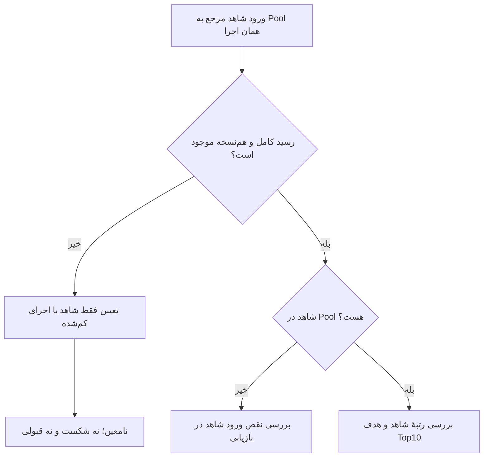

<h1>وضعیت بازیابی، معنی امتیازها و مسیر ادامهٔ فاز دوم</h1>

پروژهٔ RAG_finance — شاخهٔ <bdi dir="ltr"><code>rag-phase2</code></bdi> تاریخ تهیه: ۵ نوامبر ۲۰۲۶ / ۱۴ آبان ۱۴۰۵ نقطهٔ جاری این توضیح: خروجی C253 که مالک پروژه در همین چت گزارش کرده است.

<h2>۱. ابتدا تصویر کلی: بهترین امتیازهای ثبت‌شده و علت رسیدن به مسیر فعلی</h2>

<strong>حد پذیرش ثبت‌شده هنوز پوشش بازیابی حداقل ۸۵٪ و کیفیت ترتیب حداقل ۰٫۷۵ است.</strong> بهبود نسبت به خط پایه، پایان گزارش یا سلامت اجرای کد، جای رسیدن به این حدها را نمی‌گیرد.

در پروژه یک «مدل واحد با یک امتیاز ثابت» نداریم: بازیابی Dense، Sparse، ترکیب Hybrid و رتبه‌بندی مجدد، اجزای متفاوت‌اند. BGE نیز در آزمایش‌های مشخص به‌عنوان رتبه‌بند بررسی شده است؛ DeepSeek در بسته‌های اخیر پاسخ‌سازی یا داوری داشته و امتیازهای بازیابی مستقیماً امتیاز کیفیت پاسخ آن نیستند.

<strong>روش‌های زیر فقط در جدول جمعیت مربوط به خود، از پوشش بیشتر به کمتر مرتب شده‌اند.</strong> جدول‌های Development، Test و نمونه‌های کوچک، جدول رتبه‌بندی مشترک نیستند. این فهرست، خلاصهٔ نتایج مشخصِ قابل‌ردیابی در منابع همین چت است؛ فهرست جامع تمام تنظیمات آزمایش‌شدهٔ مخزن نیست.

<h3>۱٫۱. نتایج تاریخی روی کل Development — ۲۶۶۴ سؤال</h3>

<table dir="rtl">
<thead><tr><th align="right">ترتیب بر اساس Recall</th><th align="right">روش / شاهد</th><th align="right">Recall@10</th><th align="right">nDCG@10</th><th align="right">حدود نتیجه</th></tr></thead>
<tbody>
<tr><td align="right">۱</td><td align="right">رتبه‌بندی مجددِ فریز‌شده؛ NB17، سل ۱۷</td><td align="right">۶۶٫۷۷٪</td><td align="right">۰٫۵۹۸۸</td><td align="right">بهترینِ ردیف‌های این جدول؛ زیر هر دو حد پذیرش</td></tr>
<tr><td align="right">۲</td><td align="right">Hybrid با ترکیب وزنی؛ NB16، سل‌های ۱۲ و ۱۸</td><td align="right">۶۲٫۱۲٪</td><td align="right">۰٫۵۳۸۲</td><td align="right">خط پایهٔ تاریخی برای مرحلهٔ رتبه‌بندی مجدد</td></tr>
<tr><td align="right">۳</td><td align="right">آزمایش ترکیب RRF؛ NB16، سل ۱۱</td><td align="right">۶۱٫۹۶٪</td><td align="right">۰٫۵۱۴۱</td><td align="right">نتیجهٔ ثبت‌شدهٔ این آزمایش؛ جزئیات انتخاب از Producer مصرف شود</td></tr>
<tr><td align="right">۴</td><td align="right">بازیابی Dense؛ NB16، سل ۱۰ و اتصال Cache در NB21</td><td align="right">۴۷٫۳۵٪</td><td align="right">۰٫۳۷۴۰</td><td align="right">بازیابی برداری به‌تنهایی؛ نه پاسخ‌سازی</td></tr>
</tbody></table>

اعداد این جدول از نمایهٔ گزارش عمیق و خروجی‌های تاریخی نقل شده‌اند. ردیف نخست، تنظیم فریز‌شدهٔ NB17 است؛ نباید مقدار نخستین رکورد چاپ‌شده در یک خروجی حجیم را به‌جای نتیجهٔ نهایی آن مرحله برداشت کرد. این جدول بازاجرای مستقل آن مدل‌ها نیست.

<h3>۱٫۲. نتیجهٔ نهایی تاریخی روی کل Test — ۱۱۴۹ سؤال</h3>

<table dir="rtl">
<thead><tr><th align="right">روش / دامنه</th><th align="right">Recall@10</th><th align="right">nDCG@10</th><th align="right">Hit@10</th><th align="right">وضعیت</th></tr></thead>
<tbody>
<tr><td align="right">Reranker تاریخی؛ گزارش NB21C و Gate مصرف‌شده در NB22</td><td align="right">۶۳٫۴۳٪</td><td align="right">۰٫۵۷۳۵</td><td align="right">۸۰٫۳۳٪؛ طبق گزارش مقایسهٔ تاریخی اقدام ۴۰</td><td align="right">حدهای ۸۵٪ و ۰٫۷۵ تأمین نشده‌اند</td></tr>
</tbody></table>

در مقایسهٔ تاریخی اقدام ۴۰، Hit@10 روش Hybrid برابر ۷۵٫۵۴٪ و برای Reranker برابر ۸۰٫۳۳٪ گزارش شده بود. بنابراین در آن مقایسه، حداقل یک شاهد برای سؤال‌های بیشتری پیدا شده، ولی این به معنی عبور Recall از ۸۵٪ نیست. برای Hybrid، عدد دقیق Recall و nDCG هم‌نسخهٔ همین مقایسه در مواد خوانده‌شدهٔ این نوبت احراز نشده؛ به‌جای آن مقدار حدسی درج نشده است.

<strong>تفاوت کلیدی:</strong> عدد ۶۳٫۴۳٪ متعلق به کل Test تاریخی است؛ عدد ۱۹٫۰۵٪ در C253 متعلق به ۷۰ سؤال انتخاب‌شده و بازوی دیگری است. از اختلاف این دو عدد، افت کل سامانه نتیجه نمی‌شود.

<h3>۱٫۳. آزمایش‌های بعدی Development؛ جدا از نتایج کل جمعیت</h3>

<table dir="rtl">
<thead><tr><th align="right">دامنه</th><th align="right">روش</th><th align="right">Recall@10</th><th align="right">nDCG@10</th><th align="right">تفسیر</th></tr></thead>
<tbody>
<tr><td align="right">۲۴ سؤال دیده‌شده؛ NB22E v2، C064</td><td align="right">BGE روی Pool کامل ذخیره‌شده</td><td align="right">۶۹٫۷۹٪</td><td align="right">۰٫۶۳۰۴</td><td align="right">نتیجهٔ محدود همین نمونه</td></tr>
<tr><td align="right">همان ۲۴ سؤال؛ NB22E v3، C023</td><td align="right">نامزدِ بازچینی همان Top10 پایه با ترتیب BGE</td><td align="right">۶۹٫۴۴٪</td><td align="right">۰٫۶۳۷۴</td><td align="right">پوشش ثابت؛ ترتیب بهتر شده</td></tr>
<tr><td align="right">همان ۲۴ سؤال</td><td align="right">baseline</td><td align="right">۶۹٫۴۴٪</td><td align="right">۰٫۶۱۱۴</td><td align="right">مبنای دو ردیف مقایسهٔ همان نمونه</td></tr>
<tr><td align="right">۶۲۴ سؤال Check داخلی؛ NB22F</td><td align="right">baseline منتخب میان روش‌های آن آزمایش</td><td align="right">حدود ۶۹٫۶۰٪</td><td align="right">حدود ۰٫۶۰۳۸</td><td align="right">کل Development و آزمون مستقل انتشار نیست</td></tr>
<tr><td align="right">Development validation؛ NB22D</td><td align="right">char_rrf</td><td align="right">حدود ۶۸٫۳۵٪</td><td align="right">حدود ۰٫۶۱۱۶</td><td align="right">این ردیف در گزارش، validation است؛ به کل ۲۶۶۴ سؤال تعمیم داده نشود</td></tr>
</tbody></table>

ترتیب سه ردیف اول بر حسب Recall است؛ دو ردیف آخر جمعیت جدا دارند و رتبهٔ چهارم و پنجم مدل‌ها نیستند. پوشش بیشتر یک نمونهٔ کوچک، برتری عمومی بر کل Test را ثابت نمی‌کند. در یکی از بررسی‌های قدیمی Pool گسترش‌یافته، ظرفیت نظری بالای ۹۴٪ گزارش شده بود؛ ظرفیت Pool، امتیاز واقعی Top10 یا قبولی محصول نیست و به این جدول اضافه نشده است.

<h3>۱٫۴. چرا مسیر به اینجا رسید؟</h3>

<table dir="rtl">
<thead><tr><th align="right">مرحله</th><th align="right">آنچه مشخص شد</th><th align="right">نتیجه برای ادامه</th></tr></thead>
<tbody>
<tr><td align="right">بازیابی و رتبه‌بندی تاریخی</td><td align="right">از Dense به Hybrid و Reranker بهبود داشتیم، اما Test تاریخی زیر حدها ماند</td><td align="right">Gate کیفیت قبول نشد</td></tr>
<tr><td align="right">گسترش Pool و آزمایش رتبه‌بندها</td><td align="right">حضور شاهد در نامزدها، لزوماً آوردن آن در Top10 نیست؛ بهبود نمونهٔ کوچک تعمیم نیافت</td><td align="right">تفکیک مشکل ورود شاهد از مشکل ترتیب لازم شد</td></tr>
<tr><td align="right">ممیزی نگاشت مرجع</td><td align="right">اشتراک Locator و حدود ارتباط/کفایت شاهد نیازمند رسیدگی بود</td><td align="right">خطای احتمالی مرجع نباید ضعف موتور یا برعکس معرفی شود</td></tr>
<tr><td align="right">بستهٔ تشخیصی ۱۲ سؤال / ۱۹۷ جفت</td><td align="right">پیشنهادها، نامعین‌ها و دامنهٔ مصرف تفکیک شدند</td><td align="right">نتایج تشخیصی محفوظ؛ پذیرش عمومی مرجع نتیجه نشد</td></tr>
<tr><td align="right">آزمایش C023 و فریز C024</td><td align="right">بازچینی Top10 فقط ترتیب را بهتر کرد؛ شواهد char_rrf فریز شد</td><td align="right">حل مشکل Recall یا پذیرش اجرای زنده احراز نشد</td></tr>
<tr><td align="right">کار ۱۱ و آزمون محصول</td><td align="right">اتصال اجرای زنده، رفتار پاسخ، استناد و موانع مرجع بررسی شدند؛ خطاهای واقعی هم ثبت شد</td><td align="right">پایان حسابرسی با رفع خطا تفاوت دارد</td></tr>
<tr><td align="right">تفکیک سناریوهای Retrieval</td><td align="right">۱۰۴ سناریو Pool50 ثابت و ۱۵۶ سناریو ورود شاهد به Pool، دو قرارداد متفاوت دارند</td><td align="right">یک نتیجه نمی‌تواند جای هر دو آزمون بنشیند</td></tr>
<tr><td align="right">اجرای بازوی Pool50 و C253</td><td align="right">۷۰ سؤال کامل اجرا و با نگاشت ۵۸ گروهی تحلیل شد</td><td align="right">مقایسهٔ این بازوی مستقل تمام شد؛ ادامه مربوط به گروه ۱۵۶تایی است</td></tr>
</tbody></table>

بخشی از طولانی‌شدن کار ناشی از خردشدن بیش‌ازحد کنترل، بسته‌بندی، نمایش و ثبت نتایج بود. این مراحل نباید تکرار شوند. در عین حال، تمام تأخیر شکلی نبود: خط پایهٔ ناسازگار، نبود رسید کامل Pool، خطاهای رفتاری و محدودیت مرجع موانع واقعی‌اند.

<h2>۲. سه معیار اصلی به زبان ساده</h2>

برای هر سؤال، سامانه قطعه‌های متن را پیدا و مرتب می‌کند. عدد ۱۰ یعنی فقط ده نتیجهٔ اول را می‌سنجیم. قطعهٔ مرجع یعنی قطعه‌ای که طبق قرارداد همان ارزیابی، مرتبط/مرجع محسوب شده است؛ صحت و دامنهٔ این نگاشت اهمیت دارد.

<table dir="rtl">
<thead><tr><th align="right">معیار</th><th align="right">پرسش ساده</th><th align="right">معنی عدد</th></tr></thead>
<tbody>
<tr><td align="right">Hit@10؛ یافتن حداقل یک شاهد</td><td align="right">آیا در ده نتیجهٔ اول حداقل یک قطعهٔ مرجع هست؟</td><td align="right">برای هر سؤال صفر یا یک؛ میانگین سؤال‌ها به درصد گزارش می‌شود</td></tr>
<tr><td align="right">Recall@10؛ پوشش شاهدها</td><td align="right">چه سهمی از تمام قطعه‌های مرجع این سؤال در ده نتیجه آمده؟</td><td align="right">تعداد مرجع‌های یافته‌شده تقسیم بر تعداد مرجع‌های معتبر سؤال؛ سپس میانگین طبق قرارداد</td></tr>
<tr><td align="right">nDCG@10؛ کیفیت ترتیب</td><td align="right">قطعه‌های مرتبط چقدر بالا آمده‌اند؟</td><td align="right">امتیاز جایگاه‌های بازیابی‌شده نسبت به ترتیب ایدئال؛ عدد بین صفر و یک، نه درصد پاسخ صحیح</td></tr>
</tbody></table>

<h3>مثال دیداری با یک سؤال</h3>

فرض کنید سؤال چهار قطعهٔ مرجع دارد و فقط دو قطعه از آن‌ها در ده نتیجه پیدا شده‌اند:

<table dir="rtl">
<thead><tr><th align="right">رتبه</th><th align="right">۱</th><th align="right">۲</th><th align="right">۳</th><th align="right">۴</th><th align="right">۵</th><th align="right">۶</th><th align="right">۷</th><th align="right">۸</th><th align="right">۹</th><th align="right">۱۰</th></tr></thead>
<tbody>
<tr><td align="right">وضعیت</td><td align="right">—</td><td align="right">—</td><td align="right">—</td><td align="right">—</td><td align="right">—</td><td align="right">—</td><td align="right">—</td><td align="right">مرجع</td><td align="right">—</td><td align="right">مرجع</td></tr>
</tbody></table>

در این مثال Hit برابر ۱ است، Recall برابر ۲ از ۴ یعنی ۵۰٪ است و nDCG از حالتی که همین دو مرجع رتبهٔ ۱ و ۲ باشند پایین‌تر است. با مرجع دودویی و چهار مثبت، مقدار این نمونه تقریباً ۰٫۲۳۶۰ است؛ اگر همان دو قطعه رتبهٔ ۱ و ۲ باشند تقریباً ۰٫۶۳۶۷ می‌شود. Hit و Recall تغییر نمی‌کنند، اما ترتیب بهتر می‌شود.

مرجع با مخرج صفر یا نامعین، خودکار نمرهٔ صفر یا قبولی نمی‌گیرد؛ سیاست قرارداد لازم است. کیفیت پاسخ نهایی، صحت استناد و رفتار خودداری هم از این سه عدد به‌تنهایی به دست نمی‌آیند.

<h2>۳. C253 دقیقاً چه چیزی را اندازه گرفته است؟</h2>

این آزمون برای بازوی مستقل <bdi dir="ltr"><code>pool50_char_rrf_v1</code></bdi> روی ۷۰ سؤال و ۱۰۴ سناریوی تاریخی است. نامزدها به همان Pool50 مقیدند؛ این بازو، نسخهٔ منتخب گسترش‌یافته نیست. عدد صفر خط پایه، دربارهٔ همین زیرجمعیت و تعریف مرجع آزمون است، نه کل پروژه.

<table dir="rtl">
<thead><tr><th align="right">معیار</th><th align="right">خط پایه</th><th align="right">نامزد</th><th align="right">تغییر؛ واحد درصد</th><th align="right">بازهٔ ۹۵٪ تغییر؛ واحد درصد</th></tr></thead>
<tbody>
<tr><td align="right">Hit@10</td><td align="right">۰٪</td><td align="right">۲۵٫۷۱٪</td><td align="right">۲۵٫۷۱+</td><td align="right">از ۱۶٫۱۳+ تا ۳۵٫۷۱+</td></tr>
<tr><td align="right">Recall@10</td><td align="right">۰٪</td><td align="right">۱۹٫۰۵٪</td><td align="right">۱۹٫۰۵+</td><td align="right">از ۱۱٫۴۴+ تا ۲۶٫۸۵+</td></tr>
<tr><td align="right">nDCG@10</td><td align="right">۰٫۰۰۰۰</td><td align="right">۰٫۰۸۱۸</td><td align="right">۸٫۱۸+ در نمایش درصدی</td><td align="right">از ۴٫۷۸+ تا ۱۱٫۹۸+ در نمایش درصدی</td></tr>
</tbody></table>

تفسیر: حدود ۱۸ سؤال از ۷۰ سؤال حداقل یک مرجع در Top10 دارند؛ میانگین پوشش مرجع ۱۹٫۰۵٪ است؛ کیفیت ترتیب ۰٫۰۸۱۸ است. در شمارش سناریویی، ۳۱ هدف ترمیم محقق و ۷۳ هدف محقق نشده‌اند. ۳۱ از ۱۰۴ حدود ۲۹٫۸۱٪ است، اما این «نرخ تحقق سناریو» با Hit سؤال‌محور ۲۵٫۷۱٪ یکی نیست؛ یک سؤال می‌تواند چند سناریو داشته باشد.

<h3>بازه‌های مثبت چه می‌گویند؟</h3>

طبق گزارش C253، Paired Group Bootstrap با ۵۸ گروه والد، ۱۰٬۰۰۰ بازنمونه، seed برابر <bdi dir="ltr"><code>20261027</code></bdi> و بازهٔ صدکی دوطرفهٔ ۹۵٪ انجام شده است. در هر سه بازهٔ جداگانه، کران پایین اختلاف مثبت است. این پشتیبانی آماری برای بهبود همین مقایسه است؛ نه تضمین بهبود هر سؤال، قبولی مشترک سه معیار، رفع تمام خطاها یا رسیدن به آستانهٔ مطلق.

<strong>بهترشدن و کافی‌بودن دو شرط جدا هستند.</strong> همچنین چون این زیرجمعیت برای بررسی خطاهای تاریخی انتخاب شده، نتیجه نمایندهٔ عملکرد کل Test نیست. از این اعداد نباید فاصلهٔ عددی نسخهٔ منتخب تا Gate کل را محاسبه کرد.

<h2>۴. نقشهٔ دوازده‌مرحله‌ای اکنون کجاست؟</h2>

<table dir="rtl">
<thead><tr><th align="right">کار</th><th align="right">موضوع</th><th align="right">وضعیت و حدود</th></tr></thead>
<tbody>
<tr><td align="right">R01</td><td align="right">تثبیت مبنا و مصرف بسته‌ها</td><td align="right">در دامنهٔ ثبت‌شده انجام شده</td></tr>
<tr><td align="right">R02</td><td align="right">مصرف بازبینی روش</td><td align="right">انجام شده؛ دور تأیید مدل تکرار نشود</td></tr>
<tr><td align="right">R03</td><td align="right">قرارداد مصرف و روش</td><td align="right">در دامنهٔ تشخیصی آماده؛ صلاحیت رسمی از آن نتیجه نمی‌شود</td></tr>
<tr><td align="right">R04</td><td align="right">رسیدگی هدفمند به پیشنهادها</td><td align="right">بستهٔ تشخیصی ثبت‌شده مصرف شود</td></tr>
<tr><td align="right">R05</td><td align="right">پوشش مرجع و قابلیت سنجش</td><td align="right">حدود مرجع منتخب و نامعین‌ها محفوظ</td></tr>
<tr><td align="right">R06</td><td align="right">مقایسه بر رتبه‌های ذخیره‌شده</td><td align="right">در سناریوهای محدود ثبت‌شده انجام شده</td></tr>
<tr><td align="right">R07</td><td align="right">تصمیم تشخیصی</td><td align="right">انجام شده؛ جایگزینی عمومی موتور تأیید نشده</td></tr>
<tr><td align="right">R08</td><td align="right">بازیابی مکانیکی Heldها</td><td align="right">۱۶۰ مورد بازیابی؛ ۱۰۱ Held و یک HTTP failure محفوظ</td></tr>
<tr><td align="right">R09</td><td align="right">آزمایش تازهٔ موجه</td><td align="right">آزمایش ۲۴سؤالی تمام؛ نامزد اکتشافی محفوظ</td></tr>
<tr><td align="right">R10</td><td align="right">فریز نسخه و حدود ارزیابی</td><td align="right">فریز شواهد انجام شده؛ پذیرش محصول نیست</td></tr>
<tr><td align="right">R11</td><td align="right">سنجه، رگرسیون و Gate</td><td align="right">مرحلهٔ فعال؛ R11.2 و R11.3 کامل نیستند؛ تصمیم Gate به‌روز BLOCKED است</td></tr>
<tr><td align="right">R12</td><td align="right">Release و تحویل NB23</td><td align="right">تحویل رسمی احراز نشده؛ از بسته‌های موجود استفاده شود</td></tr>
</tbody></table>

آخرین دفتر نقل‌شده برای R11.3 دارای ۱۲ مورد داخلی بود: ۹ انجام‌شده و ۳ باز، یعنی موارد ۹، ۱۰ و ۱۲. C253 وابستگی تحلیل تجمیعی بازوی Pool50 در مورد ۱۰ را رفع کرده، اما گزارش کاربر تصریح می‌کند خود مورد ۱۰ هنوز بسته نشده است. برای شمار جدید، دفتر به‌روز لازم است؛ نباید از روی تعداد سل‌ها تیک ساخت.

<h2>۵. کارهای پاسخ‌سازی و سیاست، جدا از اعداد بازیابی</h2>

در مسیر کار ۱۱، اجرای زندهٔ محدود و بستهٔ پاسخ/استناد ثبت شده است. سیاست روشن‌سازی سؤال نیز نسخه‌گذاری و در کنترل‌های محدود بررسی شده؛ موفقیت کنترل‌های ساختگی، قبولی Test واقعی یا محصول نیست. در مقایسهٔ محدودِ گزارش‌شده تا C250، از ۱۱ زوج واجد گزارش دودویی، ۲ مورد شکست→قبولی و ۹ مورد شکست→شکست بوده‌اند. سایر سناریوهای نامعین یا غیرقابل‌اعمال حفظ شده‌اند. این نتیجه، برتری عمومی prompt یا رفع شکست‌های باقی‌مانده را اثبات نمی‌کند.

ابهام هویت بعضی پاسخ‌ها با شناسهٔ مدلِ متفاوت فقط موارد وابسته را مسدود می‌کند. شواهد نگاشت باید متعلق به همان درگاه باشد؛ شباهت نام کافی نیست. هیچ‌یک از این کارها جای آزمون ورود شاهد به Pool یا امتیاز Recall را نمی‌گیرد.

<h2>۶. ادامهٔ منطقی: ورود شاهد به Pool و سپس رتبه‌بندی</h2>

قدم گزارش‌شدهٔ بعدی، مصرف اتصال‌های C211 و یافتن رسید کامل Pool هم‌نسخه برای ۱۵۶ سناریوی جداست. اگر شاهد در Top10 باشد، در همان Pool هم بوده است؛ اما نبود آن در Top10، نبود آن در کل Pool را ثابت نمی‌کند. نبود رسید کافی نیز شکست بازیاب نیست.

شرح متنی نمودار: نخست رسید کامل و هم‌نسخه بررسی می‌شود. نبود رسید به وضعیت نامعین می‌انجامد. اگر رسید موجود باشد، حضور شاهد در Pool سنجیده می‌شود؛ غیبت شاهد مسئلهٔ ورود کاندیداهاست و حضور شاهد، بررسی مرحلهٔ رتبه‌بندی را ممکن می‌کند.

گروه ۱۵۶تایی مربوط به معیار عضویت در Pool است؛ هر بررسی تکمیلیِ Top10 باید با سناریوی همان هدف و دامنهٔ مجاز گزارش شود. نمودار، مجوز تغییر قرارداد یا اجرای API جدید نیست.

<h2>۷. مسیر باقی‌مانده و جلوگیری از دوباره‌کاری</h2>

<table dir="rtl">
<thead><tr><th align="right">گام</th><th align="right">خروجی واقعی موردنیاز</th><th align="right">کاری که تکرار نشود</th></tr></thead>
<tbody>
<tr><td align="right">گروه ۱۵۶ سناریویی</td><td align="right">رسید Pool کامل و هم‌نسخه یا کار کم‌شدهٔ دقیق</td><td align="right">رتبه‌بندی ۷۰ سؤال و Bootstrap C253</td></tr>
<tr><td align="right">شکست‌های رفتار و استناد</td><td align="right">اصلاح نسخه‌دار و آزمون اثر اصلاح در دامنهٔ مجاز</td><td align="right">تنظیم prompt با همین Testهای دیده‌شده</td></tr>
<tr><td align="right">R11.2</td><td align="right">سنجه‌های قابل‌مصرف نسخهٔ منتخب، با جمعیت و مخرج مستقل</td><td align="right">ارتقای آمار بستهٔ کوچک به معیار کل محصول</td></tr>
<tr><td align="right">R11.5</td><td align="right">تصمیم واقعی PASS / FAIL / BLOCKED با شواهد به‌روز</td><td align="right">قبولی‌ساختن از سلامت گزارش یا بهبود محدود</td></tr>
<tr><td align="right">R12</td><td align="right">رفع شروط نسخه‌ها، بازتولیدپذیری و تحویل مطابق نقشه</td><td align="right">بازسازی خودکار پیش‌نویس‌های موجود NB23</td></tr>
</tbody></table>

<strong>وضعیت فعلی:</strong> کارهای واقعی انجام شده و بخشی از خطاها ترمیم شده‌اند؛ اما پذیرش نسخهٔ منتخب هنوز احراز نشده است. هدف ۸۵٪ و ۰٫۷۵ پابرجاست. ادامه باید به اصلاح مشخص یا تعیین نتیجهٔ آزمون مشخص منجر شود، نه زنجیرهٔ تازهٔ گزارش‌های مشابه.

<h2>۸. منابع، حدود بررسی و نحوهٔ نمایش</h2>

این سند از مواد همین پروژه و همین چت تهیه شده است؛ ممیزی تازهٔ کل مخزن یا اجرای مدل نیست. اعداد گرد شده‌اند. امتیازهایی که تنها از گزارش تاریخی در دسترس‌اند، با همان دامنه نقل شده‌اند.

<table dir="rtl">
<thead><tr><th align="right">منبع</th><th align="right">کاربرد</th></tr></thead>
<tbody>
<tr><td align="right"><bdi dir="ltr"><code>RAG_finance_phase2_complete_deep_audit_and_execution_reference_fa(1).md</code></bdi></td><td align="right">نمایهٔ نتایج تاریخی NB16، NB17، NB21C و آزمایش‌های NB22؛ گزارش کاری، نه تأیید مستقل همهٔ Artifactها</td></tr>
<tr><td align="right"><bdi dir="ltr"><code>22e_retrieval_experiment_lab_v2(20261102-174148).ipynb</code></bdi></td><td align="right">خروجی C064 برای مقایسهٔ دقیق ۲۴ سؤال و تشخیص رتبه</td></tr>
<tr><td align="right"><bdi dir="ltr"><code>22e_retrieval_experiment_lab_v3(20261105-105250).ipynb</code></bdi></td><td align="right">آخرین فایل محلی خوانده‌شده تا C238 و حدود Gate</td></tr>
<tr><td align="right">گزارش‌های مستقیم مالک از C240 تا C253</td><td align="right">وضعیت جدیدتر، نگاشت ۷۰ سؤال / ۵۸ گروه و نتیجهٔ Bootstrap؛ بایت Artifact نهایی C253 در این نوبت مستقل بازخوانی نشده</td></tr>
<tr><td align="right"><bdi dir="ltr"><code>C253</code></bdi> و <bdi dir="ltr"><code>pool50_char_rrf_v1</code></bdi></td><td align="right">تحلیل محدود و مستقل؛ نه کل Test، نه مدل گسترش‌یافته و نه پذیرش محصول</td></tr>
</tbody></table>

مخزن: <a href="https://github.com/Shahbazi-Amir/RAG_finance/tree/rag-phase2">RAG_finance / rag-phase2</a>. این لینک برای مراجعه است؛ HEAD زنده در تهیهٔ این سند بررسی نشده است.

فایل با UTF-8، جهت راست‌به‌چپ و جدول‌های HTML ساخته شده است. برای دیدن نمودار، پیش‌نمایش Markdown باید Mermaid را پشتیبانی کند. شرح متنی نمودار نیز در فایل وجود دارد تا در نمایشگر فاقد Mermaid، محتوا از دست نرود. برای نمایش راست‌به‌چپ، پشتیبانی از HTML باید فعال باشد؛ ظاهر در ویرایشگر متن خام با پیش‌نمایش متفاوت است.

